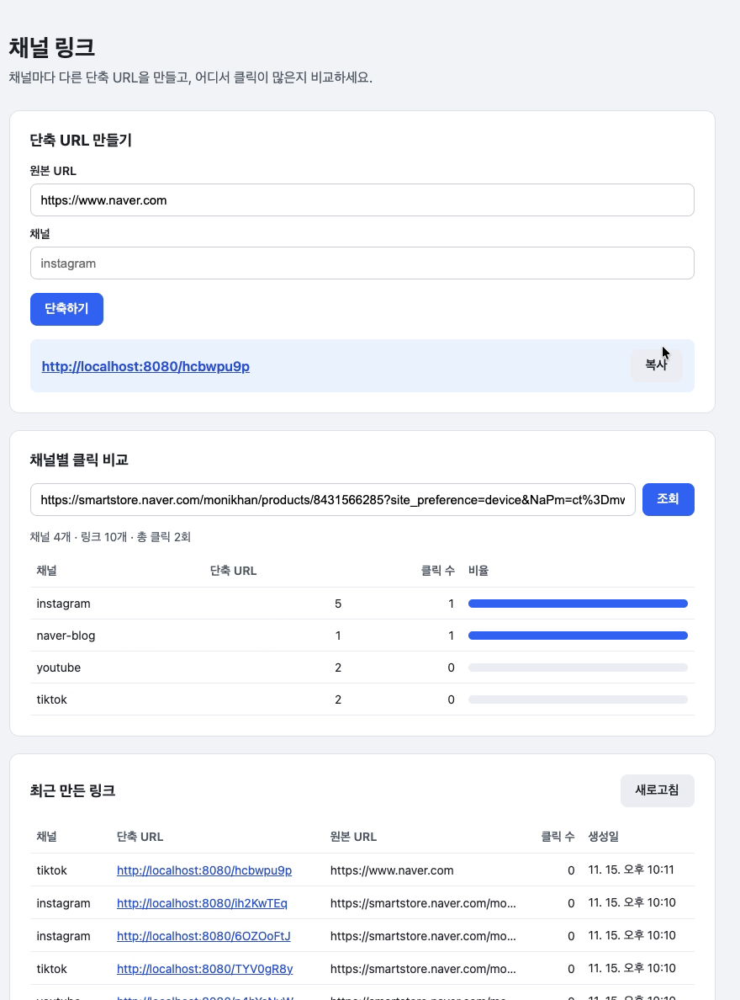
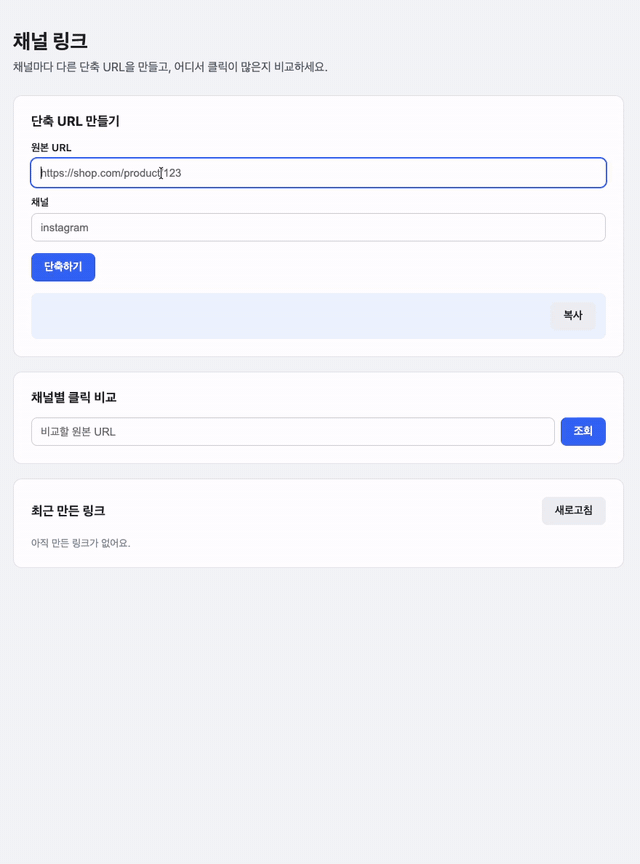
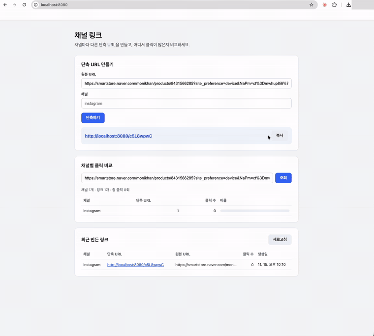
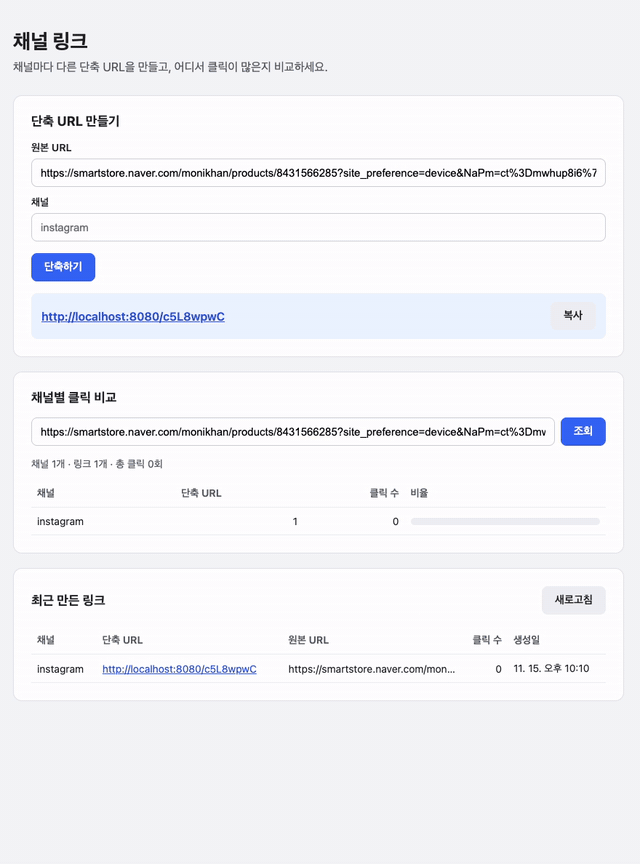
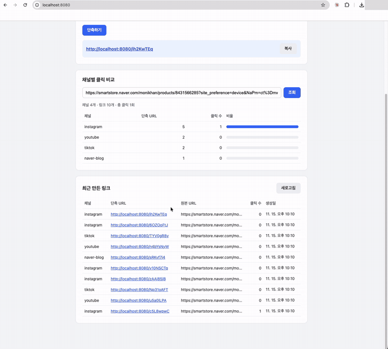
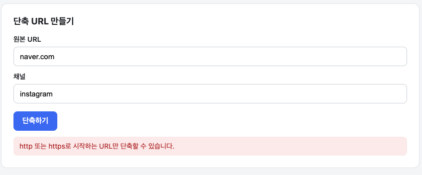
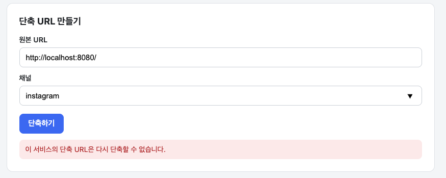
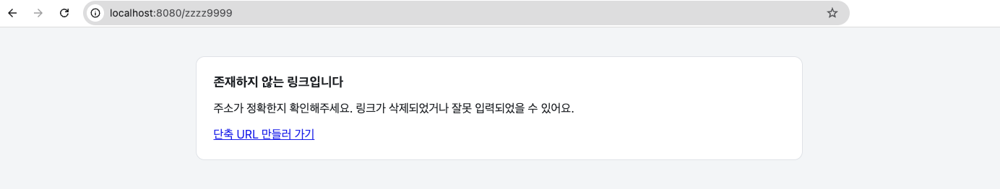

# 채널 링크 - 채널별 유입 분석 단축 URL 서비스

> 같은 상품을 인스타그램, 틱톡, 블로그에 홍보했다면, 어디서 클릭이 가장 많을까?

마케팅 채널마다 별도의 8자리 단축 URL을 발급하고, 링크별 클릭 수를 집계해 **어느 채널에서 유입이 많은지 비교**할 수 있는 서비스입니다.



<br>

## 목차

- [배경](#배경)
- [주요 기능](#주요-기능)
- [기술 스택](#기술-스택)
- [실행 방법](#실행-방법)
- [API 명세](#api-명세)
- [기술적으로 고민한 부분](#기술적으로-고민한-부분)
- [프로젝트 구조](#프로젝트-구조)
- [테스트](#테스트)
- [향후 개선](#향후-개선)
- [참고 자료](#참고-자료)

<br>

## 배경

같은 상품 페이지를 여러 채널에 올리면, 원본 URL만으로는 어느 채널에서 클릭이 왔는지 알 수 없습니다. 채널마다 다른 단축 URL을 붙이면 **링크별 클릭 수가 곧 채널별 유입 수**가 됩니다. 이를 근거로 성과가 좋은 채널에 마케팅 예산과 노력을 집중할 수 있습니다.

| 사용자 | 사용 상황 |
| --- | --- |
| 마케터 | 같은 상품 URL로 채널별 링크를 만들어 SNS 게시물·영상 설명란에 첨부하고 클릭 수 비교 |
| 인플루언서 협업 담당자 | 인플루언서마다 다른 링크를 주고 실제 유입 성과 비교 |
| 오프라인 홍보 담당자 | 전단지·포스터의 QR 코드, 문자 메시지처럼 길이 제한이 있는 곳에 짧은 링크 사용 |

<br>

## 주요 기능

### 1. 채널별 단축 URL 생성

원본 URL과 채널 이름을 입력하면 8자리 단축 URL을 발급합니다. 같은 원본 URL이어도 **요청할 때마다 새 키를 발급**해서 채널별로 클릭을 따로 집계합니다.



### 2. 리다이렉트와 클릭 수 집계

단축 URL로 접속하면 `302 Found`와 `Location` 헤더로 원본 페이지에 이동하고, 클릭 수가 1 증가합니다.



### 3. 채널별 클릭 비교

같은 원본 URL로 만든 링크를 채널별로 묶어 링크 수, 클릭 수, 비율 막대를 보여줍니다. 채널을 추가할 때마다 비교표가 바로 갱신됩니다.



링크를 클릭하고 원래 탭으로 돌아오면 새로고침 없이 클릭 수가 갱신됩니다.



### 4. 잘못된 입력 차단

| 잘못된 URL | 자기 도메인 단축 |
| --- | --- |
|  |  |
| `http`/`https`가 아닌 URL은 거부 | 이 서비스의 단축 URL을 다시 단축하면 거부 (리다이렉트 무한 루프 방지) |

### 5. 존재하지 않는 링크 안내

없는 단축 URL로 접속하면 JSON 대신 안내 페이지를 보여줍니다. API로 조회할 때는 기존처럼 JSON 에러를 반환합니다.



<br>

## 기술 스택

| 구분 | 기술 |
| --- | --- |
| Language | Java 17 |
| Framework | Spring Boot 4.x, Spring Web, Spring Validation |
| Data | Spring Data JPA, MySQL 8 |
| Infra | Docker Compose |
| Test | JUnit 5, AssertJ, MockMvc, H2 |
| Frontend | HTML, CSS, JavaScript (외부 라이브러리·CDN 없음) |

<br>

## 실행 방법

### 요구 사항

- Java 17 이상
- Docker, Docker Compose

### 1. 환경 변수 설정

```bash
cp .env.example .env
```

`.env`에 DB 계정 정보를 입력합니다.

```properties
DB_ROOT_PASSWORD=루트_비밀번호
DB_USERNAME=shorten
DB_PASSWORD=비밀번호
```

### 2. MySQL 실행

```bash
docker compose up -d
docker compose ps      # STATUS가 healthy인지 확인
```

### 3. 애플리케이션 실행

```bash
./gradlew bootRun
```

브라우저에서 [http://localhost:8080](http://localhost:8080)에 접속합니다.

### 4. 테스트 실행

```bash
./gradlew test
```

테스트는 인메모리 H2 DB를 사용하므로 MySQL 없이 실행됩니다.

### 배포 시 서비스 주소 설정

단축 URL 앞에 붙는 주소는 환경 변수로 바꿀 수 있습니다. 설정하지 않으면 `http://localhost:8080`을 사용합니다.

```bash
APP_BASE_URL=https://your-domain.com java -jar shorten-url.jar
```

<br>

## API 명세

| 기능 | Method | URL | 성공 | 실패 |
| --- | --- | --- | --- | --- |
| 단축 URL 생성 | `POST` | `/api/shorten-urls` | 201 Created | 400 |
| 리다이렉트 | `GET` | `/{shortenUrlKey}` | 302 Found | 404 |
| 단축 URL 정보 조회 | `GET` | `/api/shorten-urls/{shortenUrlKey}` | 200 OK | 404 |
| 목록 조회 | `GET` | `/api/shorten-urls?originalUrl={url}` | 200 OK | - |

`http/shorten-url.http` 파일로 IntelliJ HTTP Client에서 전체 API를 바로 호출해볼 수 있습니다.

<details>
<summary><b>단축 URL 생성</b></summary>

```http
POST /api/shorten-urls
Content-Type: application/json

{
  "originalUrl": "https://shop.com/product/123",
  "channel": "instagram"
}
```

```http
HTTP/1.1 201 Created
Location: /api/shorten-urls/aB3xK9pQ

{
  "shortenUrlKey": "aB3xK9pQ",
  "shortenUrl": "http://localhost:8080/aB3xK9pQ",
  "originalUrl": "https://shop.com/product/123",
  "channel": "instagram",
  "createdAt": "2026-11-15T15:00:00"
}
```

| 필드 | 규칙 |
| --- | --- |
| `originalUrl` | 필수, 최대 2048자, `http`/`https`만 허용, 이 서비스의 도메인 금지 |
| `channel` | 필수, 최대 50자, 소문자로 변환해 저장 |

</details>

<details>
<summary><b>리다이렉트</b></summary>

```http
GET /aB3xK9pQ
```

```http
HTTP/1.1 302 Found
Location: https://shop.com/product/123
```

키는 영문 대소문자와 숫자로 된 8자리만 허용합니다. 형식이 맞지 않으면 404를 반환합니다.

</details>

<details>
<summary><b>단축 URL 정보 조회</b></summary>

```http
GET /api/shorten-urls/aB3xK9pQ
```

```json
{
  "shortenUrlKey": "aB3xK9pQ",
  "shortenUrl": "http://localhost:8080/aB3xK9pQ",
  "originalUrl": "https://shop.com/product/123",
  "channel": "instagram",
  "redirectCount": 1240,
  "createdAt": "2026-11-15T15:00:00",
  "lastRedirectedAt": "2026-11-20T21:13:05"
}
```

</details>

<details>
<summary><b>목록 조회</b></summary>

`originalUrl`이 없으면 전체 목록을 최신순으로, 있으면 해당 URL의 링크를 클릭 수 많은 순으로 반환합니다.

```http
GET /api/shorten-urls?originalUrl=https%3A%2F%2Fshop.com%2Fproduct%2F123
```

```json
{
  "totalRedirectCount": 5520,
  "items": [
    { "shortenUrlKey": "Zx81mQw2", "channel": "tiktok", "redirectCount": 3870, "...": "..." },
    { "shortenUrlKey": "aB3xK9pQ", "channel": "instagram", "redirectCount": 1240, "...": "..." }
  ]
}
```

</details>

<details>
<summary><b>에러 응답</b></summary>

모든 에러는 같은 형식으로 응답합니다. 입력값 검증 실패 시 `errors`에 필드별 사유를 담습니다.

```json
{
  "status": 400,
  "code": "INVALID_URL",
  "message": "http 또는 https로 시작하는 URL만 단축할 수 있습니다.",
  "errors": [],
  "timestamp": "2026-11-15T15:00:00"
}
```

| 코드 | 상태 | 상황 |
| --- | --- | --- |
| `INVALID_INPUT` | 400 | 필수값 누락, 길이 초과 |
| `INVALID_URL` | 400 | URL 형식 오류, `http`/`https`가 아닌 스킴, 도메인 없음 |
| `SELF_REFERENCE_URL` | 400 | 이 서비스의 URL을 다시 단축 |
| `INVALID_REQUEST_BODY` | 400 | 잘못된 JSON |
| `SHORTEN_URL_NOT_FOUND` | 404 | 존재하지 않는 키 |
| `NOT_FOUND` | 404 | 존재하지 않는 경로 |
| `METHOD_NOT_ALLOWED` | 405 | 지원하지 않는 HTTP 메서드 |
| `KEY_GENERATION_FAILED` | 500 | 키 생성 재시도 초과 |
| `INTERNAL_ERROR` | 500 | 예상하지 못한 서버 오류 |

</details>

<br>

## 기술적으로 고민한 부분

### 1. 같은 URL이면 기존 키를 돌려줄까, 새로 만들까?

처음에는 저장 공간을 아끼려고 같은 원본 URL이면 기존 단축 URL을 반환하려 했습니다. 하지만 이 서비스의 핵심은 **링크별 클릭 통계**입니다. 키를 재사용하면 서로 다른 채널(또는 사용자)의 클릭이 하나로 합쳐져 비교가 불가능해집니다. 한 링크를 삭제하거나 만료할 때 다른 사용자의 링크까지 영향을 받는 문제도 있습니다.

→ **요청할 때마다 새 키를 발급**하고, 같은 원본 URL의 링크는 조회 시 채널별로 묶어서 비교하도록 했습니다.

### 2. 301이 아니라 302를 선택한 이유

bitly는 `301 Moved Permanently`를 사용합니다. 하지만 301은 브라우저가 캐시하기 때문에, 같은 브라우저에서 두 번째로 클릭하면 서버를 거치지 않고 바로 원본 페이지로 이동합니다. 그러면 클릭 수가 집계되지 않습니다.

| | 301 Moved Permanently | 302 Found |
| --- | --- | --- |
| 브라우저 캐시 | 함 | 하지 않음 |
| 두 번째 클릭 | 서버를 거치지 않음 | 매번 서버를 거침 |
| 클릭 수 집계 | 누락 | 정확 |
| 서버 부하 | 적음 | 많음 |

→ 서버 부하보다 **정확한 클릭 집계**가 중요한 서비스이므로 302를 선택했습니다.

### 3. 키 생성: 랜덤 base62 + 중복 재시도

| 방식 | 장점 | 단점 |
| --- | --- | --- |
| 자동 증가 ID → base62 | 중복 없음 | **다음 키를 추측할 수 있어** 다른 사람의 링크를 훔쳐볼 수 있음 |
| hash(원본 URL) → 앞 8자 | 구현 간단 | 같은 URL이면 같은 키가 나와 "매번 새 키" 정책과 충돌 |
| **랜덤 base62 8자** | 추측 불가 | 중복 확인 필요 |

`SecureRandom`으로 숫자·영문 대소문자 62자 중 하나를 8번 뽑습니다. 경우의 수는 62⁸ ≈ 218조로 충돌 확률이 매우 낮지만, 중복이면 최대 5번까지 다시 생성하고 DB의 UNIQUE 제약을 최종 방어선으로 둡니다.

`Random`이 아니라 `SecureRandom`을 쓴 이유는, `Random`은 연속된 출력 몇 개로 다음 값을 계산할 수 있어 "추측할 수 없는 키"라는 목적이 무너지기 때문입니다.

MySQL의 기본 정렬 규칙은 대소문자를 구분하지 않아 `aBc`와 `ABC`를 같은 값으로 봅니다. 대소문자를 구분하는 base62 키를 위해 DB collation을 `utf8mb4_bin`으로 설정했습니다.

### 4. 동시 클릭 시 클릭 수 유실 방지

엔티티의 카운트를 `count++`로 올리고 더티 체킹으로 저장하면, 두 요청이 동시에 같은 값(예: 5)을 읽고 둘 다 6을 저장해 클릭 하나가 사라집니다(lost update).

```java
@Modifying(clearAutomatically = true)
@Query("UPDATE ShortenUrl s SET s.redirectCount = s.redirectCount + 1, " +
       "s.lastRedirectedAt = :now WHERE s.shortenUrlKey = :key")
int increaseRedirectCount(@Param("key") String key, @Param("now") LocalDateTime now);
```

→ **DB에서 `count = count + 1`을 계산하는 UPDATE 쿼리**로 바꿔, DB의 행 잠금이 순서를 보장하게 했습니다. `ExecutorService`와 `CountDownLatch`로 100개의 리다이렉트를 동시에 실행해 클릭 수가 정확히 100이 되는 것을 테스트로 검증합니다.

### 5. Repository 인터페이스 분리 (DIP)

서비스가 `JpaRepository`를 직접 의존하면 JPA라는 기술에 묶이고, `deleteAll()` 같은 불필요한 메서드까지 모두 노출됩니다.

```text
ShortenUrlService ──→ ShortenUrlRepository (이 서비스에 필요한 메서드만 정의)
                              ↑ 구현
                      ShortenUrlRepositoryImpl ──→ ShortenUrlJpaRepository (Spring Data JPA)
```

→ 서비스는 인터페이스에만 의존하고, JPA는 구현체 안에 숨겼습니다. 덕분에 서비스 단위 테스트에서 **메모리 기반 가짜 저장소**(`FakeShortenUrlRepository`)를 넣어 DB 없이 빠르게 테스트할 수 있습니다. 키 생성기도 인터페이스로 분리해, 미리 정한 키를 내는 가짜 생성기로 **키 중복 재시도 상황을 재현**했습니다.

### 6. 입력 검증과 보안

- **스킴 화이트리스트**: `javascript:`, `data:`, `file:` 같은 URL로 리다이렉트되면 XSS 등 보안 문제가 생기므로 `http`/`https`만 허용합니다.
- **자기 도메인 단축 금지**: 이 서비스의 단축 URL을 다시 단축하면 리다이렉트가 체인처럼 이어지거나 무한 루프가 생길 수 있어 거부합니다.
- **화면 출력 시 `textContent` 사용**: 사용자가 입력한 원본 URL과 채널을 `innerHTML`로 넣으면 스크립트가 실행될 수 있어, 모든 값을 `textContent`로 출력합니다.

### 7. 일관된 예외 처리

```text
BusinessException (ErrorCode를 가짐)
 ├── NotFoundShortenUrlException   → SHORTEN_URL_NOT_FOUND (404)
 ├── InvalidUrlException           → INVALID_URL (400)
 ├── SelfReferenceUrlException     → SELF_REFERENCE_URL (400)
 └── LackOfShortenUrlKeyException  → KEY_GENERATION_FAILED (500)
```

에러 종류와 상태 코드를 `ErrorCode` enum 한 곳에 모으고, 모든 커스텀 예외가 `BusinessException`을 상속하게 했습니다. `GlobalExceptionHandler`는 `BusinessException` 하나만 처리하면 되므로 예외가 늘어나도 핸들러 코드는 바뀌지 않습니다.

Spring Boot 3.2부터 없는 경로 요청은 `NoResourceFoundException`을 던지는데, 이를 따로 처리하지 않으면 마지막 `Exception` 핸들러가 잡아 **404가 500으로 응답되는 문제**가 있어 별도로 처리했습니다.

<br>

## 프로젝트 구조

```text
src/main/java/com/work/shortenurl
├── config         # AppProperties (서비스 주소 설정)
├── controller     # ShortenUrlApiController, RedirectController
├── domain         # ShortenUrl (엔티티)
├── dto            # 요청·응답 DTO (record), ErrorResponse
├── exception      # ErrorCode, BusinessException, 커스텀 예외, GlobalExceptionHandler
├── keygen         # KeyGenerator, RandomBase62KeyGenerator
├── repository     # ShortenUrlRepository, ShortenUrlRepositoryImpl, ShortenUrlJpaRepository
└── service        # ShortenUrlService, UrlValidator

src/main/resources
├── application.yaml
└── static         # index.html, style.css, app.js, 404.html
```

<br>

## 테스트

| 대상 | 방식 | 검증 내용 |
| --- | --- | --- |
| 키 생성기 | 순수 JUnit | 8자리, 허용 문자만 사용, 중복 없음, base62 전체 문자 사용 |
| URL 검증 | 순수 JUnit (`@ParameterizedTest`) | 올바른 URL 통과, 잘못된 스킴·형식 거부, 자기 도메인 거부 |
| 서비스 | 가짜 저장소·키 생성기 | 같은 URL 두 번 생성 시 다른 키, 키 중복 재시도, 재시도 초과 예외 |
| Repository | `@DataJpaTest` + H2 | 조회, UNIQUE 제약 위반, 클릭 수 UPDATE 쿼리 |
| 동시성 | `@SpringBootTest` + 멀티스레드 | 100개 동시 리다이렉트 후 클릭 수 정확히 100 |
| API | `@SpringBootTest` + MockMvc | 상태 코드, `Location` 헤더, 에러 응답 형식 |

<br>

## 참고 자료

- 『이것이 취업을 위한 백엔드 개발이다』 13장 단축 URL 서비스 요구사항을 바탕으로, 채널별 유입 분석이라는 주제로 확장했습니다.
- 『가상 면접 사례로 배우는 대규모 시스템 설계 기초』 8장 URL 단축기 설계