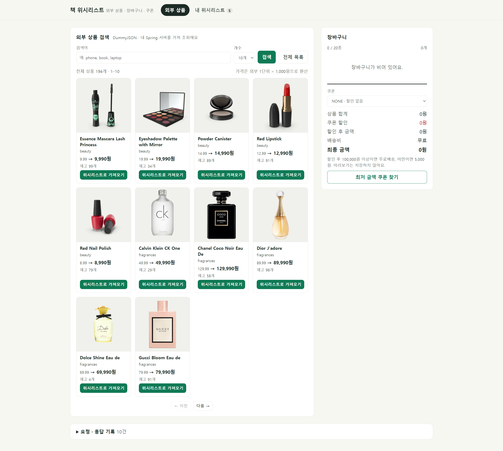
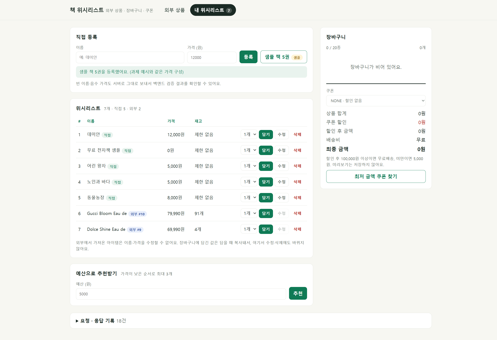
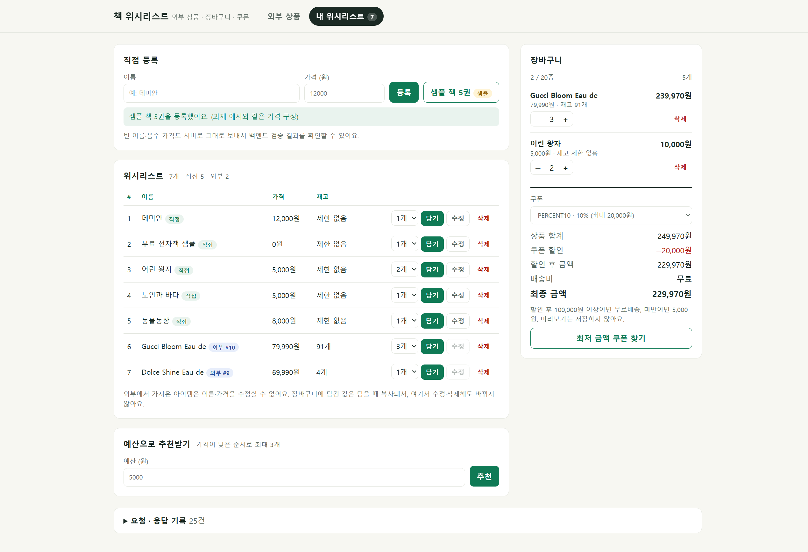
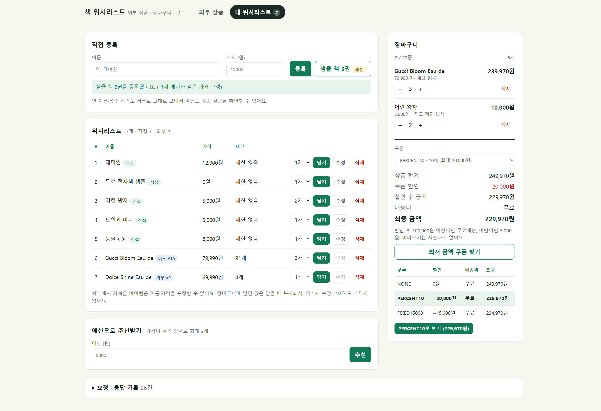
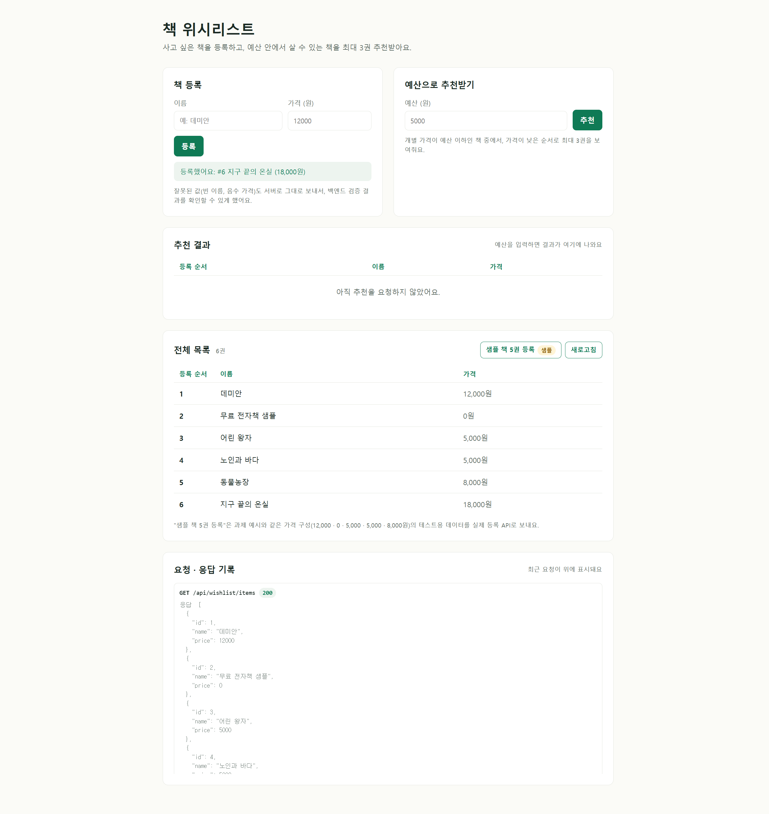

# 📚 책 위시리스트 API

사고 싶은 책을 위시리스트에 등록하고, **예산 안에서 살 수 있는 책을 최대 3권 추천**하는 Spring Boot 프로젝트입니다.
2차 과제에서 **외부 상품(DummyJSON) 검색·가져오기**와 **장바구니 · 쿠폰 · 배송비 금액 미리보기**를 추가했습니다.

- 과제: SeSAC Spring Boot · 취미 위시리스트 (주제: 책)
- 기술: Java · Spring Boot · Spring Web · RestClient · Gradle (Lombok·DB 없음, 메모리 저장)
- 외부 API: [DummyJSON](https://dummyjson.com) 상품 API
- 화면: 순수 HTML·CSS·JavaScript (외부 라이브러리·CDN 없음)

<br>

## 실행 방법

```bash
./gradlew bootRun   # 서버 실행 후 http://localhost:8080/ 접속
./gradlew test      # 전체 테스트 81개 (외부 서버에 실제로 요청하지 않음)
```

<br>

## 화면

`http://localhost:8080/` · 브라우저 → 내 Spring 서버 → DummyJSON

### 외부 상품 목록 · 검색
| 전체 목록 (썸네일 · 외부 가격 → 원 환산 · 재고) | 검색 `q=book` |
|---|---|
|  |  |

- 상품마다 **위시리스트로 가져오기**, 이미 가져온 상품은 `가져옴`으로 비활성화
- 10개/20개 보기, 이전·다음 페이지

### 내 위시리스트


- 출처 배지: `직접` / `외부 #외부id` (내 위시리스트 id와 외부 상품 id를 따로 표시)
- 직접 등록 아이템만 **수정** 가능, 외부에서 가져온 아이템은 수정 버튼 비활성화
- 수량(1~5)을 골라 **담기**, 품절 상품은 담기 비활성화
- 직접 등록 · 샘플 책 5권 `샘플` · 예산 추천

### 장바구니 · 쿠폰 미리보기 · 최저 금액 쿠폰
| 장바구니 (NONE) | PERCENT10 미리보기 | 최저 금액 쿠폰 찾기 |
|---|---|---|
|  |  |  |

- `−`/`+`로 수량 변경 (5개 또는 저장된 재고에 닿으면 `+` 비활성화), 줄 삭제
- 쿠폰을 바꾸면 상품 합계 · 할인 · 할인 후 금액 · 배송비 · 최종 금액이 바로 갱신 (저장하지 않음)
- 최저 금액 쿠폰: 상품 합계 249,970원에서 PERCENT10(최대 20,000원 할인)이 FIXED15000(15,000원)보다 유리 → 229,970원
- 담기 응답이 **201이면 "담았어요"**, **200이면 "수량을 합쳤어요"** 로 안내
- 화면 아래 **요청 · 응답 기록**에서 실제 요청과 상태 코드, 응답 JSON 확인

<br>

## API

성공 응답은 `ResponseEntity`로 상태 코드를 정하고, 실패 응답은 모두 `{ "message": "실패 이유" }` 형식입니다.

### 외부 상품 `/api/external-products`

| 기능 | 메서드 | 주소 | 입력 | 성공 | 실패 |
|---|---|---|---|---|---|
| 목록 | `GET` | `/api/external-products?limit=10&skip=0` | limit 기본 10 (1~20), skip 기본 0 (0 이상) | 200 | 400 · 502 |
| 검색 | `GET` | `/api/external-products/search?q=phone` | q 필수 (누락·공백 거부), limit·skip 동일 | 200 (결과 없으면 빈 목록) | 400 · 502 |
| 상세 | `GET` | `/api/external-products/{id}` | id 1 이상 | 200 | 400 · 404 · 502 |

<details>
<summary>응답 예시</summary>

```json
{
  "products": [
    {
      "id": 1,
      "title": "Essence Mascara Lash Princess",
      "price": 9.99,
      "priceWon": 9990,
      "category": "beauty",
      "thumbnail": "https://cdn.dummyjson.com/.../thumbnail.webp",
      "stock": 99,
      "soldOut": false
    }
  ],
  "total": 194,
  "skip": 0,
  "limit": 10
}
```
- `price`: 외부 원래 가격, `priceWon`: 가져오면 저장될 원 단위 가격
- DummyJSON에서 `id · title · price · category · thumbnail · stock`만 읽고, `discountPercentage · minimumOrderQuantity` 등은 사용하지 않습니다.
</details>

### 위시리스트 `/api/wishlist`

| 기능 | 메서드 | 주소 | 요청 본문 | 성공 | 실패 |
|---|---|---|---|---|---|
| 직접 등록 | `POST` | `/api/wishlist/items` | `{ "name", "price" }` | 201 + `Location` | 400 |
| 외부 상품 가져오기 | `POST` | `/api/wishlist/items/import` | `{ "externalId": 1 }` | 201 + `Location` | 400 · 404 · 409(중복) · 502 |
| 전체 목록 | `GET` | `/api/wishlist/items` | - | 200 | - |
| 단건 조회 | `GET` | `/api/wishlist/items/{id}` | - | 200 | 404 |
| 수정 | `PUT` | `/api/wishlist/items/{id}` | `{ "name", "price" }` | 200 | 400 · 404 · 409(가져온 아이템) |
| 삭제 | `DELETE` | `/api/wishlist/items/{id}` | - | 204 (본문 없음) | 404 |
| 예산 추천 | `GET` | `/api/wishlist/recommendations?budget=5000` | - | 200 | 400 |

<details>
<summary>응답 예시</summary>

```http
HTTP/1.1 201 Created
Location: /api/wishlist/items/6
```
```json
{
  "id": 6,
  "name": "Gucci Bloom Eau de",
  "price": 79990,
  "sourceType": "EXTERNAL",
  "externalId": 10,
  "stock": 91,
  "soldOut": false
}
```
- `id`: 내 위시리스트 id / `externalId`: 외부 상품 id (따로 관리)
- 직접 등록한 아이템은 `sourceType: "MANUAL"`, `externalId · stock`은 `null`
</details>

### 장바구니 `/api/cart`

| 기능 | 메서드 | 주소 | 요청 본문 | 성공 | 실패 |
|---|---|---|---|---|---|
| 조회 | `GET` | `/api/cart` | - | 200 | - |
| 행 조회 | `GET` | `/api/cart/items/{cartItemId}` | - | 200 | 404 |
| 담기 | `POST` | `/api/cart/items` | `{ "wishlistItemId": 1, "quantity": 2 }` | **201 + `Location`(새 줄) / 200(같은 상품 합산)** | 400 · 404 · 409 |
| 수량 변경 | `PATCH` | `/api/cart/items/{cartItemId}` | `{ "quantity": 3 }` | 200 | 400 · 404 · 409 |
| 행 삭제 | `DELETE` | `/api/cart/items/{cartItemId}` | - | 204 | 404 |
| 금액 미리보기 | `GET` | `/api/cart/preview?couponCode=PERCENT10` | - | 200 | 400 |
| 최저 금액 쿠폰 | `GET` | `/api/cart/best-coupon` | - | 200 | - |

<details>
<summary>응답 예시</summary>

장바구니 조회
```json
{
  "items": [
    {
      "id": 1,
      "wishlistItemId": 6,
      "name": "Gucci Bloom Eau de",
      "unitPrice": 79990,
      "quantity": 3,
      "stockLimit": 91,
      "lineTotal": 239970
    }
  ],
  "kindCount": 1,
  "totalQuantity": 3,
  "subtotal": 239970
}
```

금액 미리보기 (`couponCode` 생략 시 NONE)
```json
{
  "subtotal": 110000,
  "discount": 11000,
  "discountedSubtotal": 99000,
  "shipping": 5000,
  "finalAmount": 104000,
  "coupon": "PERCENT10"
}
```

최저 금액 쿠폰
```json
{
  "best": { "subtotal": 110000, "discount": 15000, "discountedSubtotal": 95000, "shipping": 5000, "finalAmount": 100000, "coupon": "FIXED15000" },
  "candidates": [ "NONE · PERCENT10 · FIXED15000 계산 결과 (사용 가능한 쿠폰만)" ]
}
```
</details>

<br>

## 규칙

### 외부 상품 가져오기
- 요청은 **외부 상품 id만** 받고, 이름·가격·재고는 서버가 상세 API에서 조회합니다. (요청에 name·price를 넣어도 무시)
- 내 위시리스트 `id`와 `sourceType`·`externalId`를 따로 관리합니다.
- 같은 외부 상품을 다시 가져오면 **409** (외부 서버를 호출하기 전에 확인)
- **품절 상품(재고 0)도 위시리스트에는 저장 가능**합니다. (장바구니에는 담을 수 없음)
- 가져온 이름·가격은 요청으로 수정할 수 없고 **(409)**, 외부 상품이 바뀌어도 자동 갱신하지 않습니다.
- 직접 등록한 아이템의 수정 기능은 그대로 유지됩니다.
- **가격 환산**: 외부 price 1단위 = 1,000원. `BigDecimal`로 1,000을 곱한 뒤 `HALF_UP`으로 원 단위 반올림
  - 9.99 → 9,990원 / 1.2345 → 1,235원 / 1.2344 → 1,234원

### 장바구니
- 담을 때 위시리스트 id와 수량(1~5)을 받고, 위시리스트에 원본 아이템이 있어야 합니다. (없으면 404)
- 같은 상품을 또 담으면 새 줄을 만들지 않고 **수량 합산**, 합산 후에도 최대 5개 (넘으면 409)
- 상품 종류는 **최대 20종**, 외부 상품은 **저장된 재고 이하**, 직접 등록 상품은 재고 제한 없음
- 품절 외부 상품은 담을 수 없음 (409), 재고 예약·차감과 실제 결제는 하지 않습니다.
- 서버 메모리에 장바구니 하나를 관리합니다.

| 상황 | 동작 |
|---|---|
| 처음 담을 때 | 이름·가격·재고를 장바구니에 **복사** → 원본이 수정·삭제돼도 유지 |
| 수량 변경·같은 상품 추가 | 처음 복사한 단가·재고를 계속 사용 |
| 행 삭제 후 다시 담기 | 그때의 위시리스트 값을 새로 복사 |

- 수량 변경·삭제는 **장바구니 행 id**를 사용하므로 원본 상품이 삭제돼도 가능합니다.
- 잘못된 변경은 기존 장바구니의 항목·수량·복사한 값을 그대로 유지합니다.
- 단가 × 수량, 합계·할인·배송비는 모두 `long`으로 계산합니다.
- **400과 409 구분**: 수량 0·6처럼 요청 값 자체가 틀리면 400, 값은 맞지만 합산 6개·21번째 종류·재고 초과·품절처럼 현재 상태와 충돌하면 409

### 쿠폰과 배송비 (상품 합계 subtotal 기준)

| couponCode (생략하면 NONE) | 할인 |
|---|---|
| `NONE` | 할인 없음 |
| `PERCENT10` | 10% 할인 · 원 미만 버림 · 최대 20,000원 |
| `FIXED15000` | 상품 합계가 100,000원 이상일 때 15,000원 |

- 쿠폰은 한 번에 하나만 적용, 미리보기는 저장하거나 장바구니를 바꾸지 않습니다.
- 할인 후 금액이 **100,000원 이상이면 무료배송**, 미만이면 배송비 5,000원
- **빈 장바구니는 모든 금액이 0**이며 NONE만 사용할 수 있습니다.
- 쿠폰 코드는 앞뒤 공백과 대소문자를 구분하지 않습니다. (`percent10`도 허용)

| 상품 합계 110,000원 | 할인 | 배송비 | 최종 금액 |
|---|---|---|---|
| NONE | 0원 | 0원 | 110,000원 |
| PERCENT10 | 11,000원 | 5,000원 | 104,000원 |
| FIXED15000 | 15,000원 | 5,000원 | **100,000원** |

### 최저 금액 쿠폰 (선택 기능)
- 가장 큰 할인액이 아니라 **배송비까지 포함한 최종 금액이 가장 작은 쿠폰**을 찾습니다.
- 후보는 NONE과 지금 사용할 수 있는 쿠폰입니다.
- 최종 금액이 같으면 `NONE → PERCENT10 → FIXED15000` 순으로 선택하고, 저장 상태는 바꾸지 않습니다.

### 실패 응답

| 상태 | 상황 |
|---|---|
| 400 | 잘못된 입력 (필수 값 누락, 범위 밖 수량·limit·skip, 공백 검색어, 숫자가 아닌 값, 깨진 JSON) · 알 수 없거나 사용할 수 없는 쿠폰 |
| 404 | 없는 위시리스트 아이템 · 외부 상품 · 장바구니 행 |
| 409 | 외부 상품 중복 가져오기 · 상품 종류·수량·재고 규칙 충돌 · 가져온 아이템 수정 |
| 502 | 외부 API 연결 실패·시간 초과(연결 3초·응답 5초)·외부 서버 오류 |

실패한 가져오기·추가·변경·미리보기는 기존 저장 데이터를 바꾸지 않습니다.

<br>

## 프로젝트 구조

기능(도메인)별로 패키지를 먼저 나누고, 각 기능 안에서 계층을 나눴습니다.

```
src/main/java/com/example/wishlist
├── WishlistApplication.java
├── common
│   └── exception                     # 공통: HTTP 의미별 부모 예외 + 전역 예외 처리
│       ├── BadRequestException       (400)
│       ├── NotFoundException         (404)
│       ├── ConflictException         (409)
│       ├── ExternalServiceException  (502)
│       ├── InvalidRequestException   # DTO 형식 검증 실패
│       ├── ErrorResponse
│       └── GlobalExceptionHandler
├── item                              # 내 위시리스트 아이템
│   ├── controller/WishlistController
│   ├── service/WishlistService, WishlistImportService
│   ├── domain/WishlistItem, SourceType
│   ├── repository/WishlistItemRepository, WishlistItemRepositoryImpl
│   ├── dto/ItemCreateRequest, ItemUpdateRequest, ItemImportRequest, ItemResponse, RecommendationResponse
│   └── exception/InvalidItemException, InvalidBudgetException, ItemNotFoundException,
│                 DuplicateImportException, ImportedItemNotEditableException
├── product                           # 외부 상품 (DummyJSON)
│   ├── controller/ExternalProductController
│   ├── service/ExternalProductService
│   ├── client/ProductClient(인터페이스), DummyJsonClient, DummyJsonProduct, DummyJsonProductPage
│   ├── domain/ExternalProduct, ExternalProductPage, PriceConverter
│   ├── dto/ProductQuery, ExternalProductResponse, ExternalProductPageResponse
│   └── exception/ExternalProductNotFoundException, ExternalApiException
├── cart                              # 장바구니
│   ├── controller/CartController
│   ├── service/CartService, CartAddResult
│   ├── domain/Cart, CartItem
│   ├── repository/CartRepository, CartRepositoryImpl
│   ├── dto/CartAddRequest, CartQuantityRequest, CartItemResponse, CartResponse,
│   │       PricePreviewResponse, BestCouponResponse
│   └── exception/InvalidQuantityException, CartRuleViolationException, CartItemNotFoundException
└── coupon                            # 쿠폰·배송비 금액 계산 (순수 도메인)
    ├── domain/Coupon, ShippingPolicy, PriceBreakdown, CouponComparison
    └── exception/InvalidCouponException

src/main/resources/static
├── index.html                        # 2차 과제 화면 (외부 상품 · 위시리스트 · 장바구니)
└── wishlist.html                     # 1차 과제 화면

http/                                 # 수동 확인용 curl 스크립트 (Git Bash)
├── lib.sh, external-products.sh, wishlist.sh, cart.sh
```

### 기능 사이의 의존 방향
```
         common  ← 모든 기능이 사용
item ──(가져오기)──▶ product
 ▲
cart ──(금액 계산)──▶ coupon
```
- `product`와 `coupon`은 `common`에만 의존하는 독립 기능입니다. DummyJSON을 다른 API로 바꿔도 `item`·`cart`는 영향을 받지 않습니다.
- 화살표가 한 방향이라 순환 의존이 없습니다.

### 계층별 역할

| 계층 | 맡는 일 | 예 |
|---|---|---|
| Controller | HTTP 입력·응답(`ResponseEntity`), DTO 형식 검증 | `CartAddRequest.validate()`, `ProductQuery.forSearch()` |
| Service | 외부 조회·가져오기·장바구니 작업 **조율** | 중복 확인 → 외부 조회 → 저장 / 불러오기 → 규칙 → 저장 |
| Domain | 수량·재고·금액 **규칙** | `Cart.add()`, `CartItem.addQuantity()`, `Coupon.discountFor()` |
| Repository | 메모리 저장·조회 | `WishlistItemRepositoryImpl`, `CartRepositoryImpl` |
| Client | 외부 API 호출 | `DummyJsonClient` (RestClient, 연결 3초·응답 5초 제한) |

- Service는 **Repository 인터페이스와 Client 인터페이스(`ProductClient`)를 생성자로 주입**받습니다.
- 외부 호출·할인 계산·저장 코드를 Controller 하나에 몰아넣지 않았습니다.

<br>

## 설계 포인트

**1. 기능별 패키지** <br/>
계층별(controller/service/...)로만 나누면 기능이 늘수록 한 폴더에 여러 기능의 파일이 섞입니다. `item · product · cart · coupon`으로 먼저 나눠 한 기능의 코드를 한곳에서 볼 수 있게 했습니다.

**2. Client를 인터페이스로 분리** <br/>
Service는 `ProductClient` 인터페이스만 알고 `DummyJsonClient`는 모릅니다. 테스트에서는 네트워크 없는 `FakeProductClient`를 넣고, 통합 테스트에서는 `@TestConfiguration` + `@Primary`로 교체해 인터넷 없이 전체 흐름을 검증합니다. DummyJSON 응답 모양(`DummyJsonProduct`)은 client 패키지 안에만 두고 밖으로는 `ExternalProduct`로 바꿔 내보냅니다.

**3. 규칙은 도메인 객체 안에** <br/>
- 수량·재고·종류 규칙은 `Cart`·`CartItem`에 있습니다. `CartItem`의 수량 변경 메서드는 패키지 전용이라, 장바구니를 바꾸는 입구는 `Cart` 하나뿐입니다.
- 할인 규칙은 `Coupon` enum의 각 상수가 직접 구현합니다. if-else 분기 없이 `coupon.discountFor(subtotal)`로 계산하고, 새 쿠폰은 상수 하나만 추가하면 됩니다.

**4. 실패해도 데이터가 바뀌지 않는 구조** <br/>
- `CartItem`·`WishlistItem`은 불변 객체라 바꿀 때 항상 새 객체를 만듭니다.
- `CartRepository.load()`는 복사본을 주고, Service는 규칙을 모두 통과한 뒤에만 `save()`합니다. 중간에 예외가 나면 저장된 장바구니는 그대로입니다.
- 가져오기는 중복 확인과 외부 조회가 모두 성공한 뒤에만 저장합니다.

**5. 예외는 HTTP 의미별 부모를 상속** <br/>
도메인 예외는 `BadRequestException`·`NotFoundException`·`ConflictException`·`ExternalServiceException` 중 하나를 상속하고, `GlobalExceptionHandler`는 이 4개 부모만 처리합니다. 새 예외를 추가해도 핸들러를 고칠 필요가 없고, 도메인 코드는 Spring(`HttpStatus`)을 몰라도 됩니다. Spring이 먼저 막는 형식 오류(`?budget=` 누락, `?limit=abc`, 깨진 JSON)도 같은 `{"message"}` 형식으로 응답합니다.

**6. ResponseEntity로 상태 코드 표현** <br/>
- 생성은 `ResponseEntity.created(location)` → 201 + `Location` 헤더, 삭제는 `noContent()` → 204
- 장바구니 담기는 `CartAddResult(item, newLine)`으로 **새 줄이면 201, 합산이면 200**을 구분합니다. 새로 만든 자원이 없는데 201을 주지 않기 위해서입니다.

**7. 금액 계산** <br/>
외부 가격은 `BigDecimal`로 받아 소수 오차 없이 환산하고(`HALF_UP`), 장바구니 금액은 `long`과 `Math.multiplyExact`·`addExact`로 계산해 넘침을 감지합니다.

<br>

## 테스트

`./gradlew test` · **총 81개** (외부 서버에 실제로 요청하지 않음)

| 구분 | 파일 | 개수 | 확인 내용 |
|---|---|---|---|
| 위시리스트 | `WishlistServiceTest` | 15 | 등록·조회·실패·추천 규칙 (1차 과제) |
| | `WishlistServiceEditTest` | 4 | 직접 등록 수정, 가져온 아이템 수정 거부, 삭제 |
| | `WishlistItemRepositoryImplTest` | 5 | id 순차 부여, 저장 순서, 수정·삭제, externalId 조회 |
| 가져오기 | `WishlistImportServiceTest` | 6 | id만으로 가져오기, 가격 환산, id 분리, 중복 409(외부 호출 없음), 품절 저장, 실패 시 저장 안 함 |
| 외부 상품 | `DummyJsonClientTest` | 6 | MockRestServiceServer로 상세·목록·빈 검색, 404·500·시간 초과 |
| | `PriceConverterTest` | 3 | 1단위 = 1,000원, HALF_UP 반올림 |
| | `ProductQueryTest` | 4 | limit·skip 기본값과 범위, 검색어 공백 거부 |
| 쿠폰 | `PriceBreakdownTest` | 12 | 110,000원 예시, 버림·상한, 100,000원 조건, 배송비 경계, 빈 장바구니, 최저 쿠폰·동점 |
| 장바구니 | `CartTest` | 13 | 복사, 합산, 최대 5개, 수량 범위, 재고, 품절, 20종, 행 id 변경·삭제, copy 독립성 |
| | `CartServiceTest` | 7 | 원본 필요, 201/200 구분 값, 실패 시 보존, 원본 수정·삭제 후 유지, 재담기 복사, 미리보기 무변경 |
| 통합 | `WishlistApplicationTests` | 4 | Spring 빈 연결, ResponseEntity 201·`Location`·204 |
| | `ShoppingFlowIntegrationTest` | 2 | 가져오기 → 장바구니(201→200) → 쿠폰 → 최저 쿠폰 전체 흐름, 품절 흐름 |

### 수동 확인 (curl 스크립트)
IntelliJ HTTP Client는 Ultimate 전용이라, Git Bash에서 실행하는 curl 스크립트로 실제 서버를 확인했습니다. 서버를 새로 켠 뒤 실행하고, 각 요청의 상태 코드와 응답 내용을 자동으로 검사해 ✓/✗로 보여줍니다.

```bash
bash http/external-products.sh   # 외부 상품 목록·검색·상세·입력 검증 (21개 검사)
bash http/wishlist.sh            # 등록·실패·추천·가져오기·조회·수정·삭제 (40개 검사)
bash http/cart.sh                # 담기·합산·쿠폰 미리보기·복사 값 유지·20종 (약 50개 검사)
```

<br>

## 발견한 문제와 수정 기록

### 1차 과제
| 증상 | 원인 | 수정 |
|---|---|---|
| 통합 테스트 실패 `NoSuchBeanDefinitionException` | 메모리 구현체 이름을 바꾸면서 `@Repository`가 빠져 Repository 빈이 없음 | 구현체에 `@Repository` 추가 |
| 이름·가격 실패 테스트 `AssertionError` | 예산 검증만 새 예외로 바꾸고, 이름·가격 검증은 `IllegalArgumentException`을 그대로 던짐 | 검증 메서드도 `InvalidItemException`으로 변경 |
| 통합 테스트 실패 `ExceptionHandlerMethodResolver` | 같은 예외에 `@ExceptionHandler` 메서드가 두 개 연결됨 | 메서드마다 처리할 예외를 하나씩 지정 → 2차에서 부모 예외 4개만 처리하는 구조로 바꿔 재발 방지 |

### 2차 과제
| 증상 | 원인 | 수정 |
|---|---|---|
| 외부 상품 검색이 400 `요청 값의 형식이 올바르지 않습니다: id` (curl 스크립트로 발견) | 검색 메서드의 매핑 경로가 `/search`가 아니어서 `/search` 요청이 상세 조회 `/{id}`로 들어감 | `@GetMapping("/search")`로 수정 |
| 가져온 아이템이 `MANUAL`·`externalId: null`로 저장, 중복 가져오기·수정이 허용됨 (curl 스크립트로 발견) | `WishlistItem.withId()`가 1차 과제 버전(3개 필드)이라 저장할 때 `sourceType`·`externalId`·`stock`이 사라짐 | `withId()`가 6개 필드를 모두 복사하도록 수정, `findByExternalId` 저장소 테스트와 가져오기 서비스 테스트로 재발 방지 |
| `CartService`에서 `Cannot resolve method 'changeQuantity' in 'Cart'` 컴파일 오류 | `CartItem.changeQuantity(int)`만 있고 `Cart.changeQuantity(Long, int)`가 없음 | `Cart`에 "행 찾기 → `CartItem`에 변경 맡기기 → 목록 교체" 메서드 추가 (역할: `CartItem`은 한 줄의 규칙, `Cart`는 목록 관리) |
| 1단계 패키지 이동 후 테스트가 옛 위치에 남음 | main 패키지만 이동되고 test 패키지는 따라오지 않음 | 테스트를 `item/service`, `item/repository`로 이동해 main 구조와 맞춤 |

<br>

## 1차 과제 화면

| 등록 · 전체 목록 | 예산 추천 결과 |
|---|---|
|  |  |
