# greeting-api

인사말을 반환하는 간단한 Spring Boot 서버입니다.

## 1. 소개 · 환경

| 항목 | 버전 |
|---|---|
| Java | java 21.0.12.1 |
| Spring Boot | 4.1.2 |
| 빌드 도구 | Gradle (Gradle Wrapper 사용) |
| 서버 포트 | 8080 |

## 2. 실행 명령

서버가 켜지면 `http://localhost:8080`으로 접속할 수 있습니다.

## 3. 완료 기능 · API

### POST /study/participants
- 요청 값 name으로 이름 전달
- 이름 정리: 앞뒤 공백 제거 · 누락·빈 값·공백뿐인 이름은 거절
- 중복 이름: 정리한 이름이 명단에 있으면 거절 · 취소 후 재신청 가능
- 신청 성공: 프로그램이 고유 id 부여 · id·이름·확정/대기 반환

### GET /study/participants
- 명단이 비었을 때: “참가자가 없습니다” 반환
- 처음 정원은 3명: 정원 안은 확정 · 초과하면 신청 순서대로 대기
- 명단 보관: Service의 List 또는 Map 사용 · 서버 재시작 시 초기화

### POST /study/cancel
- 요청 값 memberId로 취소할 id 전달
- 확정 참가자 취소: 삭제 후 가장 먼저 신청한 대기자 1명을 확정으로 변경
- 대기자 취소: 그 대기자만 삭제 · 다른 사람의 상태 유지
- 없는 id·빈 값·숫자 아님: 실패 이유 안내 · 명단 전체 유지

### POST /study/capacity
- 요청 값 capacity · 누락·빈 값 거절 · 1~10 정수만 허용
- 정원을 늘리면: 빈자리 수만큼 대기자를 신청 순서대로 확정으로 변경
- 현재 확정 인원보다 작으면: 변경 거절 · 기존 정원과 명단 유지
- 0·음수·11 이상·숫자 아님: 변경 거절 · 같은 정원 재요청은 명단 변화 없음

### AI로 신청 화면 만들기
- AI를 활용해 화면 제작 · 참가 신청·취소·정원 변경·명단 조회 기능 연결

## 4. 실제 결과
### 1. 빈 명단 체크 (postman)
- GET http://localhost:8080/study/participants
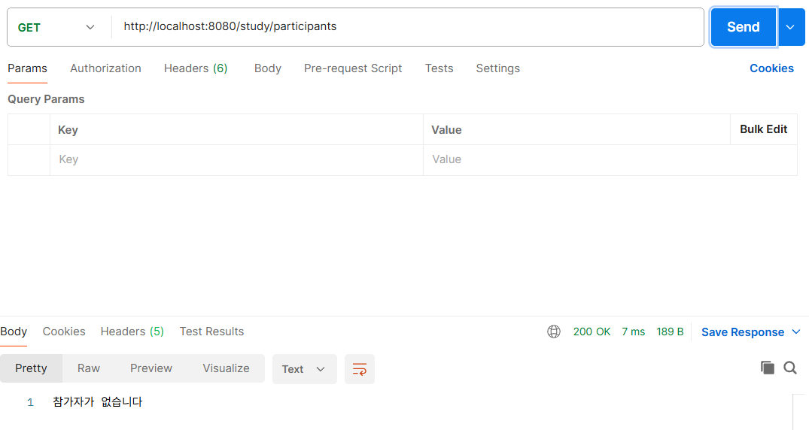
### 2. 6명 추가
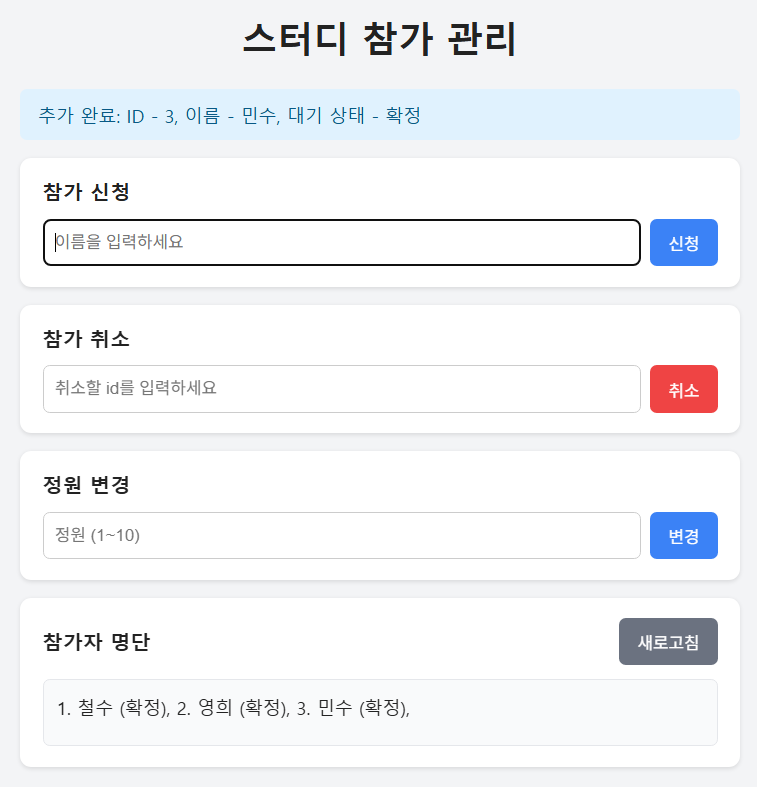
- 확정상태

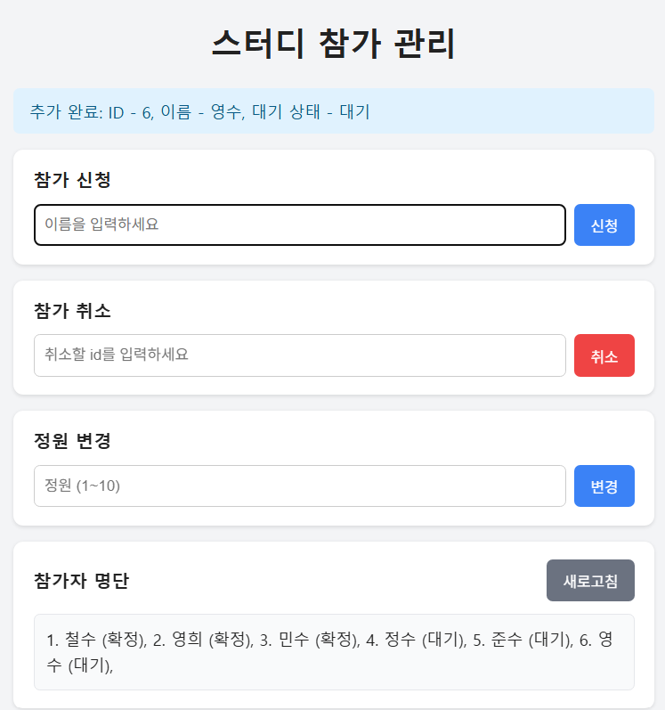
- 대기상태 포함 6명

### 3. 명단 출력
- GET http://localhost:8080/study/participants
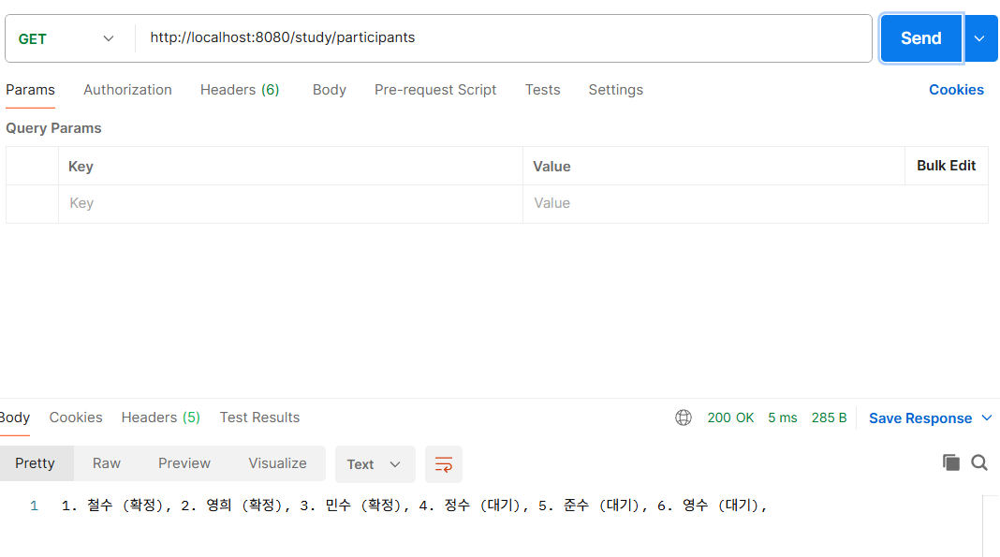
### 4. id에 공백, 실수, 문자 넣어보기
- POST http://localhost:8080/study/cancel?memberId=
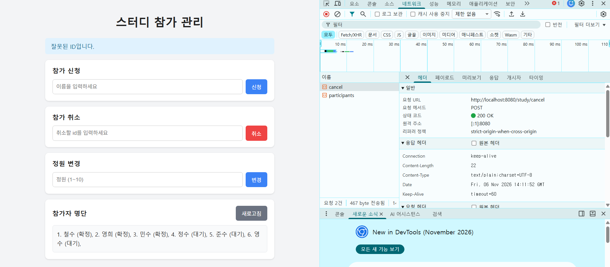

- POST http://localhost:8080/study/cancel?memberId=3.5
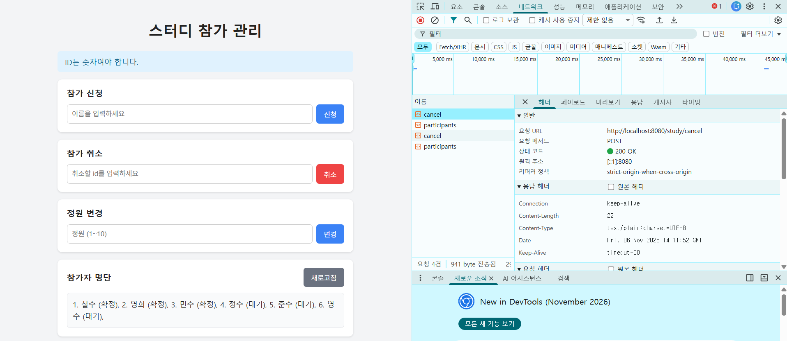

- POST http://localhost:8080/study/cancel?memberId=abc
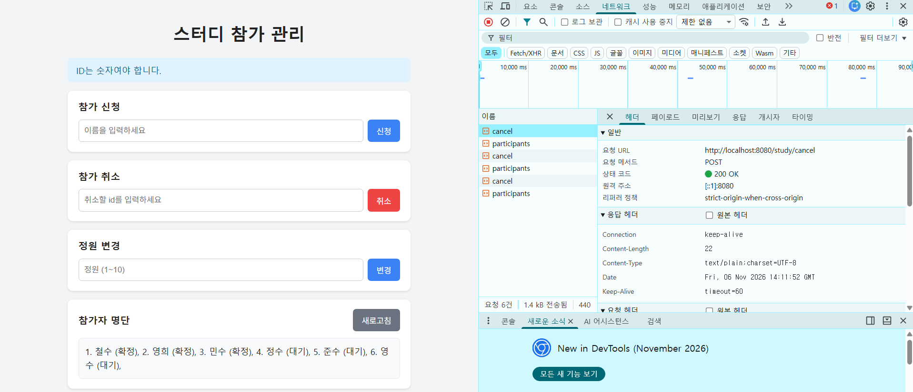
### 5. 철수 취소 (id=1), 명단 출력
- POST http://localhost:8080/study/cancel?memberId=1
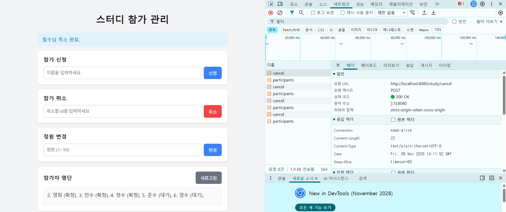

- GET http://localhost:8080/study/participants
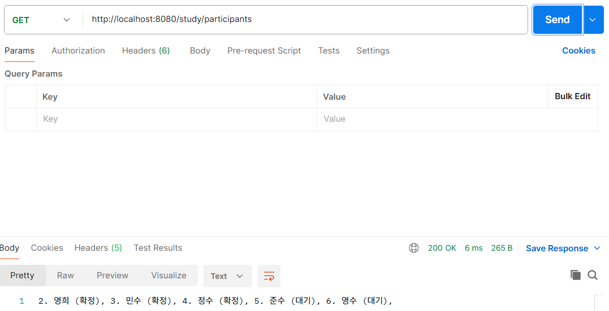
### 6. 영수 취소 (id=6), 명단 출력
- POST http://localhost:8080/study/cancel?memberId=6
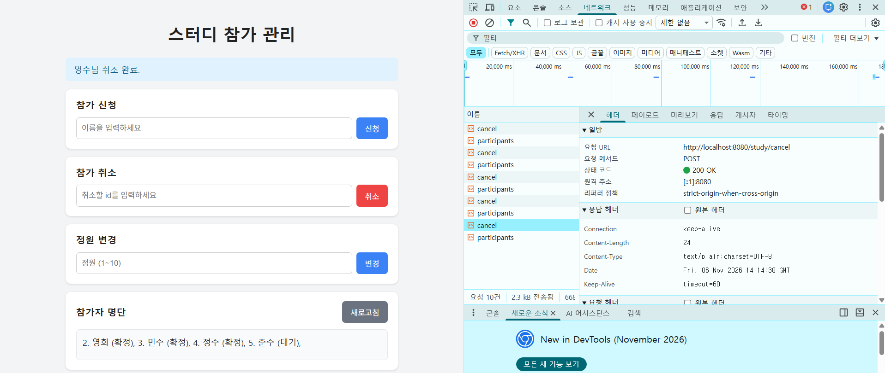

- GET http://localhost:8080/study/participants
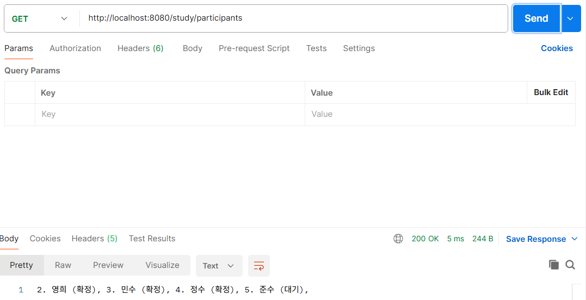

### 7. 철수와 영수 다시 추가
- POST http://localhost:8080/study/participants?name=철수
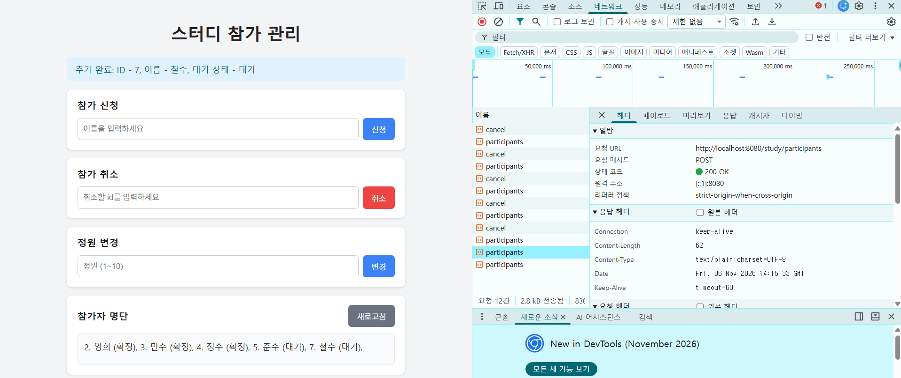

- POST http://localhost:8080/study/participants?name=영수
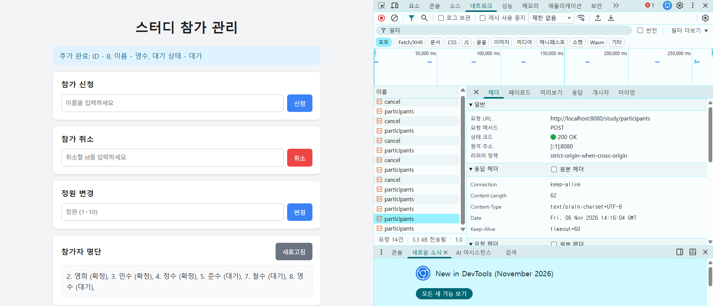
- 
### 8. 정원을 4로 늘리기, 명단 출력
- POST http://localhost:8080/study/capacity?capacity=4
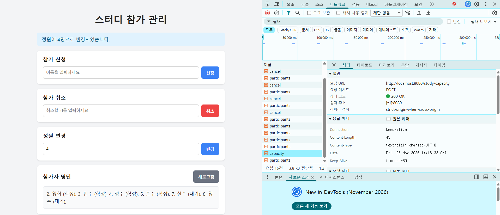

- GET http://localhost:8080/study/participants

### 9. 정원을 3으로 줄이기
- POST http://localhost:8080/study/capacity?capacity=3
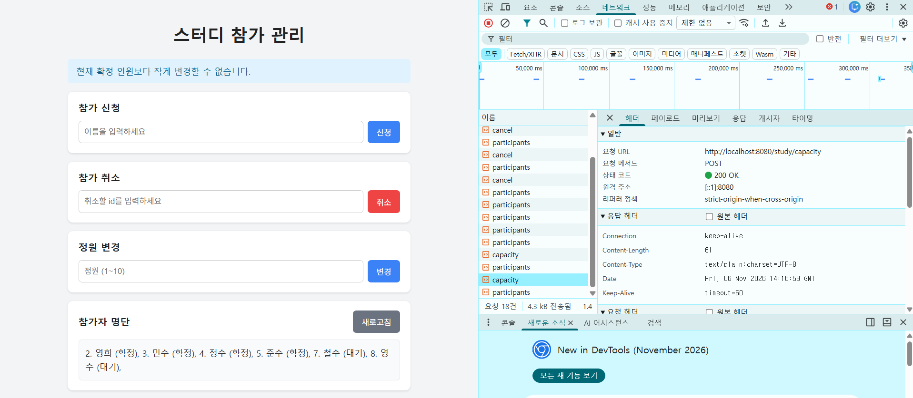
### 10. 정원 값에 0, 음수, 11, 문자 넣어보기
- POST http://localhost:8080/study/capacity?capacity= {0, -1, 11, abc}
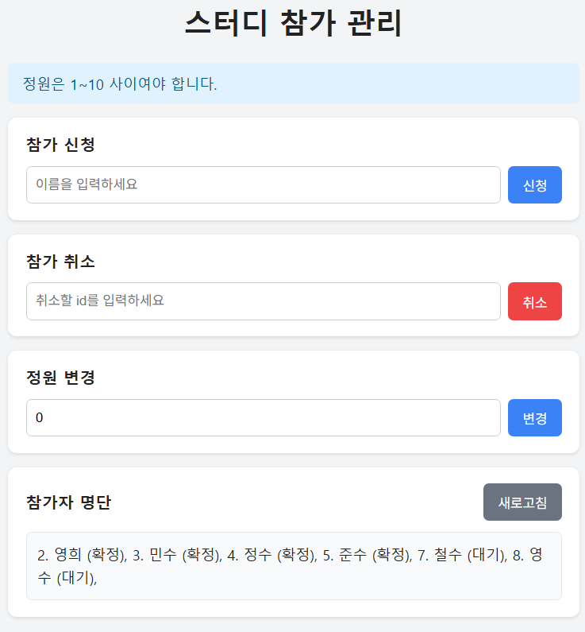

### 11. 마지막 명단 확인 (실패 후 데이터 유지 확인)
- GET http://localhost:8080/study/participants
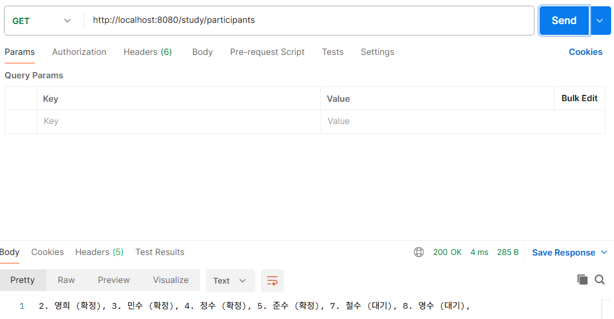