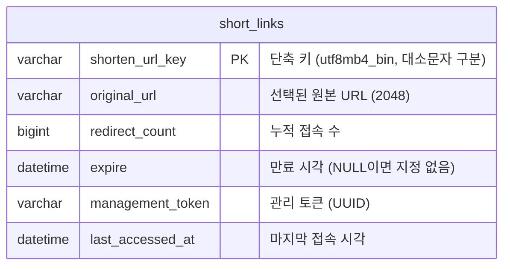
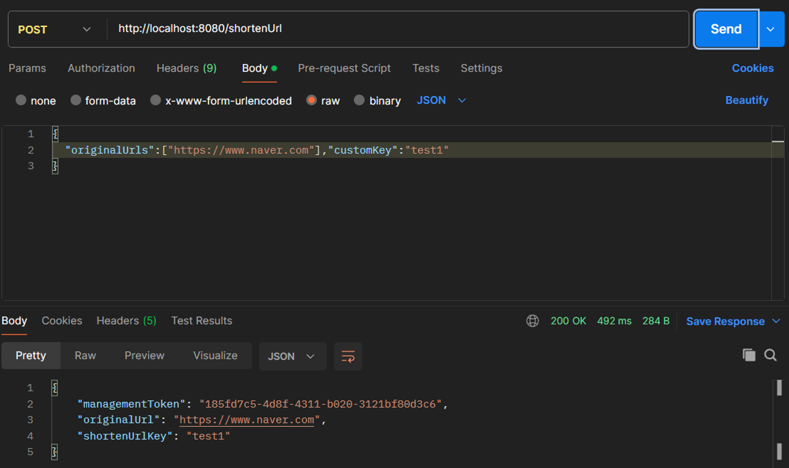
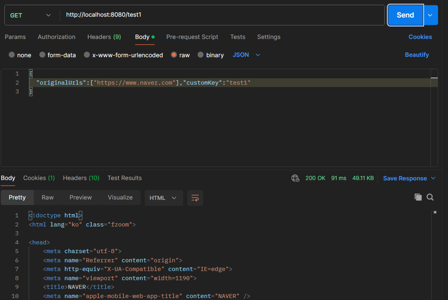
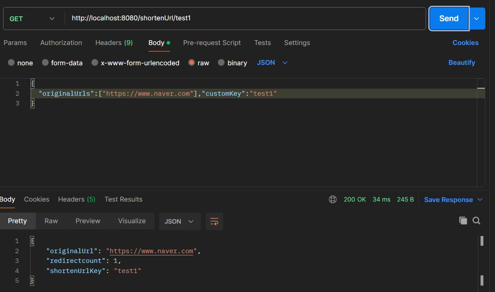
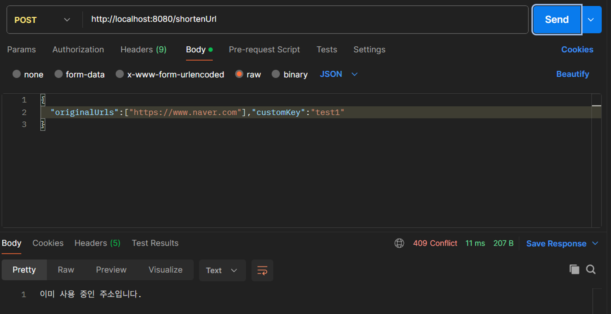
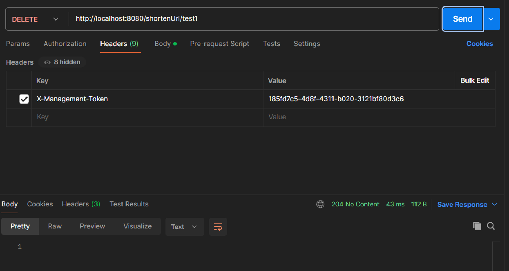
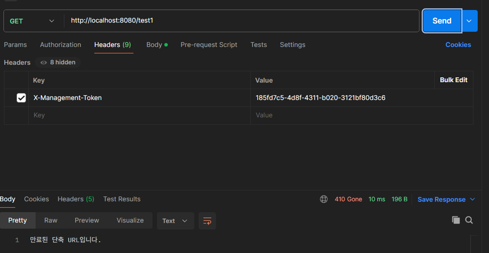
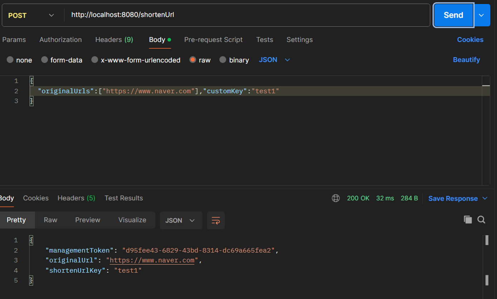
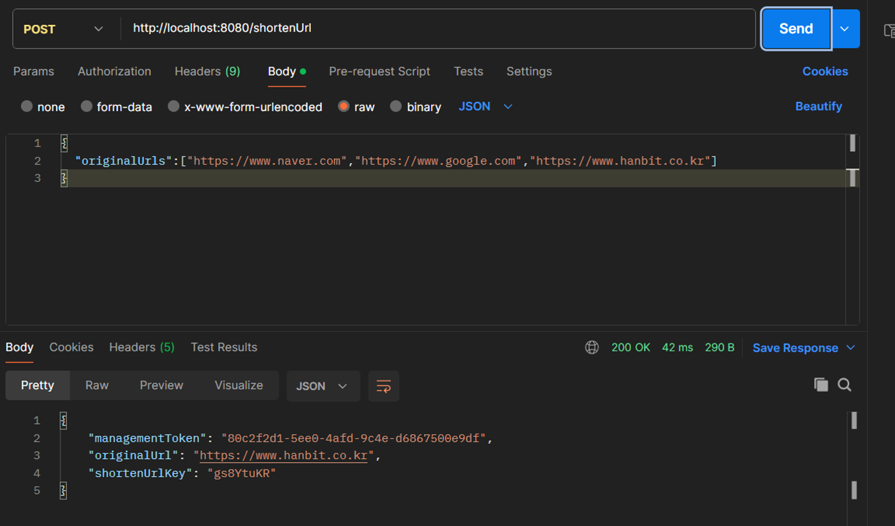

# 여러 링크 중 하나를 골라 연결해 주는 URL 단축 서비스 (Roulink)

## 개요

원본 URL을 짧은 주소로 바꿔 주는 URL 단축 서비스입니다. 일반적인 단축 기능에 더해 두 가지 특징이 있습니다.

- **여러 링크 중 하나를 골라 주는 기능**: 원본 URL을 여러 개 넣으면 서버가 그중 하나를 랜덤으로 선택해 단축 주소에 연결합니다.
- **짧은 주소를 직접 정하는 기능**: `roulink.io/portfolio`처럼 사용자가 의미 있는 이름을 지정할 수 있습니다. 지정하지 않으면 base56 랜덤 8자리 키를 자동 생성합니다.

링크마다 만료도 설정할 수 있습니다. 기간을 정해 두는 만료, 관리 토큰으로 직접 하는 즉시 만료, 일정 기간 사용하지 않으면 적용되는 자동 만료를 지원합니다.

## 배경

실생활에서 링크를 가장 많이 주고받는 상황을 떠올려 보면 두 가지가 있었습니다.

1. **친구들과 약속을 정하며 맛집 링크를 공유할 때**
   후보가 여러 개일 때 하나를 고르는 일이 번거로웠습니다. 이 선택을 대신해 주면 좋겠다고 생각해서, 링크 여러 개를 넣으면 그중 하나를 골라 주는 기능을 만들었습니다.
2. **학과 설문조사나 행사 링크를 받을 때**
   base56 같은 방식으로 단축된 링크는 글자만 봐서는 무엇을 위한 링크인지 알 수 없어 열어 보기 망설여졌습니다. 그래서 사용자가 뒷글자를 직접 지정해 목적을 드러낼 수 있는 기능을 넣었습니다.

## 주요 기능

| 기능 | 설명 |
|---|---|
| 단축 URL 생성 | 원본 URL을 보내면 단축 키를 발급 |
| 여러 링크 중 하나 선택 | `originalUrls`에 후보를 여러 개 보내면 생성 시점에 서버가 1개를 랜덤 선택해 저장. 같은 단축 주소는 항상 같은 곳으로 이동 |
| 짧은 주소 직접 지정 | `customKey`로 원하는 키를 지정. 이미 사용 중이면 409 |
| 랜덤 키 자동 생성 | 지정하지 않으면 base56 8자리 키 생성. 중복되면 최대 5회 재시도 |
| 만료 기간 지정 | `expireDays`(1~365)를 보내면 해당 일수 뒤 만료 |
| 즉시 만료 | 생성 시 발급된 관리 토큰을 헤더로 보내 만료 처리 |
| 미사용 자동 만료 | 마지막 접속 후 일정 기간(기본 7일) 접속이 없으면 만료 |
| 만료된 주소 재사용 | 만료된 `customKey`는 다시 등록 가능 |
| 조회수 집계 | 리다이렉트할 때마다 접속 수 증가 (만료된 링크는 증가하지 않음) |
| 정보 조회 | 원본 URL, 단축 키, 조회수 확인 |
| 입력 검증 | URL 형식, 빈 목록, 키 형식, 일수 범위 |
| 일관된 예외 응답 | 전역 예외 처리기로 404, 409, 410, 403 등을 통일 |

## 기술 스택

- Java 21, Spring Boot 4.1.2 (Spring MVC, Bean Validation)
- Spring JDBC (`NamedParameterJdbcTemplate`)
- MySQL 8 (Docker)
- Gradle
- 
## API

| 메서드 | 경로 | 설명 |
|---|---|---|
| POST | `/shortenUrl` | 단축 URL 생성 |
| GET | `/{shortenUrlKey}` | 원본 URL로 리다이렉트 |
| GET | `/shortenUrl/{shortenUrlKey}` | 링크 정보 조회 |
| DELETE | `/shortenUrl/{shortenUrlKey}` | 링크 즉시 만료 |

## 오류 응답

| 상태 코드 | 상황 |
|---|---|
| 400 | 입력 검증 실패, 관리 토큰 헤더 누락 |
| 403 | 관리 토큰이 일치하지 않음 |
| 404 | 존재하지 않는 단축 키 |
| 409 | 이미 사용 중인 `customKey` |
| 410 | 만료된 링크 |

## 도메인 구성

테이블은 `short_links` 하나이고, 도메인 객체는 `ShortenUrl`입니다.

| 필드 | 설명 |
|---|---|
| `shortenUrlKey` | 기본키. 단축 주소의 키 |
| `originalUrl` | 후보 중 선택되어 저장된 원본 URL |
| `redirectCount` | 리다이렉트 횟수 |
| `expire` | 사용자가 지정한 만료 시각. 지정하지 않으면 `null` |
| `managementToken` | 즉시 만료 권한을 증명하는 토큰 |
| `lastAccessedAt` | 마지막 접속 시각. 미사용 자동 만료의 기준 |

`ShortenUrl.isExpired()` 한 곳에서 "지정한 만료 시각이 지났는가"와 "마지막 접속 후 기준 기간이 지났는가"를 함께 판단합니다.

## 설계 및 문제 해결 기록

### 리다이렉트 상태 코드 (301 vs 302)

- 301은 브라우저가 결과를 캐시해 이후 요청이 서버를 거치지 않습니다. 조회수 집계와 만료 확인이 누락될 수 있어, 서버가 매번 호출되는 302가 적합합니다.

### 4. 키 중복 처리와 만료된 키 재사용

- 지정한 키가 이미 있으면 409를 반환합니다.
- 만료된 링크는 데이터가 남아 있어 같은 이름을 다시 등록하면 "사용 중"으로 거절되었습니다. 중복 검사를 "존재하고 만료되지 않았을 때만 거절"로 바꿔 재사용을 허용했습니다. 이 과정에서 조건을 반대로 쓰는 실수(`!` 누락)가 있었고, 그 결과 사용 중인 링크가 덮어써지는 문제까지 연결되는 것을 Postman으로 확인해 수정했습니다.

### 5. 로그인 없이 만료 권한을 구분하는 방법

- 링크 생성 시 서버가 추측하기 어려운 UUID 토큰을 발급하고, 만료 요청 때 `X-Management-Token` 헤더로 보내게 했습니다. 토큰은 생성 응답에서만 한 번 알려 주고 조회 API에는 노출하지 않습니다.

### 6. 세 가지 만료를 한 곳에서 판단

- 기간 만료, 즉시 만료(만료 시각을 "지금"으로), 미사용 만료를 모두 `isExpired()`에서 판단합니다.
- 접속 시점에 확인하는 방식이라 별도 스케줄러가 필요 없습니다.
- 만료 검사는 조회수 증가와 접속 시각 갱신보다 앞에 둡니다. 순서가 바뀌면 만료된 링크가 접속만으로 되살아납니다.
- 정보 조회는 "사용"으로 보지 않아 접속 시각을 갱신하지 않습니다.
## API 동작 확인 (Postman)

아래 순서대로 호출해 정상 동작과 오류 응답을 확인했습니다. 지정 키는 `test1`을 사용했고, 관리 토큰은 생성 응답에서 복사해 썼습니다.

### 1. 단축 URL 생성

`POST /shortenUrl`로 원본 URL과 `customKey`를 보냅니다. 지정한 키(`test1`)로 생성되고, 응답에 관리 토큰이 함께 발급됩니다. (200 OK)

### 2. 리다이렉트 접속

`GET /test1`로 접속하면 원본 URL(네이버)로 이동합니다. Postman은 리다이렉트를 자동으로 따라가기 때문에 최종 페이지의 200 OK가 표시됩니다. 서버가 보내는 상태 코드와 `Location` 헤더를 보려면 Postman 설정에서 *Automatically follow redirects*를 끄면 됩니다.

### 3. 정보 조회

`GET /shortenUrl/test1`로 원본 URL, 단축 키, 접속 횟수를 확인합니다. 2번에서 접속한 1회가 `redirectcount: 1`로 집계된 것을 볼 수 있습니다. (200 OK)

### 4. 중복 키 거절

1번과 같은 본문으로 다시 `POST /shortenUrl`을 보내면 이미 사용 중인 키이므로 409 Conflict와 "이미 사용 중인 주소입니다."가 반환됩니다.

### 5. 즉시 만료

`DELETE /shortenUrl/test1`에 헤더 `X-Management-Token`으로 1번에서 받은 토큰을 보내면 링크가 즉시 만료됩니다. (204 No Content)

### 6. 만료된 링크 접속

만료 후 `GET /test1`로 접속하면 410 Gone과 "만료된 단축 URL입니다."가 반환됩니다. 조회수와 접속 시각은 갱신되지 않습니다.

### 7. 만료된 키 재사용

만료된 키는 다시 등록할 수 있습니다. 1번과 같은 본문으로 `POST /shortenUrl`을 보내면 200 OK로 생성되고 새 관리 토큰이 발급됩니다. 이전 토큰은 더 이상 쓸 수 없습니다.

### 8. 여러 링크 중 하나 선택

`customKey` 없이 원본 URL 3개를 보내면, 랜덤 8자리 키가 생성되고 후보 중 1개가 생성 시점에 선택되어 고정됩니다. 응답의 `originalUrl`이 선택된 결과입니다. (200 OK)

