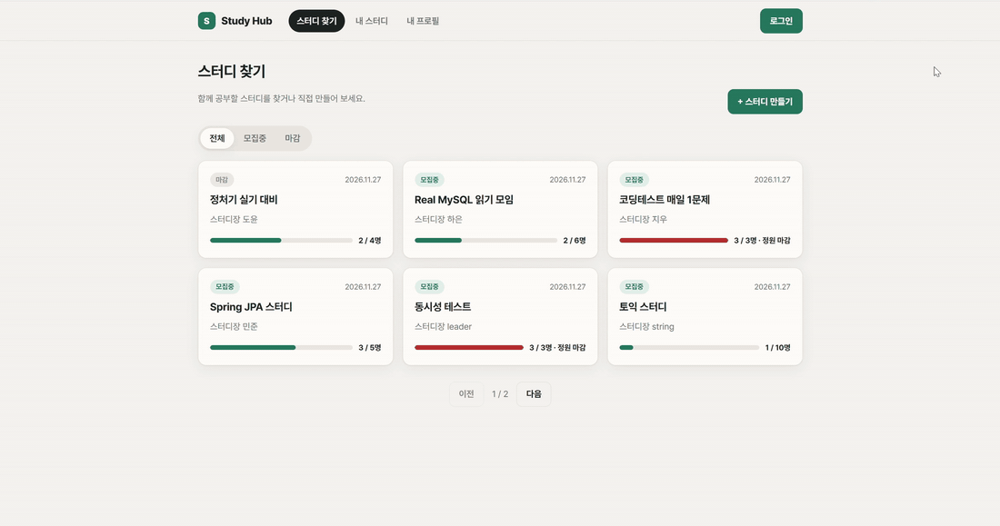
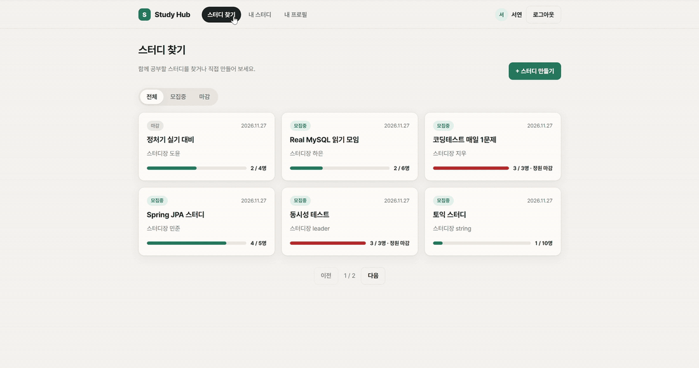
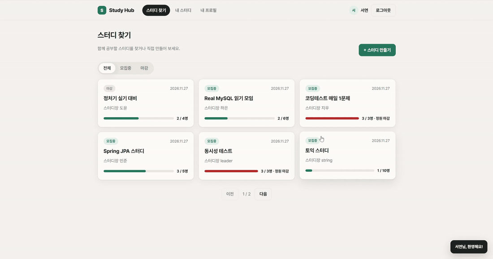
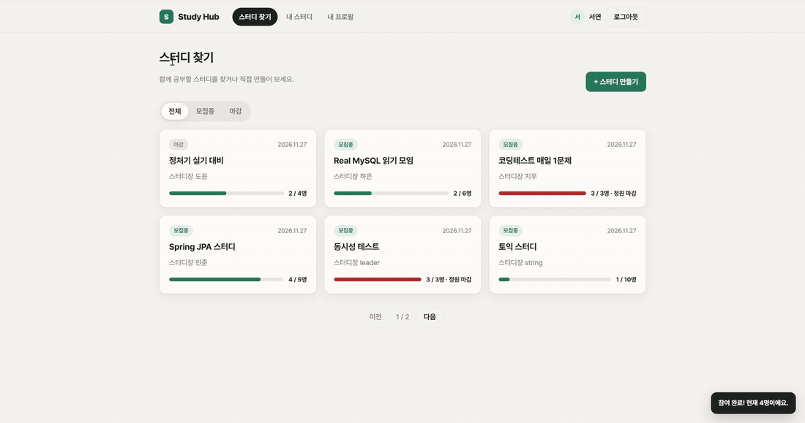
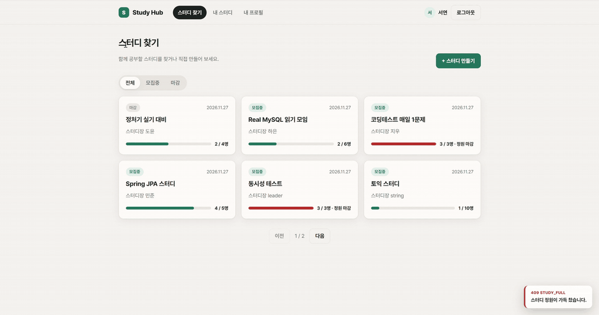
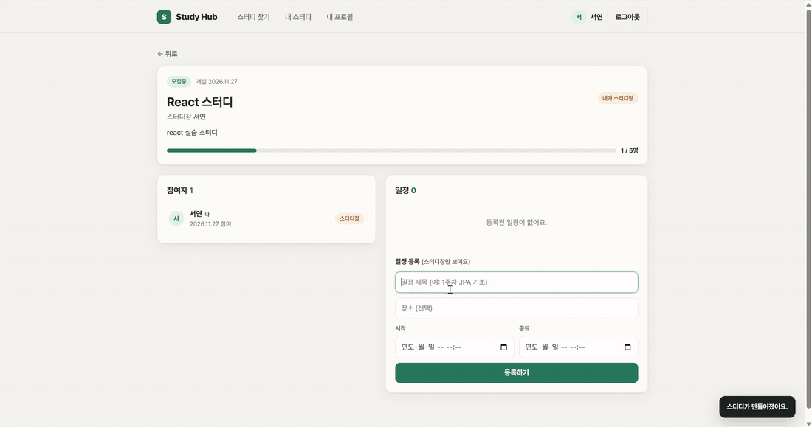
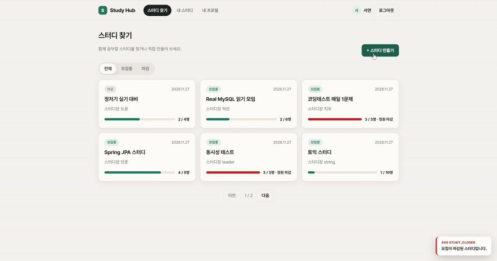
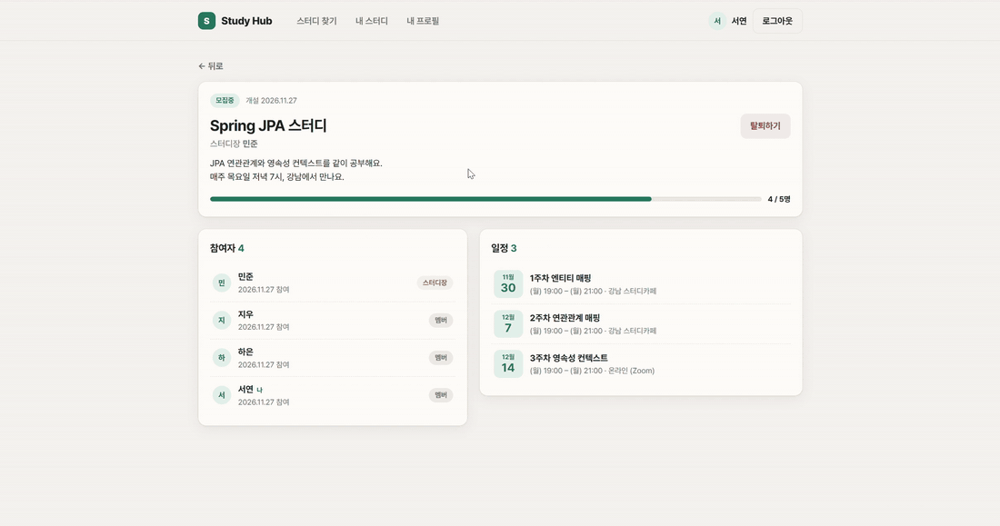
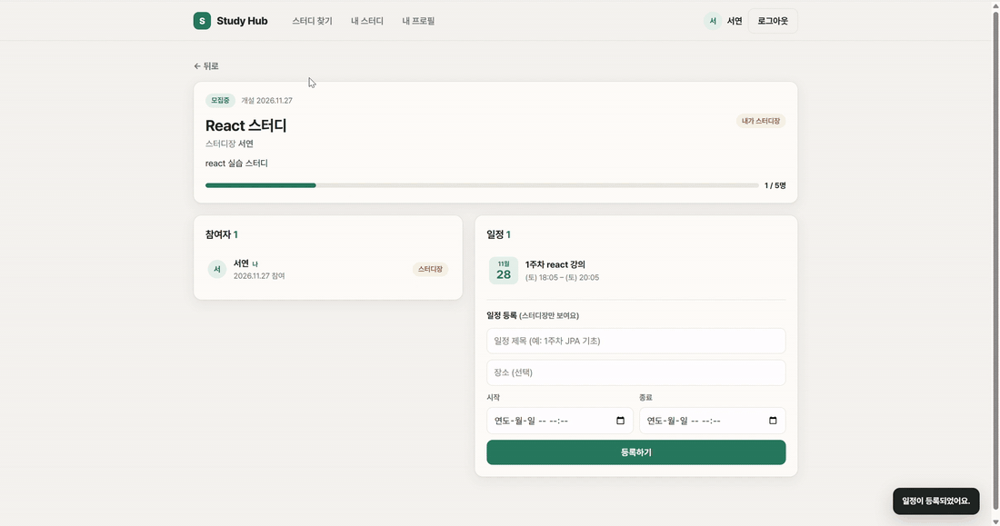
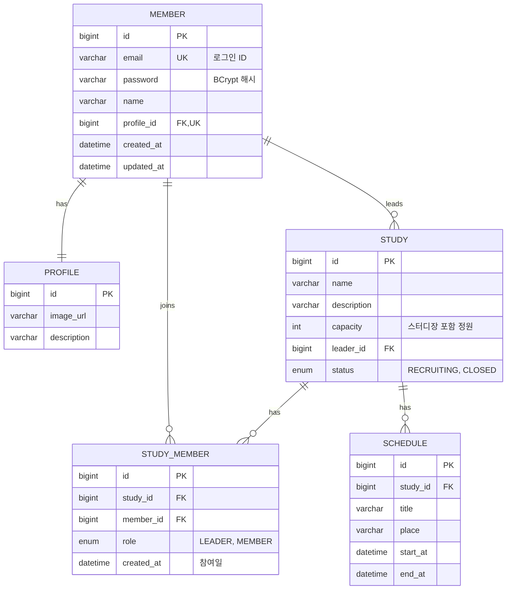

# 📚 Study Hub

> 회원들이 스터디를 만들고 참여하며 모임 일정을 관리하는 **스터디 모집·모임 관리 REST API**

- 회원 · 프로필 (1:1), 스터디 · 참여 (N:M → 중간 엔티티), 스터디 · 일정 (1:N) 관계를 JPA로 직접 설계했습니다.
- 중복 참여 · 정원 초과 · 스터디장 탈퇴 금지 같은 **서비스 규칙을 직접 정의**하고, 동시 요청에도 정원이 지켜지도록 **비관적 락**을 적용했습니다.
- Spring Security + JWT 인증, 공통 예외 응답, Testcontainers 기반 통합 테스트까지 구성했습니다.

<br>

## 목차

1. [시연](#-시연)
2. [기술 스택](#-기술-스택)
3. [실행 방법](#-실행-방법)
4. [ERD와 연관관계 설계](#-erd와-연관관계-설계)
5. [서비스 규칙](#-서비스-규칙)
6. [API 명세](#-api-명세)
7. [핵심 구현](#-핵심-구현)
8. [테스트](#-테스트)
9. [패키지 구조](#-패키지-구조)
10. [트러블슈팅](#-트러블슈팅)
11. [개선할 점](#-개선할-점)

<br>

## 🎬 시연

> API 테스트용 화면(`src/main/resources/static`)으로 녹화했습니다. 서버의 에러 응답(`코드 + 메시지`)이 오른쪽 아래 토스트로 그대로 표시됩니다.

### 로그인


### 스터디 개설 → 개설자가 스터디장으로 자동 참여


### 스터디 참여
참여하면 인원 막대가 `3/5 → 4/5`로 늘어나고, 참여자 목록에 추가됩니다.



### 정원 초과 → `409 STUDY_FULL`


### 모집 마감 → `400 STUDY_CLOSED`


### 일정 등록 (스터디장 전용) · 기간 검증 → `400 INVALID_SCHEDULE_PERIOD`
일정 등록 폼은 스터디장에게만 보이며, 종료 시간이 시작 시간보다 앞서면 서버가 거부합니다.



### 내 스터디 · 프로필 수정
| 내 스터디 | 프로필 수정 |
|---|---|
|  |  |

### 다른 계정(스터디장)으로 전환


<br>

## 🛠 기술 스택

| 구분 | 기술 |
|---|---|
| Language | Java 21 |
| Framework | Spring Boot 4.2, Spring Data JPA, Spring Security, Bean Validation |
| Auth | JWT (jjwt 0.12), BCrypt |
| Database | MySQL 8.4 |
| Infra | Docker, Docker Compose |
| Docs | Swagger (springdoc-openapi) |
| Test | JUnit 5, Mockito, AssertJ, MockMvc, Testcontainers |

<br>

## 🚀 실행 방법

### 1. 환경 변수 파일 생성
프로젝트 루트에 `.env` 파일을 만듭니다. (Git에는 올라가지 않습니다)
```env
DB_PASSWORD=studyhub1234
DB_ROOT_PASSWORD=root1234
JWT_SECRET=change-this-to-a-random-string-at-least-32-bytes
```

### 2. 실행
```bash
# 앱 + DB 한 번에 실행
docker compose up -d --build

# 개발 중에는 DB만 띄우고 앱은 IDE에서 실행
docker compose up -d db
```

### 3. 접속
| 주소 | 설명 |
|---|---|
| http://localhost:8080 | API 테스트용 화면 |
| http://localhost:8080/swagger-ui.html | Swagger API 문서 |

### 4. 샘플 계정
`app.seed.enabled=true`이면 앱이 시작될 때 샘플 데이터(회원 5명, 스터디 4개, 일정)가 생성됩니다. 비밀번호는 모두 `password123`입니다.

| 계정 | 상태 |
|---|---|
| `seoyeon@studyhub.com` | 시연용 (참여한 스터디 없음) |
| `minjun@studyhub.com` | Spring JPA 스터디장 (정원 여유) |
| `jiwoo@studyhub.com` | 코딩테스트 스터디장 (정원 가득) |
| `haeun@studyhub.com` | Real MySQL 스터디장 |
| `doyun@studyhub.com` | 정처기 스터디장 (모집 마감) |

<br>

## 🗂 ERD와 연관관계 설계



> 모든 엔티티는 공통 `BaseEntity`(id, createdAt, updatedAt)를 상속합니다.

### 연관관계를 이렇게 정한 이유

| 관계 | 매핑 | 이유 |
|---|---|---|
| **Member – Profile** (1:1) | Member가 FK 보유, `@OneToOne(LAZY, cascade=ALL, orphanRemoval=true)`, 단방향 | 프로필은 회원과 생명주기가 같고 항상 회원을 통해 조회합니다. 1:1에서 **FK가 없는 쪽은 Hibernate가 지연 로딩을 할 수 없어서** 조회를 시작하는 Member 쪽에 FK를 두었습니다. |
| **Member – Study** (N:M) | `@ManyToMany` 대신 **StudyMember 중간 엔티티**로 1:N + N:1 | 참여 정보에 역할(LEADER/MEMBER)과 참여일을 저장해야 합니다. `@ManyToMany`는 중간 테이블에 컬럼을 추가할 수 없고 테이블이 숨겨져 제어하기 어렵습니다. |
| **StudyMember → Study, Member** | `@ManyToOne(LAZY)` **단방향** | FK가 있는 N쪽이 연관관계의 주인입니다. 목록은 Repository 쿼리(fetch join)로 조회하면 되므로 양방향은 만들지 않았습니다. 양방향 동기화 코드와 JSON 순환 참조 문제를 피할 수 있습니다. |
| **Study → Member** (스터디장) | `@ManyToOne(LAZY)` | "스터디장만 일정 등록", "스터디장 탈퇴 불가" 규칙을 판단하는 데 사용합니다. |
| **Schedule → Study** (N:1) | `@ManyToOne(LAZY)` 단방향 | 일정은 항상 스터디 id로 조회합니다. |

### 엔티티 설계 원칙
- **`@Setter` 없이 의미 있는 메서드로만 상태 변경**: `updateProfile()`, `close()`처럼 어떤 변경인지가 메서드 이름에 드러납니다.
- **정적 팩토리 메서드**: `StudyMember.leader()` / `StudyMember.member()`로 역할을 잘못 넣는 실수를 막습니다.
- **`@Enumerated(EnumType.STRING)`**: enum 순서가 바뀌어도 DB 데이터가 꼬이지 않습니다.
- **현재 인원은 컬럼으로 두지 않고 계산**: 참여 행 수가 곧 인원이라 동기화 문제가 없습니다.

<br>

## 📏 서비스 규칙

| 규칙 | 처리 방식 | 응답 |
|---|---|---|
| 스터디를 개설하면 개설자가 스터디장으로 자동 참여 | 개설과 참여를 한 트랜잭션으로 저장 (스터디장도 정원에 포함) | `201` |
| 중복 참여 금지 | 서비스에서 확인 + DB 유니크 제약 `(study_id, member_id)` 이중 방어 | `409 ALREADY_JOINED` |
| 정원 초과 금지 | 스터디 행에 비관적 락을 건 뒤 인원 확인 | `409 STUDY_FULL` |
| 모집 마감된 스터디는 참여 불가 | `status == CLOSED` 확인 | `400 STUDY_CLOSED` |
| 스터디장은 탈퇴 불가 | 탈퇴하면 일정 관리 권한자가 사라지므로 금지 | `400 LEADER_CANNOT_LEAVE` |
| 탈퇴 후 재참여 가능 | 탈퇴는 hard delete → 유니크 제약과 충돌 없음 | `204` |
| 일정 등록은 스터디장만 | `study.isLeader(memberId)` 확인 | `403 NOT_STUDY_LEADER` |
| 일정 기간 검증 | 시작은 미래(DTO 검증), 종료 > 시작(엔티티 생성 시 검증) | `400` |

**검사 순서(마감 → 중복 → 정원)도 의도한 것입니다.** 이미 참여한 사람이 정원이 찬 스터디에 다시 요청하면 "정원 초과"보다 "이미 참여"가 정확한 응답이기 때문입니다.

<br>

## 📡 API 명세

인증이 필요한 API는 `Authorization: Bearer {accessToken}` 헤더가 필요합니다.

| 기능 | Method | URL | 인증 | 응답 |
|---|---|---|:---:|---|
| 회원가입 | POST | `/api/auth/signup` | | 201 / 409 |
| 로그인 | POST | `/api/auth/login` | | 200 / 401 |
| 내 정보 조회 | GET | `/api/members/me` | ✅ | 200 |
| 내 프로필 수정 | PATCH | `/api/members/me/profile` | ✅ | 200 / 400 |
| 회원 조회 (이메일 제외) | GET | `/api/members/{memberId}` | ✅ | 200 / 404 |
| 내가 참여한 스터디 | GET | `/api/members/me/studies` | ✅ | 200 |
| 스터디 목록 (상태 필터, 페이징) | GET | `/api/studies?status=&page=&size=` | | 200 |
| 스터디 상세 (현재 인원 포함) | GET | `/api/studies/{studyId}` | | 200 / 404 |
| 스터디 개설 | POST | `/api/studies` | ✅ | 201 / 400 |
| 스터디 참여 | POST | `/api/studies/{studyId}/members` | ✅ | 201 / 400 / 409 |
| 스터디 탈퇴 | DELETE | `/api/studies/{studyId}/members/me` | ✅ | 204 / 400 / 404 |
| 참여자 목록 | GET | `/api/studies/{studyId}/members` | ✅ | 200 |
| 일정 등록 | POST | `/api/studies/{studyId}/schedules` | ✅ | 201 / 400 / 403 |
| 일정 조회 | GET | `/api/studies/{studyId}/schedules` | ✅ | 200 |

### URL 설계 기준
- **`/me` 경로**: 본인 정보는 토큰으로 식별합니다. URL에 다른 사람의 id를 넣어 수정하는 일이 구조적으로 불가능합니다.
- **하위 자원**: 참여와 일정은 스터디에 속하므로 `/studies/{id}/...` 아래에 두었습니다. 참여는 `POST`, 탈퇴는 `DELETE`로 StudyMember 리소스의 생성·삭제를 표현했습니다.
- **스터디 조회는 인증 없이 허용**: 로그인 전에도 어떤 스터디가 있는지 둘러볼 수 있습니다.

### 공통 에러 응답
모든 에러(서비스 규칙 위반, 검증 실패, 인증·인가 실패)는 같은 형식으로 응답합니다.
```json
{
  "status": 400,
  "code": "INVALID_INPUT",
  "message": "입력값이 올바르지 않습니다.",
  "errors": [
    { "field": "capacity", "reason": "정원은 2명 이상이어야 합니다." }
  ]
}
```

<br>

## 🔑 핵심 구현

### 1. 동시 참여 시 정원 초과 방지 (비관적 락)

"인원을 세고 → 정원보다 적으면 저장"은 두 단계라서, 동시 요청이 둘 다 `2/3`을 보고 통과하면 정원을 넘을 수 있습니다.

```java
@Lock(LockModeType.PESSIMISTIC_WRITE)
@Query("select s from Study s where s.id = :id")
Optional<Study> findByIdForUpdate(@Param("id") Long id);   // SELECT ... FOR UPDATE
```

- 스터디 행에 쓰기 락을 걸어 **같은 스터디의 참여 요청을 한 줄로 처리**합니다. 서로 다른 스터디 참여는 기다리지 않습니다.
- 인기 스터디에 요청이 몰리는 등 충돌이 잦은 작업이라, 실패 후 재시도가 필요한 낙관적 락보다 비관적 락이 적합하다고 판단했습니다.
- `정원 3명 스터디에 10명이 동시에 참여` 테스트로 검증합니다. 락을 일반 조회(`findById`)로 바꾸면 정원을 넘는 것을 재현할 수 있습니다.

### 2. JWT 인증 흐름

```
요청 → JwtAuthenticationFilter
        ├─ 토큰 유효 → SecurityContext에 memberId 저장 → @AuthenticationPrincipal Long memberId
        └─ 토큰 없음/무효 → 인증 없이 통과
              ├─ permitAll URL (스터디 조회) → 정상 처리
              └─ 인증 필요 URL → EntryPoint → 401 (UNAUTHORIZED / INVALID_TOKEN 구분)
```

- **STATELESS + CSRF 비활성화**: 세션을 저장하지 않고 토큰을 Authorization 헤더로 받습니다.
- **필터에서 바로 401을 응답하지 않음**: 토큰이 잘못돼도 스터디 목록은 볼 수 있어야 하므로, 필터는 표시만 하고 401 판단은 인가 단계에 맡겼습니다.
- **토큰에는 memberId만**: payload는 암호화되지 않으므로 개인정보를 넣지 않았고, 요청마다 DB를 조회하지 않습니다.
- **스터디장 권한은 서비스 계층에서 확인**: "이 스터디의 스터디장인가"는 스터디마다 달라서 Security의 전역 Role로 표현할 수 없습니다.

### 3. N+1 문제 방지

| 조회 | 방법 | 쿼리 수 |
|---|---|---|
| 스터디 목록 | 스터디장은 fetch join, 인원은 현재 페이지 id들로 `group by` 집계 | 목록 크기와 상관없이 3개 |
| 참여자 목록 | StudyMember → Member → Profile fetch join | 1개 |
| 내 정보 조회 | Member → Profile fetch join | 1개 |

ManyToOne fetch join은 행 수가 늘지 않아 페이징과 함께 써도 안전하고, count 쿼리는 fetch join 없이 분리했습니다.

### 4. 공통 예외 처리

- `ErrorCode` enum에 상태 코드·에러 코드·메시지를 모아 관리하고, 서비스에서는 `throw new BusinessException(ErrorCode.STUDY_FULL)` 한 줄로 응답을 결정합니다.
- `@RestControllerAdvice`에서 Bean Validation 실패, 잘못된 JSON, DB 제약 위반, 404/405, 예상하지 못한 예외까지 같은 형식으로 변환합니다.
- Security 단계의 401/403도 `EntryPoint`와 `AccessDeniedHandler`에서 같은 형식으로 응답합니다.
- 예상하지 못한 예외는 로그만 남기고, 내부 정보(SQL, 스택 트레이스)는 응답에 노출하지 않습니다.

<br>

## 🧪 테스트

```bash
./gradlew test   # Docker가 실행 중이어야 합니다 (통합 테스트가 MySQL 컨테이너를 띄움)
```

| 종류 | 대상 | 검증 내용 |
|---|---|---|
| 도메인 단위 | `Schedule`, `Study`, `Member` | 일정 기간 규칙, 스터디장 판별·마감, 프로필 부분 수정 |
| 서비스 단위 (Mockito) | `StudyMemberService`, `ScheduleService`, `AuthService` | 참여·탈퇴 규칙, 일정 권한, 비밀번호 암호화, 로그인 실패 메시지 통일 |
| API 통합 (MockMvc) | Security 필터 → 컨트롤러 → DB | 401 / 400 / 403 / 409 응답, 목록 인원 집계 |
| 동시성 | `StudyMemberService.join` | 10명이 동시에 참여해도 정원 3명 유지 |

**테스트 설계 기준**
- 규칙 판단은 Mockito로 빠르게, 락·쿼리·Security처럼 실제 인프라가 필요한 부분만 통합 테스트로 확인합니다.
- H2 대신 **Testcontainers MySQL 8.4**를 사용해 `SELECT ... FOR UPDATE`와 enum 컬럼을 운영 DB와 같은 환경에서 검증합니다.
- 컨테이너는 한 번만 띄워 공유하고(싱글톤 컨테이너), 테스트마다 테이블을 비워 서로 영향을 주지 않게 했습니다.

<br>

## 📁 패키지 구조

도메인별로 패키지를 나눠 관련 코드가 한곳에 모이도록 했습니다.

```
com.sesac.studyhub
 ├─ global
 │   ├─ common      # BaseEntity, PageResponse
 │   ├─ config      # JPA Auditing, Swagger, 샘플 데이터
 │   ├─ security    # SecurityConfig, JwtProvider, JWT 필터, 401/403 핸들러
 │   └─ exception   # ErrorCode, BusinessException, GlobalExceptionHandler
 ├─ auth            # 회원가입, 로그인
 ├─ member          # 회원, 프로필
 ├─ study           # 스터디, 참여(StudyMember)
 └─ schedule        # 일정
```

<br>

## 🔧 트러블슈팅

### `Unable to determine Dialect without JDBC metadata`
- **상황**: 앱 시작 시 Dialect 설정 문제처럼 보이는 에러로 실패
- **원인**: 실제로는 DB 연결 실패. Hibernate가 DB에 접속해 종류를 알아내는데, 연결이 안 되면 이 메시지가 나옵니다. 로그 위쪽의 `Caused by`로 원인을 구분했습니다.
    - `Connection refused` → DB 컨테이너가 꺼져 있음
    - `EOFException ... connection was unexpectedly lost` → 컨테이너는 떴지만 MySQL 초기화 중
- **해결**: `docker compose ps`로 `healthy` 상태를 확인한 뒤 앱을 실행. 컨테이너에 `healthcheck`와 `depends_on: condition: service_healthy`를 설정해 앱이 DB 준비 후에 뜨도록 했습니다.

### 정적 파일(CSS, JS)이 JSON으로 응답됨
- **상황**: 브라우저에서 `MIME type ('application/json') is not a supported stylesheet` 에러
- **원인**: 파일 경로가 맞지 않아 404가 났고, 404를 `GlobalExceptionHandler`가 JSON 에러 응답으로 바꿨기 때문입니다.
- **해결**: `static/css`, `static/js` 폴더 구조를 맞추고, SecurityConfig에서 정적 리소스 경로를 `permitAll`로 허용했습니다.

### Spring Boot 4 마이그레이션 포인트
- Jackson 3으로 바뀌어 `ObjectMapper` 패키지가 `tools.jackson.databind`로 변경
- springdoc-openapi는 Spring Boot 4용 3.x 버전 사용
- Testcontainers 2.0에서 아티팩트(`testcontainers-mysql`)와 패키지(`org.testcontainers.mysql`)가 변경
- `@AutoConfigureMockMvc` 패키지가 `org.springframework.boot.webmvc.test.autoconfigure`로 이동

<br>

## 🌱 개선할 점

- **Refresh Token**: 현재는 access token만 발급합니다. refresh token을 DB나 Redis에 저장해 재발급·로그아웃(강제 무효화)을 지원할 수 있습니다.
- **탈퇴 이력 관리**: 지금은 hard delete입니다. 이력이 필요하면 soft delete(`status = LEFT`)로 바꾸고 재참여 시 기존 행을 다시 활성화하는 방식이 필요합니다.
- **스터디장 위임 · 스터디 삭제**: 스터디장이 탈퇴할 수 없는 대신 위임 기능을 추가할 수 있습니다.
- **일정 수정 · 삭제, 기간 필터**: 같은 구조로 `PATCH`, `DELETE`, `?from=&to=`를 확장할 수 있습니다.
- **이미지 업로드**: 현재는 이미지 URL만 저장합니다. S3 업로드를 붙여도 엔티티 구조는 바꿀 필요가 없습니다.
- **현재 인원 반정규화**: 트래픽이 커지면 인원을 매번 세는 대신 컬럼으로 두는 것을 고려할 수 있습니다.