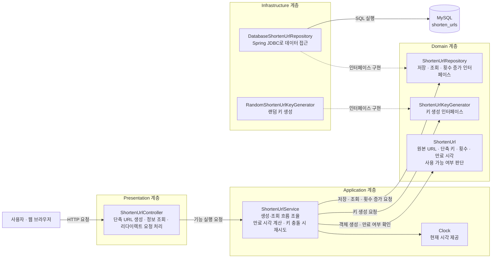

# Brevlet

긴 URL을 짧은 링크로 바꾸고, 만료 기간과 리다이렉트 횟수를 확인할 수 있는 URL 단축 서비스입니다.

URL 단축 서비스 학습 프로젝트를 바탕으로 **만료 기간 설정 기능을 직접 추가**했습니다. 행사 안내나 기간 한정 자료처럼 정해진 기간 동안 사용할 링크와, 만료 없이 사용할 링크를 선택할 수 있습니다.

## 주요 기능

| 기능 | 설명 |
|---|---|
| 단축 URL 생성 | 원본 URL에 대응하는 8자리 단축 키를 생성합니다. |
| 원본 URL로 이동 | 사용 가능한 단축 링크에 접속하면 `302 Found`로 이동합니다. |
| 만료 기간 설정 | 만료 없이 사용하거나, 생성 시점부터 1일에서 365일 사이의 기간을 설정합니다. |
| 만료된 링크 차단 | 만료 시각에 도달하면 `410 Gone`과 함께 안내 페이지를 반환합니다. |
| 링크 정보 조회 | 원본 URL, 단축 키, 리다이렉트 횟수, 만료 시각을 조회합니다. 만료 후에도 조회할 수 있습니다. |
| 웹 화면 | 링크 생성·조회·복사, 만료 상태 확인을 지원합니다. |

화면의 클릭 수는 서버에서 처리한 유효한 단축 링크 접속 횟수입니다. 고유 방문자 수를 구분하지 않으며, 만료로 차단된 접속과 정보 조회는 집계하지 않습니다. 최근 링크 목록에서 숨기거나 목록을 지워도 서버의 링크는 삭제되지 않습니다.

## 기술 스택

| 구분 | 사용 기술 |
|---|---|
| 언어 | Java 21 |
| 프레임워크 | Spring Boot 4.1.2, Spring MVC, Bean Validation |
| 데이터 접근 | Spring JDBC, `NamedParameterJdbcTemplate` |
| 데이터베이스 | MySQL |
| 웹 화면 | HTML, CSS, JavaScript |
| 테스트 | JUnit Jupiter, AssertJ, Mockito, MockMvc |
| 빌드 | Gradle Wrapper 9.8.2 |

## 계층별 구성



실선은 호출·사용 관계, 점선은 인터페이스 구현 관계입니다. 실제 요청에서는 서비스에 주입된 구현체가 키 생성과 데이터 접근을 처리합니다.

### 생성 흐름

1. 컨트롤러에서 URL과 만료 기간을 검증합니다.
2. 서비스에서 `Clock`을 기준으로 만료 시각을 계산합니다. 만료 기간이 없으면 `null`입니다.
3. 키 생성기로 단축 키를 만들고 `ShortenUrl` 객체를 생성합니다.
4. 저장소에 저장합니다. 키가 충돌하면 새 키로 재시도하며, 최대 5번 실패하면 오류를 반환합니다.
5. 생성된 링크 정보를 `201 Created`로 반환합니다.

### 리다이렉트 흐름

1. 단축 키로 `ShortenUrl`을 조회합니다. 존재하지 않으면 `404 Not Found`를 반환합니다.
2. 서비스가 현재 시각을 전달하고, 도메인 객체가 사용 가능 여부를 판단합니다.
3. 만료되었다면 `410 Gone`으로 안내 페이지를 반환합니다.
4. 사용 가능하면 저장소에서 리다이렉트 횟수를 증가시킵니다.
5. 컨트롤러가 원본 URL을 `Location` 헤더에 담아 `302 Found`로 반환합니다.

## 기술적으로 고민한 부분

### 만료 판단과 시간 제어

만료 여부는 링크에 접속할 때마다 판단합니다. 별도의 정리 작업이 실행될 때까지 기다리지 않고 만료된 링크를 차단할 수 있습니다.

```java
public boolean isAvailable(Instant now) {
    return expiresAt == null || expiresAt.isAfter(now);
}
```

- 만료 시각이 없으면 사용할 수 있습니다.
- 현재 시각이 만료 시각보다 이전이면 사용할 수 있습니다.
- 정확히 만료 시각이 된 순간부터 사용할 수 없습니다.

현재 시각은 서비스에 주입한 `Clock`으로 구하고, 도메인에는 `Instant` 값으로 전달합니다. 실행 시에는 `Clock.systemUTC()`를 사용하고, 서비스 테스트에서는 `MutableClock`으로 시간을 이동시킵니다. 이를 통해 실제로 하루를 기다리지 않고 만료 직전·정확한 만료 시각·만료 이후를 검증하도록 구성했습니다.

만료 기간의 하루는 생성 시점부터 24시간입니다. 특정 지역의 자정을 기준으로 계산하지 않습니다.

### Java와 DB 사이의 UTC 시각 매핑

도메인은 만료 시각을 `Instant`로 표현하고, DB는 `DATETIME(6)`에 저장합니다. `DATETIME`에는 시간대 정보가 없으므로 저장·조회 시 UTC 기준을 명시합니다.

```text
저장: Instant → UTC 기준 LocalDateTime → DATETIME(6)
조회: DATETIME(6) → LocalDateTime → UTC로 해석한 Instant
```

변환은 DB 저장소 안에 모았습니다. `DATETIME(6)`은 소수점 아래 초를 여섯 자리까지 저장하므로, 나노초를 표현할 수 있는 `Instant`와 정밀도가 다를 수 있습니다.

### 키 충돌 처리

단축 키는 헷갈리기 쉬운 문자 `0`, `1`, `I`, `O`, `l`, `o`를 제외한 56개 문자에서 8자리를 무작위로 뽑아 생성합니다. 키는 대소문자를 구분합니다.

중복 여부를 먼저 조회하는 대신 저장을 시도합니다. DB 기본 키 제약에 걸리면 저장소가 `DuplicateKeyException`을 `ShortenUrlKeyConflictException`으로 변환하고, 서비스가 새 키를 생성해 재시도합니다. 인메모리 저장소도 `putIfAbsent`로 중복 저장을 거부합니다.

현재는 만료된 행도 유지하므로 만료된 키가 다시 생성되어도 충돌로 처리합니다.

### 리다이렉트 횟수 갱신

DB에서는 조회한 객체의 값을 증가시켜 전체 저장하는 대신, 다음 SQL로 카운터만 증가시킵니다. 동시에 여러 요청이 들어올 때 조회한 과거 값으로 서로의 증가분을 덮어쓰는 문제를 피하기 위한 방식입니다.

```sql
UPDATE shorten_urls
SET redirect_count = redirect_count + 1
WHERE shorten_url_key = :shortenUrlKey;
```

## 실행 방법

아래 명령은 프로젝트 루트에서 실행하는 Windows PowerShell 기준입니다. JDK 21이 필요하며, Gradle은 포함된 Wrapper를 사용합니다.

### DB 없이 실행

화면과 기본 동작을 빠르게 확인하려면 인메모리 저장소를 사용하는 `test` 프로필로 실행합니다.

```powershell
.\gradlew.bat bootRun --args="--spring.profiles.active=test"
```

실행 후 [http://localhost:8080](http://localhost:8080)에 접속합니다. 이 프로필에서는 애플리케이션을 종료하면 링크 데이터가 사라집니다.

### MySQL을 사용해 실행

기본 활성 프로필은 `prod`입니다. 저장소에 있는 기본 연결 설정은 다음과 같습니다.

| 설정 | 값 |
|---|---|
| DB 주소 | `localhost:3308` |
| 데이터베이스 | `shorten_url_management` |
| 사용자 | `DB_USERNAME` 환경 변수, 없으면 `root` |
| 비밀번호 | `DB_PASSWORD` 환경 변수 |

1. MySQL에서 데이터베이스를 생성합니다.

   ```sql
   CREATE DATABASE shorten_url_management CHARACTER SET utf8mb4;
   ```

2. MySQL 클라이언트에서 해당 DB에 접속한 뒤 스키마를 적용합니다.

   ```powershell
   mysql -h localhost -P 3308 -u root -p shorten_url_management
   ```

   아래는 프로젝트 루트에서 MySQL 클라이언트를 시작한 경우의 명령입니다.

   ```sql
   SOURCE src/main/resources/schema.sql;
   ```

   기존 테이블이 없는 초기 DB에 한 번 적용합니다. 현재 설정에는 외부 MySQL의 스키마를 자동 초기화하도록 지정한 설정이 없습니다.

3. 접속 정보를 설정하고 실행합니다.

   ```powershell
   $env:DB_USERNAME = "root"
   $env:DB_PASSWORD = "실제 DB 비밀번호"
   .\gradlew.bat bootRun
   ```

DB 주소가 다르면 실행 전에 `SPRING_DATASOURCE_URL` 환경 변수로 덮어쓸 수 있습니다.

```powershell
$env:SPRING_DATASOURCE_URL = "jdbc:mysql://localhost:3306/shorten_url_management"
```

### 테스트 실행

전체 테스트의 애플리케이션 컨텍스트가 인메모리 저장소를 사용하도록 `test` 프로필을 지정합니다.

```powershell
$env:SPRING_PROFILES_ACTIVE = "test"
.\gradlew.bat test
```

작성된 테스트는 다음 동작을 다룹니다.

- 도메인: 만료 없음, 만료 직전·정확한 만료 시각·만료 이후의 사용 가능 여부
- 서비스: 만료 시각 계산, 시간 경과, 횟수 증가, 만료 링크 차단과 정보 조회, 키 충돌 재시도 및 실패
- 컨트롤러: 만료 기간 검증, UTC 시각 직렬화, 생성·리다이렉트·조회와 오류 상태 코드
- 애플리케이션: Spring 컨텍스트 로딩

도메인·서비스 테스트는 인메모리 저장소를 사용하고, 컨트롤러 테스트는 서비스를 모킹합니다. 이 테스트들로 실제 MySQL의 저장·조회나 동시 요청 동작까지 검증하는 것은 아닙니다.

## API

| 메서드 | 경로 | 설명 | 성공 응답 |
|---|---|---|---|
| `POST` | `/shorten-url` | 단축 URL 생성 | `201 Created` |
| `GET` | `/{shortenUrlKey}` | 원본 URL로 리다이렉트 | `302 Found` |
| `GET` | `/shorten-url/{shortenUrlKey}` | 링크 정보 조회 | `200 OK` |

### 단축 URL 생성

```http
POST /shorten-url
Content-Type: application/json

{
  "originalUrl": "https://example.com/articles/long-address",
  "expiresInDays": 7
}
```

| 요청 필드 | 규칙 |
|---|---|
| `originalUrl` | 필수, 검증 규칙에 맞는 HTTP 또는 HTTPS URL, 최대 2,048자 |
| `expiresInDays` | 선택, 1일에서 365일 사이의 정수. 생략하거나 `null`이면 만료 없음 |

다음은 생성 시각이 `2026-11-16T12:00:00Z`인 경우의 응답 예시입니다. 키는 요청마다 무작위로 생성됩니다.

```http
HTTP/1.1 201 Created
Location: /shorten-url/AbCd2345
Content-Type: application/json

{
  "originalUrl": "https://example.com/articles/long-address",
  "shortenUrlKey": "AbCd2345",
  "redirectCount": 0,
  "expiresAt": "2026-11-23T12:00:00Z"
}
```

응답은 단축 키를 반환하며, 웹 화면은 현재 접속한 호스트를 기준으로 `http://localhost:8080/AbCd2345`와 같은 단축 URL을 구성합니다.

### 링크 접속과 정보 조회

```http
GET /AbCd2345

HTTP/1.1 302 Found
Location: https://example.com/articles/long-address
```

`GET /shorten-url/AbCd2345`는 생성 응답과 같은 필드 구조로 최신 정보를 반환합니다. 만료된 링크도 조회할 수 있으며, 만료 없는 링크는 `expiresAt`이 `null`입니다.

### 오류 응답

| 상태 코드 | 상황 |
|---|---|
| `400 Bad Request` | 요청 본문 검증 실패, 잘못된 입력 형식, 단축 키 형식 오류 |
| `404 Not Found` | 형식은 올바르지만 존재하지 않는 단축 키 |
| `410 Gone` | 만료된 단축 링크로 리다이렉트 요청 |
| `500 Internal Server Error` | 키 생성 시 5번 모두 충돌해 생성 실패 |

만료 오류는 HTML 안내 페이지로 응답합니다. 사용자 정의 404·키 생성 실패 응답은 문자열이며, 입력 검증 오류는 Spring의 기본 오류 처리를 사용합니다.

## 데이터 모델

스키마 원본은 [schema.sql](src/main/resources/schema.sql)입니다.

| 컬럼 | 타입 | 설명 |
|---|---|---|
| `shorten_url_key` | `CHAR(8)` | 기본 키. `ascii_bin`으로 대소문자 구분 |
| `original_url` | `VARCHAR(2048)` | 원본 URL |
| `redirect_count` | `BIGINT` | 리다이렉트 횟수. 생성 시 애플리케이션에서 0으로 설정 |
| `expires_at` | `DATETIME(6) NULL` | UTC 기준 만료 시각. `NULL`이면 만료 없음 |

## 학습 기록

[프로젝트 Wiki](https://github.com/tkdgh816/brevlet/wiki)에 시간 타입과 `Clock`, DB 시각 매핑, 응답 코드와 예외, 키 설계와 확장에 대한 학습 내용을 정리했습니다.

위키에는 적용한 내용뿐 아니라 검토한 설계와 후속 아이디어도 포함되어 있습니다. 현재 구현에는 삭제 API, 소프트 삭제, 만료 데이터 정리 스케줄러가 없으며, 만료 기간의 기본값은 30일이 아닌 **만료 없음**입니다. 현재 동작은 이 README와 소스 코드를 기준으로 확인할 수 있습니다.
