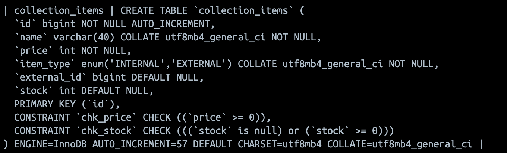
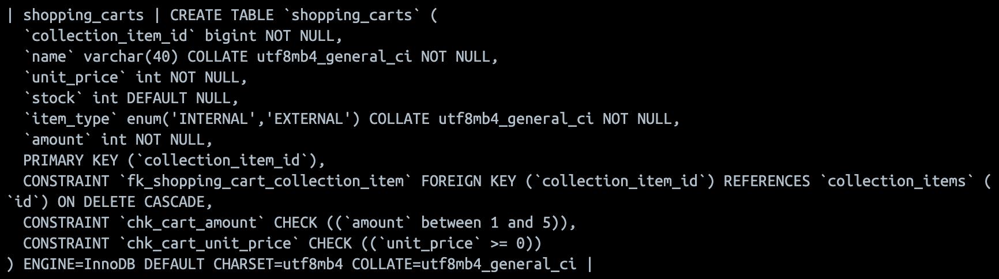
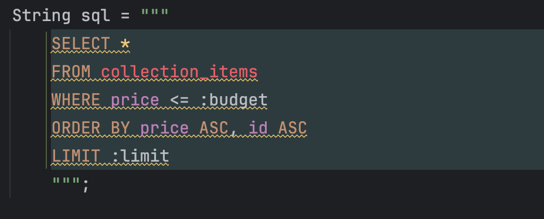

# Personal Project

## 테이블 구조

### collection_items 스키마


### shopping_carts 스키마


### 예산별 추천 아이템(예산 동률일 시 등록순서 보존 방법)


ORDER BY price ASC와 limit으로만 제한을 했을 경우에는
기존 등록 순서가 보장되지 않지만, id ASC를 넣어주어서
2차 정렬 기준을 정해주었습니다.

## 여러 쓰기

하나의 요청에서 두 곳 이상 쓰기를 하는 부분이 없으므로,
따로 트랜잭션이 필요하지 않다고 판단하였습니다.

## API 계약

### 공통 규칙

- 요청 본문이 있는 API는 `Content-Type: application/json`을 사용합니다.
- 모든 API의 정상 응답 상태는 현재 구현상 `200 OK`입니다. 상품 생성도 200을 반환하며, 장바구니 삭제 성공 시 응답 본문은 없습니다.
- 내부 상품 ID인 `id`와 외부 서비스 상품 ID는 서로 다릅니다. 장바구니의 `collectionItemId`에는 내부 상품 ID를 사용합니다.
- 내부 상품 가격, 장바구니 단가, 합계 및 할인 금액의 단위는 원입니다. 외부 상품 조회 응답의 `price`는 외부 서비스에서 받은 값을 그대로 반환합니다.
- 상품·장바구니 목록과 추천 결과는 JSON 배열이며, 결과가 없으면 `[]`를 반환합니다.

### API 목록

| 메서드 | 경로 | 기능 | 주요 오류 상태 |
| --- | --- | --- | --- |
| POST | `/item` | 내부 상품 등록 | 400 |
| GET | `/item` | 등록된 전체 상품 조회 | — |
| GET | `/item/{id}` | 내부 ID로 상품 단건 조회 | 404 |
| GET | `/item/recommendations?budget=100000` | 예산 이하 상품 최대 3개 추천 | 400 |
| POST | `/item/external/{id}` | 외부 상품 ID로 조회하여 내부 상품으로 등록 | 400, 404, 409, 502 |
| GET | `/external-item` | 외부 상품 목록 조회 | 400, 502 |
| GET | `/external-item/search?q=phone` | 외부 상품 검색 | 400, 502 |
| POST | `/shopping-cart` | 장바구니 상품 추가 | 400, 404, 409 |
| PATCH | `/shopping-cart` | 장바구니 상품 수량 변경 | 400, 404, 409 |
| GET | `/shopping-cart` | 장바구니 전체 조회 | — |
| DELETE | `/shopping-cart/{collectionItemId}` | 장바구니 상품 삭제 | 404 |
| GET / POST | `/shopping-cart/subtotal` | 쿠폰과 배송비를 반영한 합계 계산 | 400 |

### 1. 상품 등록·조회

#### 내부 상품 등록: `POST /item`

```json
{
  "name": "키보드",
  "price": 50000
}
```

| 필드 | 타입 | 필수 | 검증 규칙 |
| --- | --- | --- | --- |
| `name` | string | O | null 불가, 길이 1~40자 |
| `price` | integer | O | null 불가, 0 이상 |

이름의 앞뒤 공백을 제거한 후 1~40자 길이를 검증합니다. 공백만 있는 이름은 등록할 수 없습니다.

응답 예시:

```json
{
  "id": 1,
  "name": "키보드",
  "price": 50000,
  "stock": null
}
```

내부 상품의 재고는 `null`이며, 내부 상품을 장바구니에 담을 때는 재고를 검사하지 않습니다.

#### 전체·단건 조회

- `GET /item`: 위 상품 응답 형식의 배열을 반환합니다.
- `GET /item/{id}`: 위 상품 응답 형식의 객체를 반환합니다. 상품이 없으면 404입니다.

#### 예산별 추천: `GET /item/recommendations`

필수 쿼리 파라미터 `budget`은 0 이상의 정수입니다. 개별 가격이 예산 이하인 상품을 가격 오름차순으로 정렬하여 최대 3개 반환합니다. 여러 상품 가격의 합이 예산 이내가 되도록 조합하는 기능은 아닙니다. 재고 유무는 추천 조건에 포함되지 않습니다.

#### 외부 상품 등록: `POST /item/external/{id}`

요청 본문 없이 외부 상품 ID를 경로에 전달합니다. 성공 응답은 내부 상품 등록과 동일한 형식이며, 새 내부 ID가 부여됩니다.

- 외부 상품 ID는 양수여야 합니다.
- 외부 상품의 `title`을 내부 상품의 `name`으로 사용합니다.
- 외부 가격에 고정 환산 계수 `1,000`을 곱하고 소수점 이하를 반올림(`HALF_UP`)하여 정수 가격으로 저장합니다.
- 외부 상품의 재고를 함께 저장하고, 상품 이름·가격의 도메인 검증을 적용합니다.
- 같은 외부 상품 ID를 다시 등록하면 409를 반환합니다.
- 외부 상품 단건 조회가 404이면 404, 그 밖의 외부 통신 오류는 502를 반환합니다.

### 2. 외부 상품 목록·검색

| API | 파라미터 | 필수 | 기본값 | 검증 규칙 |
| --- | --- | --- | --- | --- |
| 목록·검색 공통 | `limit` | X | 10 | 1~20 |
| 목록·검색 공통 | `skip` | X | 0 | 0 이상 |
| 검색 | `q` | O | 없음 | 빈 문자열 및 공백만 있는 문자열 불가 |

호출 예시:

```text
GET /external-item?limit=10&skip=0
GET /external-item/search?q=phone&limit=10&skip=0
```

응답 구조 예시이며, 상품 및 페이지 값은 외부 서비스 응답에 따라 달라집니다.

```json
{
  "products": [
    {
      "id": 1,
      "title": "Example Product",
      "price": 9.99,
      "stock": 10
    }
  ],
  "total": 1,
  "skip": 0,
  "limit": 10
}
```

외부 조회만으로 내부 상품 목록에 등록되지는 않습니다. 장바구니에 담으려면 먼저 `POST /item/external/{id}`로 등록해야 합니다.

### 3. 장바구니

#### 상품 추가: `POST /shopping-cart`

```json
{
  "collectionItemId": 1,
  "amount": 2
}
```

| 필드 | 타입 | 필수 | 검증 규칙 |
| --- | --- | --- | --- |
| `collectionItemId` | integer (int64) | O | 내부 상품 목록에 존재하는 ID |
| `amount` | integer | O | 1~5 |

- 존재하지 않는 내부 상품 ID이면 404를 반환합니다.
- 이미 장바구니에 있는 상품을 다시 추가하면 기존 수량에 합산합니다. 합산 수량이 5개 또는 재고를 초과하면 409를 반환하며 기존 수량을 유지합니다.
- 서로 다른 상품을 최대 20개까지 담을 수 있으며, 한도를 초과하는 추가 요청은 409입니다.
- 수량 범위 위반 또는 외부 상품 재고 부족은 409입니다. 필수 필드 누락은 400입니다.
- 장바구니에 담거나 수량을 변경해도 상품 재고를 차감하거나 예약하지 않습니다.

응답 예시:

```json
{
  "collectionItemId": 1,
  "name": "키보드",
  "unitPrice": 50000,
  "stock": null,
  "amount": 2
}
```

#### 수량 변경: `PATCH /shopping-cart`

추가 API와 같은 요청·응답 형식을 사용합니다. `amount`는 기존 수량에 더할 값이 아니라 변경 후의 전체 수량입니다. 해당 상품이 장바구니에 없으면 404이며, 수량 범위와 외부 상품 재고를 다시 검사합니다.

#### 조회·삭제

- `GET /shopping-cart`: 장바구니 응답 객체의 배열을 반환합니다.
- `DELETE /shopping-cart/{collectionItemId}`: 내부 상품 ID에 해당하는 장바구니 항목을 삭제합니다. 해당 항목이 없으면 404입니다.

### 4. 합계 계산: `GET / POST /shopping-cart/subtotal`

API는 **JSON 본문**으로 쿠폰 코드를 받습니다. 브라우저 프론트는 GET 요청 본문을 지원하지 않는 `fetch`의 제약에 맞춰 POST를 사용하며, 기존 GET도 같은 요청·응답 계약을 유지합니다. 쿼리 파라미터로 전달하지 않습니다. 쿠폰을 사용하지 않는 경우에도 본문에 `{}` 또는 `{"couponCode": null}`을 전달합니다.

```bash
curl -X POST 'http://localhost:8080/shopping-cart/subtotal' \
  -H 'Content-Type: application/json' \
  -d '{"couponCode":"PERCENT10"}'
```

| `couponCode` | 적용 조건 | 할인 금액 |
| --- | --- | --- |
| 생략, `null` 또는 `NONE` | 제한 없음 | 0원 |
| `PERCENT10` | 상품 합계가 0원 초과 | 합계의 10%, 소수점 이하 버림, 최대 20,000원 |
| `FIXED15000` | 상품 합계가 100,000원 이상 | 15,000원 |

코드는 대소문자를 구분하며, 빈 문자열을 포함한 정의되지 않은 문자열은 400을 반환합니다. 쿠폰 사용 조건을 충족하지 못한 경우도 400입니다.

계산 순서는 다음과 같습니다.

1. `subtotal`: 장바구니의 `unitPrice × amount` 합계
2. `discount`: 선택한 쿠폰의 할인액
3. `discountedSubtotal`: `subtotal - discount`
4. `shipping`: 쿠폰 사용 여부와 관계없이 기본 5,000원. 할인 후 금액이 0원이거나 100,000원 이상이면 0원
5. `finalPrice`: `discountedSubtotal + shipping`

상품 합계 100,000원에 `PERCENT10`을 적용한 응답 예시:

```json
{
  "subtotal": 100000,
  "discount": 10000,
  "discountedSubtotal": 90000,
  "shipping": 5000,
  "finalPrice": 95000,
  "coupon": "PERCENT10"
}
```

쿠폰을 사용하지 않으면 응답의 `coupon`은 `null`입니다. 빈 장바구니에서 쿠폰 없이 계산하면 모든 금액은 0이며, 이 API는 계산 결과만 반환하고 주문 생성이나 결제를 수행하지 않습니다.

### 5. 오류 응답

`GlobalExceptionHandler`가 처리하는 예외는 다음 형식을 사용합니다.

```json
{
  "errors": [
    "장바구니 수량은 1~5입니다"
  ]
}
```

| 상태 | 발생 조건 | 처리 대상 |
| --- | --- | --- |
| 400 Bad Request | DTO·도메인·쿼리 검증 실패, 잘못된 외부 ID, 쿠폰 오류 | 검증 예외, `CommonBadRequestException` |
| 404 Not Found | 내부 상품·장바구니 항목·외부 단건 상품 없음 | `CommonNotFoundException` |
| 409 Conflict | 중복 등록, 장바구니 한도·수량 위반, 재고 부족 | `CommonConflictException` |
| 502 Bad Gateway | 외부 서버 오류, 통신 실패, 외부 응답 본문 또는 목록의 `products`가 null | `CommonBadGateWayException` |

DTO·도메인 필드 검증 메시지는 `"필드명, 메시지"` 형식이며, 쿼리 검증은 메시지만 반환합니다. 잘못된 JSON, 타입 변환 실패, 필수 쿼리 누락 등 전용 예외 처리기가 없는 오류는 Spring 기본 오류 처리에 따르므로 위 응답 형식을 보장하지 않습니다.

## 계층 구조와 클래스 책임

기본 패키지는 `com.example.personal_project`입니다.

```text
presentation    HTTP 요청 수신, 입력 검증, 응답 및 오류 표현
application     유스케이스 실행, 저장소 호출, 처리 순서 조정
domain          상품·장바구니 규칙, 쿠폰 전략, 저장소 인터페이스
infrastructure  메모리 저장소 구현, 외부 HTTP 연동
```

### Presentation

| 클래스 | 책임 |
| --- | --- |
| `CollectionItemController` | 상품 등록·조회·추천 요청을 서비스에 전달합니다. 외부 등록 요청은 `DummyJsonClient`로 외부 상품을 조회한 뒤 서비스에 전달합니다. |
| `ExternalItemController` | 외부 목록·검색의 쿼리 파라미터를 검증하고 `DummyJsonClient`를 호출합니다. |
| `ShoppingCartController` | 장바구니 추가·수정·조회·삭제 요청을 서비스에 전달하고 요청 DTO를 검증합니다. |
| `SubtotalController` | 요청 본문의 쿠폰 코드를 받아 합계 계산 서비스에 전달합니다. |
| `GlobalExceptionHandler` | 검증 예외와 도메인 예외를 HTTP 상태 및 `ErrorMessage`로 변환합니다. |
| `CollectionItemRequest` / `CollectionItemResponse` | 상품 생성 입력과 상품 조회 결과를 표현합니다. 응답의 `form` 메서드가 엔티티를 DTO로 변환합니다. |
| `ShoppingCartRequest` / `ShoppingCartResponse` | 장바구니 상품 ID·수량 입력과 장바구니 항목 결과를 표현합니다. |
| `SubtotalRequest` / `SubtotalResponse` | 쿠폰 코드 입력과 상품 합계·할인·배송비·최종 금액을 표현합니다. |
| `DummyJsonProduct` / `DummyJsonProductResponse` | 외부 상품과 목록·검색 페이지 응답을 매핑합니다. |
| `ErrorMessage` | 오류 메시지를 `errors` 문자열 배열로 표현합니다. |

### Application

| 클래스 | 책임 |
| --- | --- |
| `CollectionItemService` | 상품 객체 생성, 도메인 검증, 저장, 응답 변환을 조정합니다. 외부 상품 중복 등록을 방지하고 예산별 추천을 수행합니다. |
| `ShoppingCartService` | 상품 조회와 장바구니 중복·존재 여부 확인 후 추가·수정·조회·삭제를 수행합니다. 수량·재고 규칙은 `ShoppingCart`에 위임합니다. |
| `SubtotalService` | 쿠폰 코드 해석, 장바구니 합산, 쿠폰 전략 호출, 배송비 및 최종 금액 계산을 수행합니다. |
| `ValidationService` | `@Validated`와 메서드 인자의 `@Valid`를 통해 전달받은 도메인 객체의 Bean Validation을 실행합니다. 메서드 본문은 비어 있고 Spring의 메서드 검증 기능을 사용합니다. |

### Domain

| 클래스·인터페이스 | 책임 |
| --- | --- |
| `CollectionItem` | 내부·외부 상품의 상태와 생성 규칙을 보유합니다. 이름·가격 검증 제약, 외부 가격 환산, 내부 상품 여부 판단을 담당합니다. |
| `ItemType` | 내부(`INTERNAL`)·외부(`EXTERNAL`) 상품을 구분합니다. `CollectionItem.java`에 선언된 패키지 전용 enum입니다. |
| `ShoppingCart` | 장바구니 항목의 상품 정보와 수량을 보유합니다. 생성 시 수량 1~5 및 외부 상품 재고를 검사하고, 상품 ID를 기준으로 동등성을 판단합니다. 최대 항목 수 상수도 정의합니다. |
| `CollectionItemRepository` | 상품 저장·전체 조회·단건 조회·외부 ID 중복 확인 계약을 정의합니다. |
| `ShoppingCartRepository` | 장바구니 저장·존재 확인·단건 및 전체 조회·수정·삭제 계약을 정의합니다. |
| `CouponCalc` | 상품 합계를 받아 할인액을 반환하는 전략 인터페이스입니다. |
| `CouponCode` | 쿠폰 종류와 계산 전략을 연결하고, 배송비·무료 배송 기준 상수를 정의합니다. |
| `NoneCalc` | 쿠폰 미사용 할인액 0원을 반환합니다. |
| `Percent10Calc` | 양수 합계에 10% 할인과 최대 할인액 20,000원을 적용합니다. |
| `Fixed15000Calc` | 합계 100,000원 이상 조건을 검증하고 15,000원 할인을 적용합니다. |
| `CommonBadRequestException` / `CommonNotFoundException` / `CommonConflictException` / `CommonBadGateWayException` | 잘못된 요청, 대상 없음, 상태 충돌, 외부 연동 실패를 구분하여 전달합니다. HTTP 상태 변환은 전역 예외 처리기가 담당합니다. |

### Infrastructure 및 진입점

| 클래스 | 책임 |
| --- | --- |
| `ListCollectionItemRepository` | 상품 저장소를 메모리 목록으로 구현합니다. `AtomicLong`으로 1부터 내부 ID를 발급하고 상품 및 외부 ID를 조회합니다. |
| `ListShoppingCartRepository` | 장바구니 저장소를 메모리 목록으로 구현합니다. 추가 시 최대 20개 제한을 검사하고, 상품 ID를 기준으로 조회·교체·삭제합니다. |
| `DummyJsonClient` | `RestClient`로 외부 상품 단건·목록·검색 API를 호출합니다. 연결 제한 시간 3초, 읽기 제한 시간 5초를 설정하고 외부 오류를 애플리케이션 예외로 변환합니다. |
| `PersonalProjectApplication` | Spring Boot 애플리케이션을 시작합니다. |

### 주요 처리 흐름

```text
내부 상품 등록
CollectionItemController → CollectionItemService
  → CollectionItem 생성 → ValidationService 검증
  → CollectionItemRepository 저장 → CollectionItemResponse 변환

외부 상품 등록
CollectionItemController → DummyJsonClient 외부 단건 조회
  → CollectionItemService 중복 확인 → CollectionItem 생성·가격 환산
  → ValidationService 검증 → CollectionItemRepository 저장

장바구니 추가
ShoppingCartController → ShoppingCartService
  → CollectionItemRepository 상품 조회 → 장바구니 중복 확인
  → ShoppingCart 생성·수량 및 재고 검사
  → ShoppingCartRepository 저장·항목 수 제한 검사

합계 계산
SubtotalController → SubtotalService → ShoppingCartRepository 전체 조회
  → 상품 합산 → CouponCode / CouponCalc 할인 계산
  → 배송비·최종 금액 계산 → SubtotalResponse 반환
```

현재 의존 관계에서는 컨트롤러가 외부 클라이언트를 직접 호출하며, 서비스와 도메인의 생성 메서드가 presentation DTO를 사용합니다. 위 계층 설명은 실제 코드의 역할을 정리한 것으로, 계층 간 의존성을 엄격하게 분리한 구조는 아닙니다.

## 테스트

```bash
./gradlew test
```

| 테스트 클래스 | 검증 범위 |
| --- | --- |
| `CollectionItemIntegrationTest` | 상품 등록·조회·추천, 필수 입력과 이름·가격·예산 경계값, 앞뒤 공백 제거·공백 이름 거부 |
| `ShoppingCartIntegrationTest` | 추가·조회·수량 교체·삭제, 중복·필수 입력·수량·최대 20개 제한, 실패 시 기존 상태 유지 |
| `SubtotalIntegrationTest` | 상품 합산, 쿠폰 조건·할인 한도·소수점 버림, 할인 후 무료 배송 경계값, 잘못된 쿠폰, 큰 금액 계산 |
| `ExternalItemIntegrationTest` | 외부 목록·검색 파라미터, 상품 등록·가격 환산·중복·재고 검증, 외부 오류의 HTTP 상태 변환 |
| `DummyJsonClientTest` | 외부 응답 본문·목록 null 검사, 빈 목록 허용, 통신 예외 변환 |

API 통합 테스트는 MockMvc와 실제 서비스·메모리 저장소를 사용합니다. 외부 호출은 `MockRestServiceServer`로 재현하므로 인터넷 연결 없이 실행할 수 있습니다. 각 통합 테스트는 Spring 컨텍스트를 초기화하여 저장된 데이터가 다음 테스트에 영향을 주지 않도록 합니다.

## 단계별 완료범위

- 최저 결제금액 쿠폰 추천제외 모두

## 남은 과제

- 최저 결제금액 쿠폰 추천
