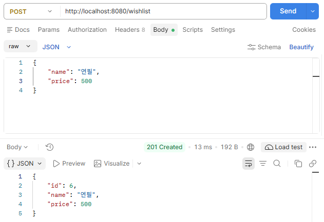
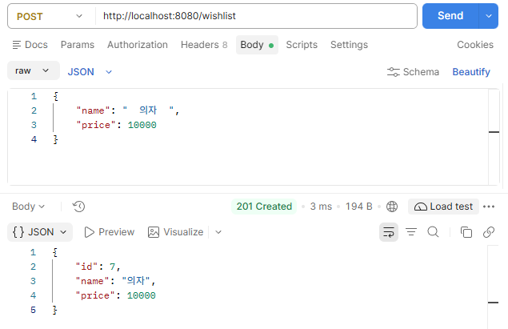
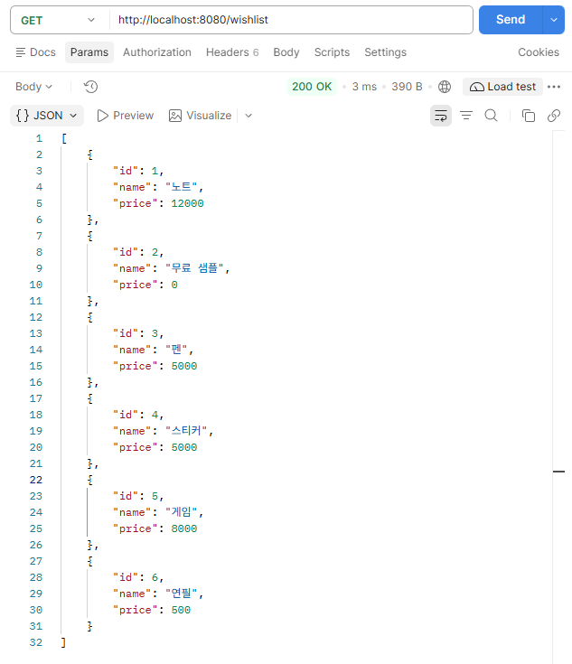
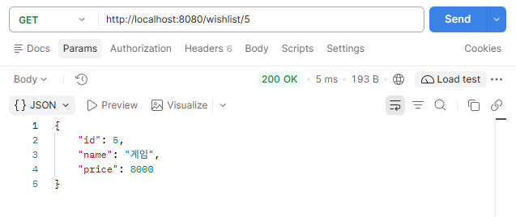
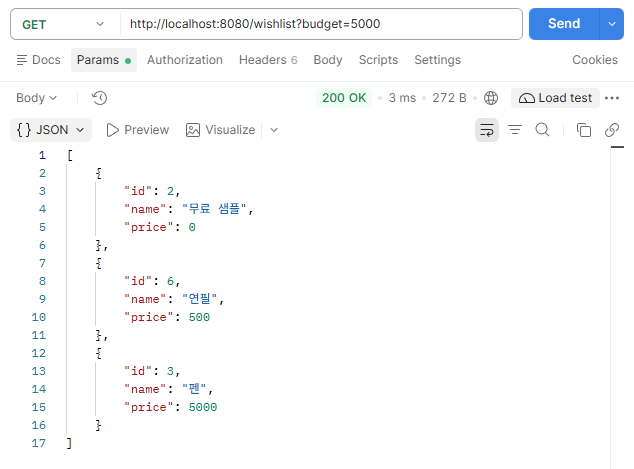
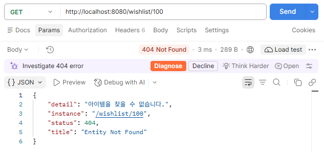
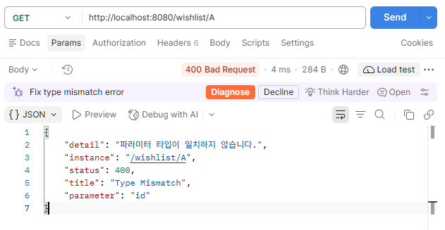
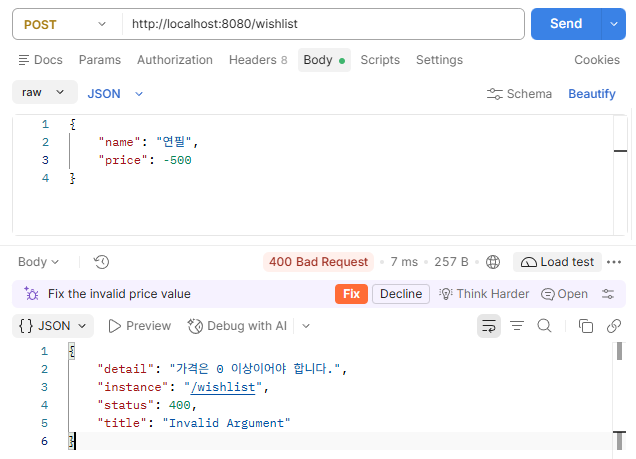
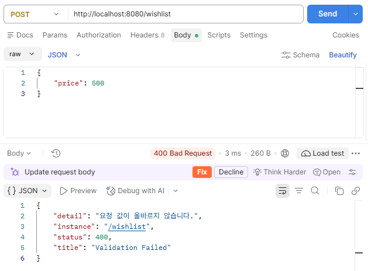

# 취미 위시리스트 (Hobby Wishlist)

사고 싶은 취미 용품을 등록하고, **예산 안에서 살 수 있는 후보를 추천**받는 Spring Boot 개인 프로젝트입니다.
REST API와 간단한 웹 화면을 함께 제공합니다.

## 기술 스택

- Java 21
- Spring Boot 4.1.2 (Spring Web MVC, Validation)
- Gradle
- JUnit 5 / Spring Boot Test

## 실행 방법

```bash
# 서버 실행
./gradlew bootRun

# 테스트 실행
./gradlew test
```

서버가 실행되면 브라우저에서 <http://localhost:8080> 으로 접속합니다.

## 실행 화면


- **아이템 등록**: 이름과 가격(0 이상의 정수)을 입력해 등록합니다.
- **예산별 추천**: 예산 이하의 아이템을 가격이 낮은 순으로 최대 3개 보여줍니다.
- **전체 목록**: 등록된 모든 아이템을 표로 확인합니다.

## API 명세

| Method | Path | 설명 | 성공 응답 |
|---|---|---|---|
| POST | `/wishlist` | 아이템 등록 | 201 Created |
| GET | `/wishlist` | 전체 목록 조회 | 200 OK |
| GET | `/wishlist/{id}` | 단건 조회 | 200 OK |
| GET | `/wishlist?budget={n}` | 예산 이하 아이템 추천 (가격 낮은 순, 최대 3개) | 200 OK |

요청 본문(JSON):

```json
{ "name": "연필", "price": 500 }
```

### 아이템 등록 `POST /wishlist`



이름 앞뒤 공백은 제거되어 저장됩니다.



### 전체 목록 조회 `GET /wishlist`



### 단건 조회 `GET /wishlist/{id}`



### 예산별 추천 `GET /wishlist?budget=5000`



## 예외 처리

모든 오류는 `GlobalExceptionHandler`에서 `ProblemDetail`(RFC 7807) 형식으로 응답합니다.

| 상황 | 상태 코드 | title | 스크린샷 |
|---|---|---|---|
| 존재하지 않는 id 조회 | 404 | Entity Not Found | [보기](docs/images/06-error-not-found-404.png) |
| 경로/쿼리 파라미터 타입 불일치 | 400 | Type Mismatch | [보기](docs/images/07-error-type-mismatch-400.png) |
| 도메인 규칙 위반 (음수 가격 등) | 400 | Invalid Argument | [보기](docs/images/08-error-invalid-price-400.png) |
| 요청 본문 검증 실패 (필수 값 누락) | 400 | Validation Failed | [보기](docs/images/09-error-validation-failed-400.png) |

**404 - 존재하지 않는 아이템**



**400 - 파라미터 타입 불일치** (`GET /wishlist/A`)



**400 - 잘못된 가격** (`price: -500`)



**400 - 요청 값 검증 실패** (`name` 누락)



## 프로젝트 구조

계층형 구조로 나누고, 의존성은 `presentation → application → domain ← infrastructure` 방향입니다.

```
src/main/java/com/example/hobby_wishlist
├── presentation     # Controller, DTO, GlobalExceptionHandler
├── application      # WishlistService
├── domain           # WishlistItem, WishlistRepository, EntityNotFoundException
└── infrastructure   # InMemoryWishListRepository
```

- `WishlistItem`이 이름(공백 불가)과 가격(0 이상) 규칙을 스스로 검증합니다.
- 저장소는 `WishlistRepository` 인터페이스 뒤에 인메모리 구현을 두어, 추후 DB로 교체할 수 있습니다.

## 테스트

도메인, 저장소, 서비스는 단위 테스트로, API는 통합 테스트로 검증합니다.


| 테스트 클래스 | 대상 | 테스트 수 |
|---|---|---|
| `WishlistItemTests` | 도메인 검증 규칙 | 3 |
| `InMemoryWishListRepositoryUnitTests` | 인메모리 저장소 | 2 |
| `WishlistServiceUnitTests` | 서비스 로직 | 7 |
| `HobbyWishlistApplicationTests` | API 통합 테스트 | 2 |

총 14개 테스트, 실패 0건.

## 한계 및 향후 계획

- 인메모리 저장소라 서버를 재시작하면 데이터가 초기화됩니다.
- 수정·삭제 API는 아직 없습니다.
