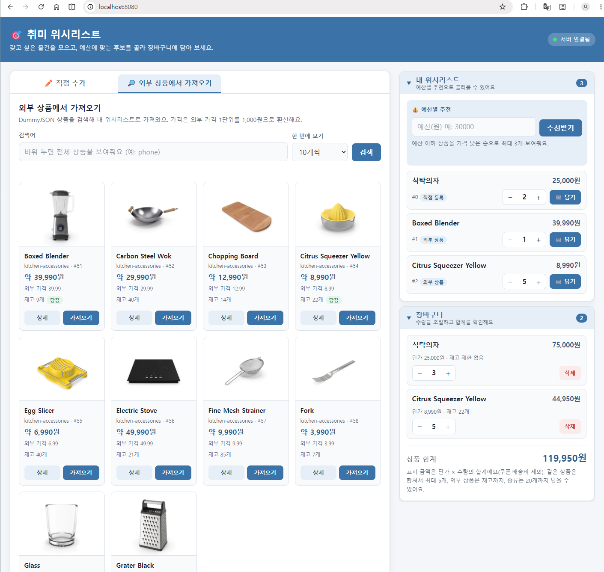
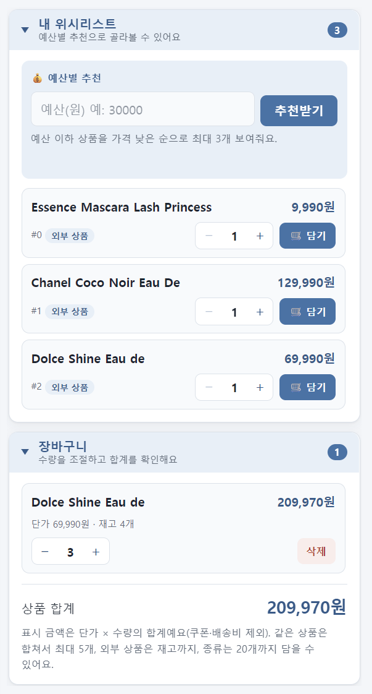
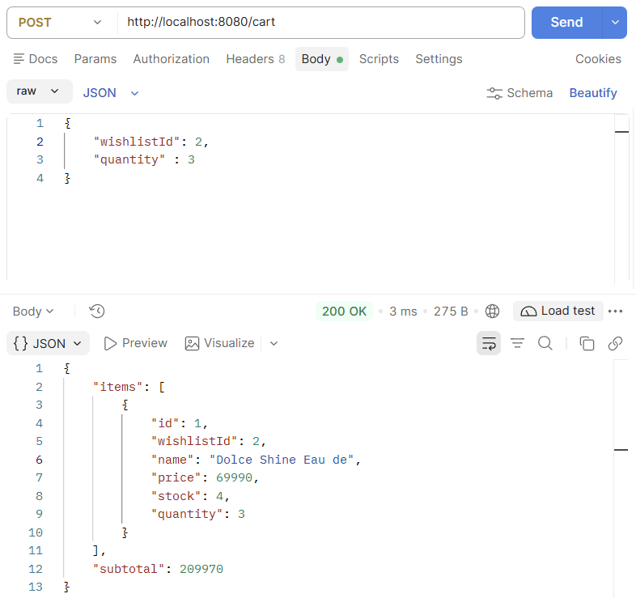
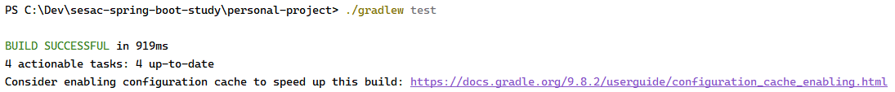
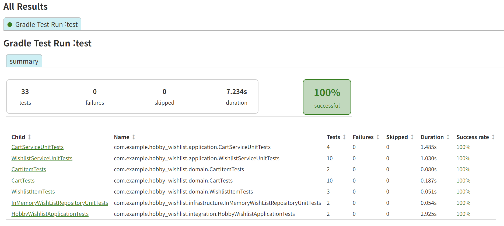

# 취미 위시리스트 (Hobby Wishlist)

사고 싶은 취미 용품을 위시리스트에 모으고, **예산 안에서 살 수 있는 후보를 추천**받고, 마음에 드는 상품은 **장바구니**에 담아 합계를 확인하는 Spring Boot 개인 프로젝트입니다.
직접 입력한 상품뿐 아니라 외부 상품([DummyJSON](https://dummyjson.com))을 검색해 위시리스트로 가져올 수 있고, REST API와 간단한 웹 화면을 함께 제공합니다.

## 주요 기능

- **위시리스트**: 상품 등록·조회, 예산 이하 상품 추천(가격 낮은 순 최대 3개)
- **외부 상품 연동**: DummyJSON 상품을 검색하고 위시리스트로 가져오기 (재고 정보 포함)
- **장바구니**: 위시리스트 상품 담기, 수량 변경, 삭제, 합계 계산
- **DB 저장**: 위시리스트와 장바구니를 MySQL에 저장하므로 서버를 재시작해도 데이터가 유지됩니다.

## 기술 스택

- Java 21
- Spring Boot 4.1.2 (Spring Web MVC, Validation, `RestClient`, Spring JDBC)
- MySQL 8.0.16+ (`NamedParameterJdbcTemplate`)
- Gradle
- JUnit 5 / Spring Boot Test

## 실행 방법

먼저 MySQL을 준비합니다. 기본 설정은 `src/main/resources/application.yaml`의 `spring.datasource`이며, `localhost:3307`의 `hobby_wishlist` 데이터베이스에 접속합니다. 데이터베이스를 만들고 [데이터베이스](#데이터베이스) 절의 테이블 생성 SQL을 한 번 실행한 뒤 서버를 실행하세요. 접속 정보가 다르면 `application.yaml`을 수정합니다.

```bash
# 서버 실행
./gradlew bootRun

# 테스트 실행
./gradlew test
```

서버가 실행되면 브라우저에서 <http://localhost:8080> 으로 접속합니다.

## 실행 화면





- **위시리스트 추가**: 이름과 가격(0 이상의 정수)을 직접 입력하거나, 외부 상품을 검색해 가져옵니다.
- **예산별 추천**: 예산 이하의 아이템을 가격이 낮은 순으로 최대 3개 보여줍니다.
- **전체 목록**: 등록된 모든 아이템을 확인하고 장바구니에 담습니다.
- **장바구니**: 수량을 조절하고 항목을 삭제하며, 서버가 계산한 합계를 확인합니다.

## API 명세

| Method | Path | 설명 | 성공 응답 |
|---|---|---|---|
| POST | `/wishlist` | 아이템 등록 | 201 Created |
| GET | `/wishlist` | 전체 목록 조회 | 200 OK |
| GET | `/wishlist/{id}` | 단건 조회 | 200 OK |
| GET | `/wishlist?budget={n}` | 예산 이하 아이템 추천 (가격 낮은 순, 최대 3개) | 200 OK |
| DELETE | `/wishlist/{id}` | 아이템 삭제 (장바구니에 담긴 아이템은 409) | 204 No Content |
| POST | `/wishlist/import` | 외부 상품을 위시리스트에 추가 (이미 있으면 409) | 201 Created |
| GET | `/products?q={검색어}&limit={1~20}&skip={n}` | 외부 상품 목록/검색 (`q` 생략 시 전체) | 200 OK |
| GET | `/products/{id}` | 외부 상품 단건 조회 | 200 OK |
| POST | `/cart` | 위시리스트 아이템을 장바구니에 담기 (같은 상품이면 수량 합산) | 200 OK |
| GET | `/cart` | 장바구니 조회 | 200 OK |
| PATCH | `/cart/{cartItemId}` | 장바구니 수량 변경 | 200 OK |
| DELETE | `/cart/{cartItemId}` | 장바구니 항목 삭제 | 204 No Content |

요청/응답 예시와 스크린샷은 [위시리스트](docs/WISHLIST_EXAMPLES.md), [장바구니·외부 상품](docs/CART_EXAMPLES.md) 문서에 정리했습니다.

### 장바구니 `/cart`

요청 본문(JSON):

```json
{ "wishlistId": 1, "quantity": 2 }
```

수량 변경(`PATCH`)은 `{ "quantity": 3 }`을 보냅니다.

담기·수량 변경·조회는 모두 **장바구니 전체와 합계**를 응답합니다. 삭제(`DELETE`)만 본문 없이 204를 돌려줍니다.

```json
{
  "items": [
    { "id": 1, "wishlistId": 1, "name": "연필", "price": 500, "stock": null, "quantity": 2 }
  ],
  "subtotal": 1000
}
```

`stock`이 `null`이면 재고 제한이 없는 직접 등록 상품입니다.



장바구니 규칙:

- 같은 상품을 다시 담으면 새 항목을 만들지 않고 수량을 더합니다.
- 한 상품은 최대 5개까지(담은 수량 합산 기준) 담을 수 있습니다.
- 재고가 있는 상품은 재고를 초과해 담을 수 없습니다.
- 서로 다른 상품은 최대 20개까지 담을 수 있습니다.

## 데이터베이스

저장소는 Spring JDBC(`NamedParameterJdbcTemplate`)로 구현했고, SQL은 `infrastructure/persistence/database`의 Repository에 둡니다. 입력값은 SQL에 이어 붙이지 않고 이름 있는 파라미터로 바인딩합니다.

### 테이블

```sql
CREATE TABLE wishlist_items (
    id          BIGINT       NOT NULL AUTO_INCREMENT,
    source_type VARCHAR(20)  NOT NULL,
    external_id BIGINT       NULL,
    name        VARCHAR(255) NOT NULL,
    price       INT          NOT NULL,
    stock       INT          NULL,
    PRIMARY KEY (id),
    CONSTRAINT uq_wishlist_external UNIQUE (source_type, external_id)
);

CREATE TABLE cart_items (
    id BIGINT NOT NULL AUTO_INCREMENT,
    wishlist_item_id BIGINT NOT NULL,
    name        VARCHAR(255) NOT NULL,
    price       INT          NOT NULL,
    stock       INT          NULL,
    quantity INT NOT NULL,
    PRIMARY KEY(id),
    CONSTRAINT uq_cart_wishlist UNIQUE (wishlist_item_id),
    CONSTRAINT fk_cart_wishlist FOREIGN KEY (wishlist_item_id)
        REFERENCES wishlist_items (id) ON DELETE RESTRICT
);
```

### 설계 결정

- **id**: DB가 발급한 키(`AUTO_INCREMENT`)를 사용하고, 추가할 때 `GeneratedKeyHolder`로 읽어 객체에 반영합니다. 조회할 때는 저장된 id를 그대로 복원합니다.
- **NULL**: 직접 등록 상품은 `external_id`·`stock`이 NULL입니다. 필수 값(`name`, `price`)은 `NOT NULL`이며, NULL을 0으로 바꿔 저장하지 않습니다. 가격 0은 정상 값입니다.
- **외부 상품 중복**: `(source_type, external_id)`에 `UNIQUE`를 걸어 DB가 중복을 막고, 충돌하면 409로 변환합니다. 직접 등록 상품의 이름 중복은 허용하므로 이름에는 `UNIQUE`를 걸지 않았습니다. 외부 상품의 이름·가격은 가져온 시점의 값을 그대로 저장하고 자동으로 갱신하지 않습니다.
- **장바구니 복사본**: 장바구니는 담을 때의 이름·단가·재고를 따로 저장하고, 원본은 `wishlist_item_id`로 참조합니다.
- **삭제 정책(FK)**: `cart_items.wishlist_item_id`는 `wishlist_items.id`를 `ON DELETE RESTRICT`로 참조합니다. 장바구니에 담긴 위시리스트 항목을 삭제하면 DB가 거부하고 API는 409를 응답합니다. 먼저 장바구니에서 빼야 삭제할 수 있습니다. 장바구니를 함께 지우지 않는 이유는 사용자가 담아 둔 항목이 의도하지 않게 사라지는 것을 막기 위해서입니다. 웹 화면도 같은 규칙으로 삭제 버튼을 잠그고 "장바구니 담김"을 표시합니다.
- **목록 순서**: 목록 SQL은 `ORDER BY`를 명시합니다. 추천은 가격이 낮은 순이며 가격이 같으면 등록 순(`id`)입니다.
- **트랜잭션**: 한 요청에서 여러 번 쓰는 `DatabaseCartRepository.saveChanges`(삭제 + 수량 갱신 + 추가)는 `@Transactional`로 묶어, 중간에 실패해도 일부만 반영되지 않습니다. 위시리스트 삭제는 SQL 한 문장이라 별도 트랜잭션이 필요 없습니다. 검증 실패(400)는 저장 전에 처리하므로 DB를 바꾸지 않습니다.
- **재시작**: 앱은 시작할 때 테이블을 `DROP`/`TRUNCATE`하거나 초기 데이터로 덮어쓰지 않습니다. 같은 DB에 다시 접속하면 같은 id·값이 조회됩니다.

## 예외 처리

모든 오류는 `GlobalExceptionHandler`에서 `ProblemDetail`(RFC 7807) 형식으로 응답합니다.

| 상황 | 상태 코드 | title | 스크린샷 |
|---|---|---|---|
| 존재하지 않는 id 조회 (위시리스트) | 404 | Item Not Found | [보기](docs/images/06-error-not-found-404.png) |
| 존재하지 않는 id 조회 (장바구니) | 404 | Item Not Found | [보기](docs/images/15-error-cart-item-not-found-404.png) |
| 중복 추가, 장바구니 규칙 위반 (수량/재고/개수 초과), 장바구니에 담긴 위시리스트 아이템 삭제 | 409 | Conflict | [보기](docs/images/16-error-cart-stock-exceeded-409.png) |
| 경로/쿼리 파라미터 타입 불일치 | 400 | Type Mismatch | [보기](docs/images/07-error-type-mismatch-400.png) |
| 도메인 규칙 위반 (음수 가격 등) | 400 | Invalid Argument | [보기](docs/images/08-error-invalid-price-400.png) |
| 요청 본문 검증 실패 (필수 값 누락) | 400 | Validation Failed | [보기](docs/images/09-error-validation-failed-400.png) |

오류 응답 스크린샷은 [위시리스트](docs/WISHLIST_EXAMPLES.md#오류-응답), [장바구니](docs/CART_EXAMPLES.md#오류-응답) 문서에서 볼 수 있습니다.

## 프로젝트 구조

계층형 구조로 나누고, 의존성은 `presentation → application → domain ← infrastructure` 방향입니다.

```
src/main/java/com/example/hobby_wishlist
├── presentation     # Controller, GlobalExceptionHandler
├── application      # WishlistService, CartService, ExternalProductService
├── dto              # wishlist / cart(CartResponse 등) / externalproduct
├── domain           # 기능별 패키지: wishlist, cart, externalproduct
└── infrastructure   # persistence(database: JDBC 저장소, inmemory: 테스트용), client(DummyJSON 연동)
```

- `WishlistItem`이 이름(공백 불가)과 가격(0 이상) 규칙을 스스로 검증합니다.
- `Cart`와 `CartItem`이 장바구니 규칙(수량, 재고, 최대 개수)을 스스로 검증하고, 소계·합계도 계산합니다.
- 저장소는 `WishlistRepository`, `CartRepository` 인터페이스 뒤에 두고, 실행 시에는 `@Primary`인 JDBC 구현(`DatabaseWishlistRepository`, `DatabaseCartRepository`)이 사용됩니다. Service·Controller·DTO는 저장소 구현을 알지 못하므로 HTTP 계약은 그대로입니다.
- 외부 상품은 `ExternalProductProvider` 인터페이스 뒤에서 DummyJSON 클라이언트가 조회합니다. (외부 API 호출이 필요하므로 인터넷 연결이 필요합니다.)

## 테스트

도메인, 저장소, 서비스는 단위 테스트로, API는 통합 테스트로 검증합니다. 테스트 패키지는 `src/main`의 계층 구조를 따릅니다.





| 테스트 클래스 | 대상 | 테스트 수 |
|---|---|---|
| `domain.WishlistItemTests` | 위시리스트 도메인 검증 규칙 | 3 |
| `domain.CartItemTests` | 장바구니 항목 수량 규칙, 소계 | 2 |
| `domain.CartTests` | 장바구니 담기·변경·삭제 규칙, 합계 | 10 |
| `infrastructure.InMemoryWishListRepositoryUnitTests` | 인메모리 저장소 | 2 |
| `application.WishlistServiceUnitTests` | 위시리스트 서비스 로직 | 10 |
| `application.CartServiceUnitTests` | 장바구니 서비스 로직 | 4 |
| `integration.HobbyWishlistApplicationTests` | API 통합 테스트 | 2 |

총 33개 테스트, 실패 0건.

## 한계 및 향후 계획

- 위시리스트의 수정 API는 아직 없습니다. (삭제는 `DELETE /wishlist/{id}`)
- 위 테스트는 인메모리 저장소 기준입니다. JDBC Repository를 별도 테스트 DB로 검증하는 통합 테스트는 아직 없습니다.
- 테이블 생성 SQL은 이 문서로 제공하며, 앱 시작 시 자동으로 실행되지 않습니다. 마이그레이션 도구는 사용하지 않았습니다.
- 장바구니는 사용자 구분 없이 하나만 존재합니다.
