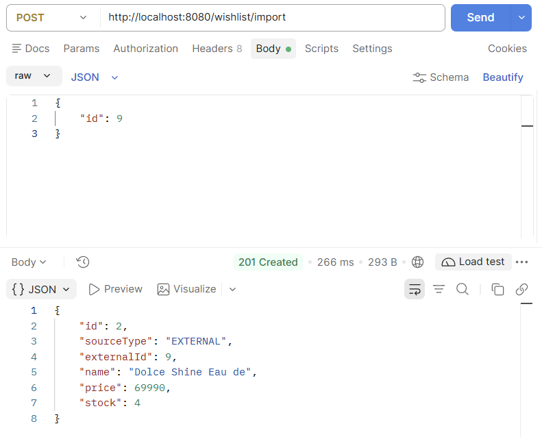
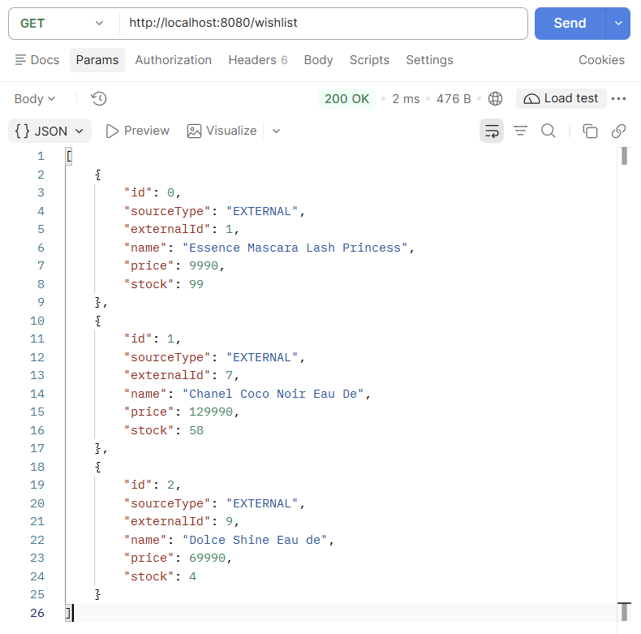
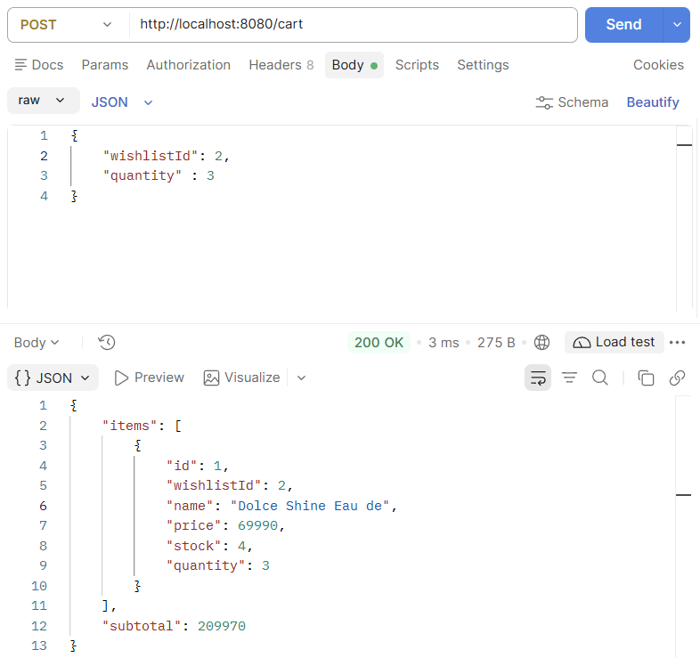
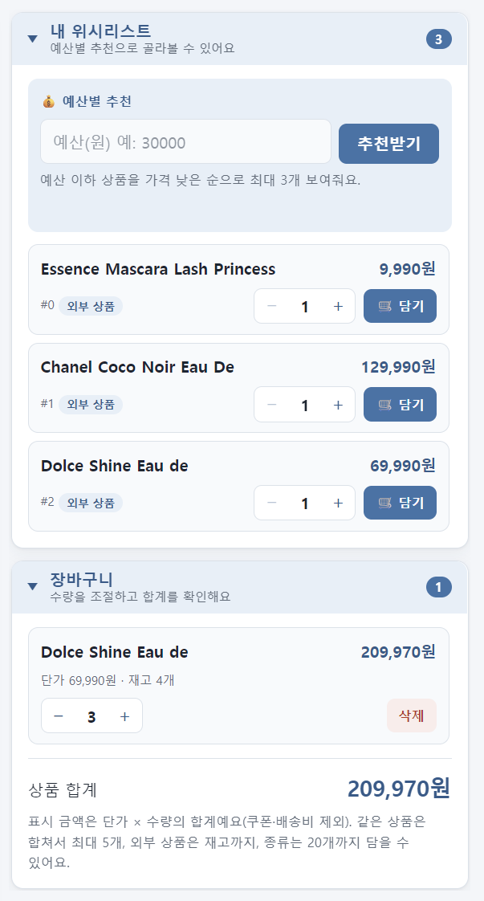
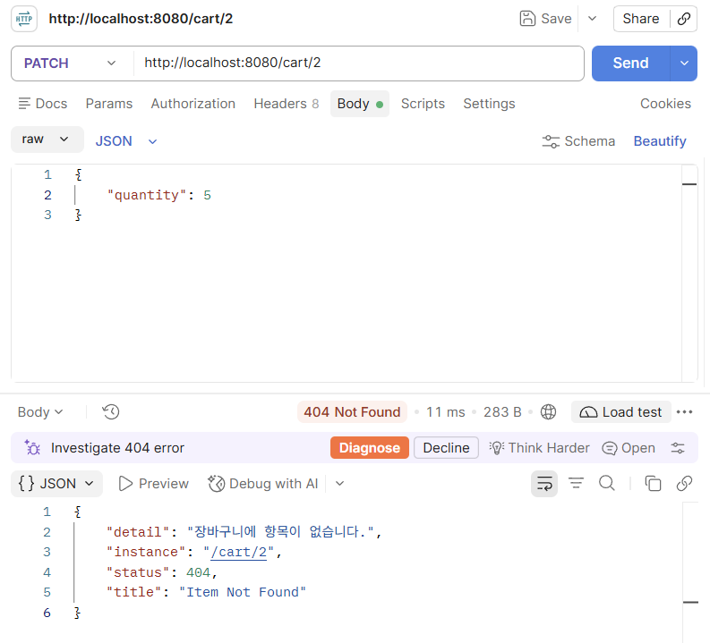
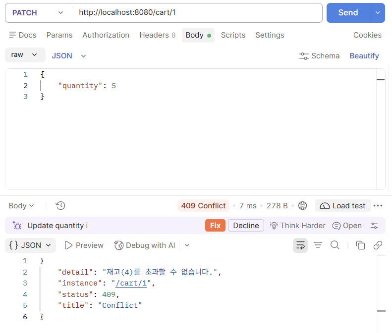

# API 예시 (장바구니)

장바구니 API의 요청/응답 예시와 실행 화면입니다. API 요약은 [README](../README.md)를 참고하세요.

담기·수량 변경·조회는 장바구니 전체(`items`)와 합계(`subtotal`)를 응답합니다.

## 정상 응답

### 외부 상품 가져오기 `POST /wishlist/import`

외부 상품(DummyJSON) id를 보내면 재고(`stock`)까지 포함해 위시리스트에 추가됩니다.

가져온 상품은 `sourceType`이 `EXTERNAL`로 표시됩니다.

### 장바구니 담기 `POST /cart`

위시리스트 상품(`wishlistId: 2`)을 3개 담으면 `단가 × 수량`으로 계산한 `subtotal`이 함께 내려옵니다.

### 웹 화면

위시리스트에서 담은 상품이 장바구니에 표시되고, 수량 조절과 삭제, 상품 합계를 확인할 수 있습니다.

## 오류 응답

**404 - 장바구니에 없는 항목** (`PATCH /cart/2`)

**409 - 재고 초과** (재고 4개인 상품을 `quantity: 5`로 변경)

