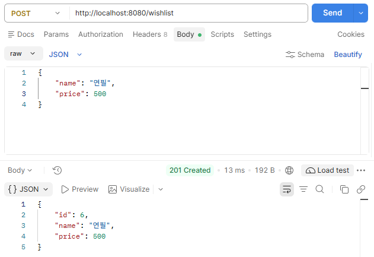
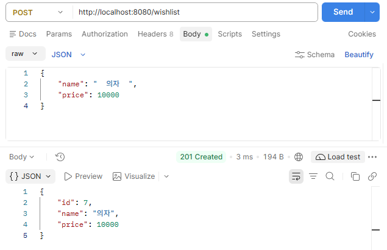
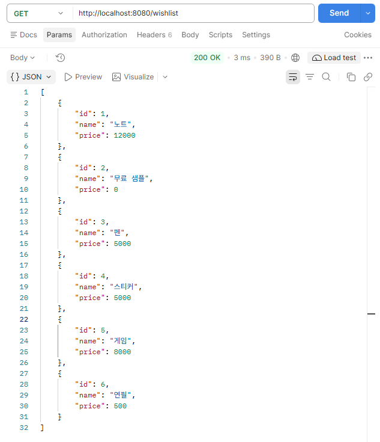
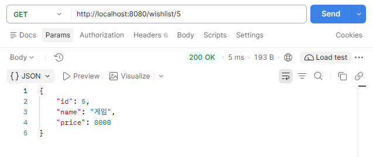
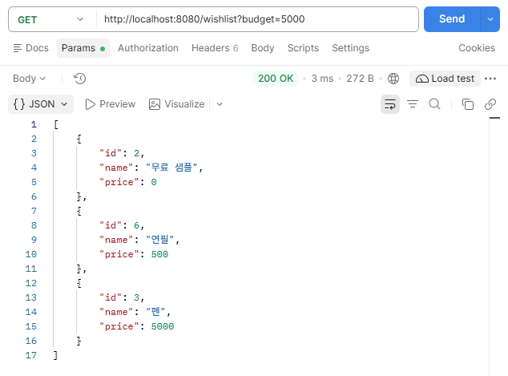
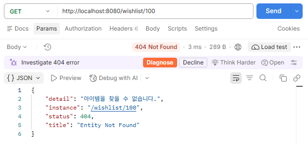
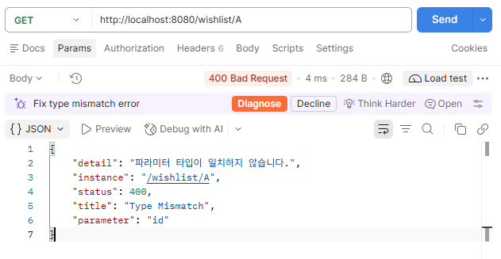
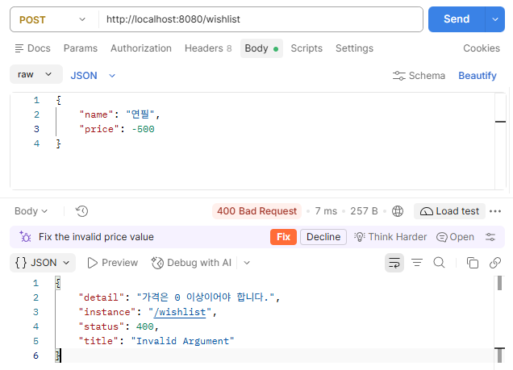
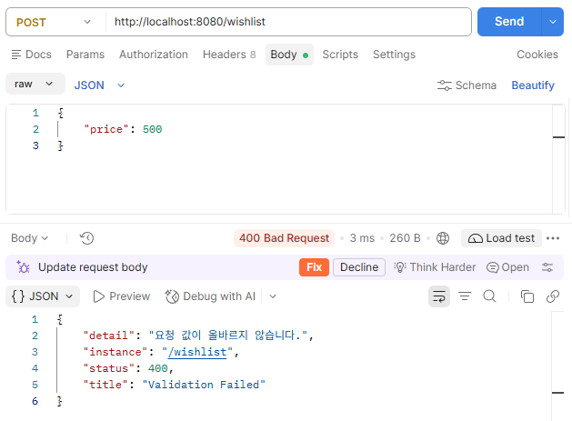

# API 예시 (위시리스트)

위시리스트 API의 요청/응답 예시와 실행 화면입니다. API 요약은 [README](../README.md)를 참고하세요.

요청 본문(JSON):

```json
{ "name": "연필", "price": 500 }
```

## 정상 응답

### 아이템 등록 `POST /wishlist`



이름 앞뒤 공백은 제거되어 저장됩니다.



### 전체 목록 조회 `GET /wishlist`



### 단건 조회 `GET /wishlist/{id}`



### 예산별 추천 `GET /wishlist?budget=5000`



## 오류 응답

**404 - 존재하지 않는 아이템**



**400 - 파라미터 타입 불일치** (`GET /wishlist/A`)



**400 - 잘못된 가격** (`price: -500`)



**400 - 요청 값 검증 실패** (`name` 누락)


