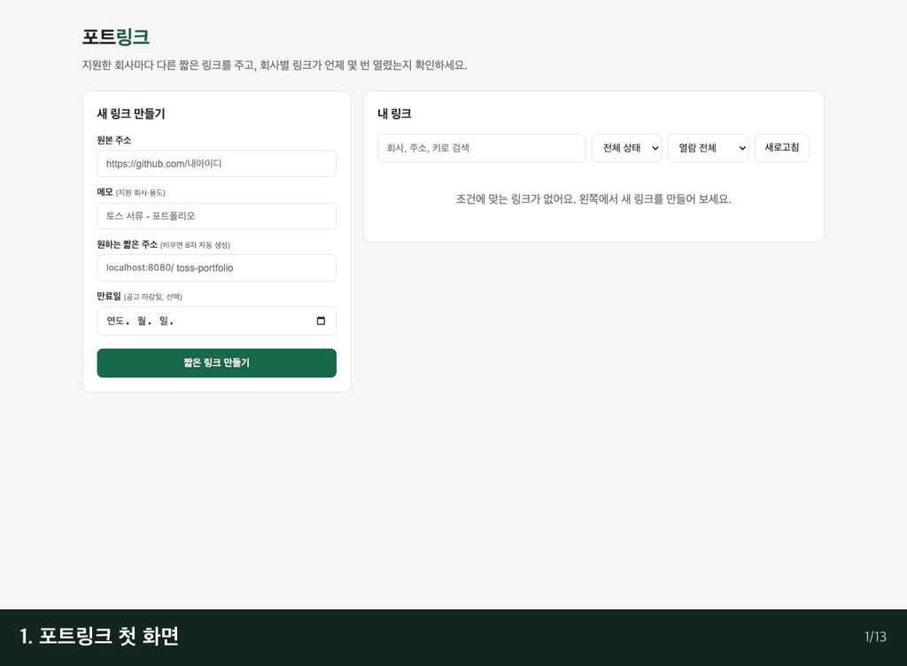
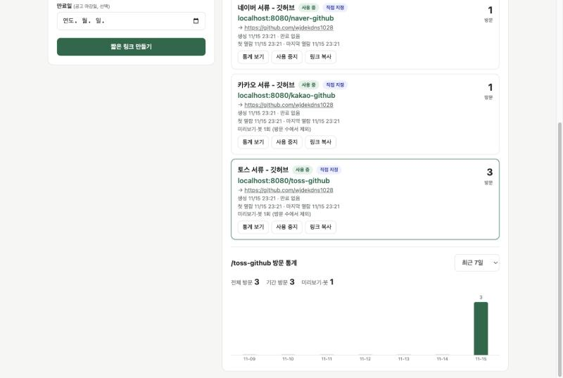

# 포트링크 — 나만의 단축 URL 서비스

취업 준비생이 **지원한 회사마다 다른 짧은 링크**를 이력서에 넣고, 회사별 링크가 언제 몇 번 열렸는지 확인하는 단축 URL 서비스입니다.
교재 CH 13 단축 URL 실습(8자 키 · 리다이렉트 · 방문 수 · 정보 조회)을 기반으로 확장 기능 6개를 더했습니다.

- 환경: Java 17, Spring Boot 4.1.2, Spring Data JPA, MySQL, Gradle Wrapper
- 실행: 로컬 MySQL을 켜고 아래 `application-dev.yml`을 만든 뒤 `short-url/`에서 `./gradlew bootRun` → http://localhost:8080/
- 테스트: `./gradlew test` (H2 메모리 DB를 쓰므로 MySQL 없이 실행됩니다)
- 저장소: **JPA + MySQL**이라 서버를 재시작해도 데이터가 남습니다. 과제 제출 때는 메모리(`LinkedHashMap`) 저장이었고, 이후 JPA로 전환했습니다.

`src/main/resources/application-dev.yml`은 DB 비밀번호가 들어가서 `.gitignore`에 넣었습니다. 아래 형식으로 직접 만들어야 합니다. `short_url` DB가 없으면 처음 실행할 때 만들어집니다.

```yaml
server:
  port: 8080

spring:
  datasource:
    url: jdbc:mysql://localhost:3306/short_url?createDatabaseIfNotExist=true&serverTimezone=Asia/Seoul
    username: root
    password: 내 MySQL 비밀번호
    driver-class-name: com.mysql.cj.jdbc.Driver
  jpa:
    hibernate:
      ddl-auto: update
    open-in-view: false
```



## 누가, 왜 쓰나

| 상황 | 불편 | 포트링크로 해결 |
| --- | --- | --- |
| 여러 회사에 같은 깃허브·노션 링크를 제출 | 어느 회사에 낸 링크가 열렸는지 알 수 없음 | 같은 주소도 회사별로 **새 키**를 발급 → 링크별 방문 수로 구분 |
| `https://www.notion.so/...a8f3c2...` 같은 긴 주소 | 이력서에서 지저분하고 오타 나기 쉬움 | `/toss-portfolio`처럼 **원하는 짧은 주소** 지정 |
| 공고 마감 후에도 링크가 계속 열림 | 오래된 자료가 계속 노출 | **만료일** 이후 자동 차단(410), 필요하면 **사용 중지**(403) |
| "서류 봤을까?" 궁금함 | 확인할 방법이 없음 | **첫·마지막 열람 시각**, **아직 안 열림** 표시, **날짜별 방문 통계** |
| 카카오톡·슬랙에 링크를 붙이면 미리보기가 먼저 열어 봄 | 아무도 안 봤는데 "열림"으로 보임 | **미리보기·봇 방문을 따로** 세고 사람 방문만 열람으로 인정 |

## 현재 범위 (MVP)

- 지금은 **localhost에서만** 동작하는 MVP입니다. 다른 사람이 링크를 열려면 서버를 배포하고 도메인을 연결해야 합니다.
- 방문 기록은 **링크 단위**입니다. 누가 열었는지는 알 수 없고, 회사마다 다른 링크를 주기 때문에 "그 회사에 낸 링크가 언제 몇 번 열렸는지"를 알 수 있습니다.
- 메신저·검색 로봇의 미리보기 방문은 `User-Agent`로 걸러 따로 셉니다. 브라우저인 척하는 봇이나 링크를 다른 사람에게 전달한 경우는 구분할 수 없습니다.

## 구현 범위

| 구분 | 내용 | 상태 |
| --- | --- | --- |
| 필수 | 원본 URL 등록 → 8자 키 생성 (헷갈리는 0·O·1·I·l·o 제외 56자, `SecureRandom`) | 완료 |
| 필수 | 같은 원본 URL을 다시 등록하면 새 키 발급, 이전 키도 계속 동작 | 완료 |
| 필수 | `GET /{key}` → 302 + `Location: 원본 주소`, 방문 수 기록 | 완료 |
| 필수 | 단축 URL 정보 조회 API | 완료 |
| 필수 | 메모리 저장, 자동 테스트 | 완료 (이후 JPA로 전환) |
| 필수 | http/https 절대 주소만 허용, 대상 페이지를 서버가 내려받지 않음 | 완료 |
| 확장 1 | 원하는 짧은 주소 지정 (영문·숫자·`-`·`_` 4~30자, 예약어 금지, 중복 409) | 완료 |
| 확장 2 | 링크별·날짜별 방문 통계 (최근 1~30일, 방문 없는 날은 0으로 채움) | 완료 |
| 확장 3 | 링크 만료일 (만료일 당일까지 이동, 다음 날부터 410) | 완료 |
| 확장 4 | 관리: 검색(메모·주소·키), 상태 필터, 사용 중지·재개 | 완료 |
| 확장 5 | 미리보기·봇 방문 분리 (`User-Agent` 판별, 봇도 302로 보내되 방문 수·통계에서 제외) | 완료 |
| 확장 6 | 첫·마지막 열람 시각, "아직 안 열림" 표시와 열람 여부 필터 | 완료 |
| 선택 | 프론트엔드 (순수 HTML·CSS·JS, `static/index.html`) | 완료 |
| 추가 | 메모리 저장 → JPA·MySQL 전환 (짧은 주소 유니크 제약, 방문 시 비관적 락) | 완료 |

## API

| 요청 | 요청 값 | 성공 | 실패 |
| --- | --- | --- | --- |
| `POST /api/short-urls` | `{"originalUrl":"https://...", "title":"토스 서류", "customKey":"toss-portfolio", "expiresOn":"2026-11-30"}` (`originalUrl`만 필수) | **201**, `Location: /api/short-urls/{key}`, 생성된 정보 | 400, 409, 503 |
| `GET /{key}` | | **302**, `Location: 원본 주소`, `Cache-Control: no-store` | 403 사용 중지, 404, 410 만료 |
| `GET /api/short-urls/{key}` | | 정보 (`key, shortPath, originalUrl, title, custom, createdAt, expiresOn, status, visitCount, botVisitCount, firstVisitedAt, lastVisitedAt`) | 404 |
| `GET /api/short-urls` | `q` 검색어, `status` `ACTIVE`·`DISABLED`·`EXPIRED`, `opened` `true`·`false` (모두 선택) | 최신순 목록 | 400 |
| `PATCH /api/short-urls/{key}/status` | `{"active":false}` | 바뀐 정보 | 400, 404 |
| `GET /api/short-urls/{key}/stats` | `days` 1~30 (기본 7) | `totalCount`(사람), `botCount`, `periodCount, from, to, daily[]` | 400, 404 |

실패 응답은 `{"status":409,"code":"DUPLICATE_CUSTOM_KEY","message":"customKey: 'portfolio'는 이미 사용 중인 짧은 주소입니다."}` 형태입니다. `code`는 `ErrorCode` enum 이름이라 화면이나 다른 클라이언트가 실패 이유를 문자열 비교 없이 구분할 수 있습니다.

## 구조

```
link/
  controller/  ShortUrlController(API), RedirectController(GET /{key})
  service/     ShortUrlService — 키 생성·재시도, 중복·만료·통계 규칙 조율
  domain/      ShortUrl(방문·만료·상태), UrlPolicy(주소·짧은 주소 검증), BotDetector(봇 판별),
               ShortUrlKeyGenerator / RandomShortUrlKeyGenerator, LinkStatus, DailyVisit
  repository/  ShortUrlRepository(인터페이스) / JpaShortUrlRepository(구현) / ShortUrlJpaRepository(Spring Data JPA)
  dto/         req, res
global/
  exception/   ErrorCode(상태 코드·메시지 목록) + ApiException + ErrorRes + GlobalExceptionHandler
  config/      ClockConfig (테스트에서 시간을 바꿔 끼우기 위해 Clock 주입)
```

DB 테이블은 두 개입니다.

| 테이블 | 내용 |
| --- | --- |
| `short_url` | 링크 정보, 방문 수, 봇 방문 수, 첫·마지막 열람 시각. 짧은 주소는 `short_key` 컬럼(유니크, 대소문자 구분) |
| `short_url_daily_visit` | 링크별 날짜별 사람 방문 수 (`ShortUrl`의 `Map<LocalDate, Long>`을 `@ElementCollection`으로 저장) |

## 이렇게 결정했습니다

1. **키 충돌은 "저장하면서" 확인합니다.** "확인 후 저장"은 그 사이에 다른 요청이 같은 키로 저장할 수 있습니다. 그래서 `short_key`에 DB 유니크 제약을 걸고, 일단 저장한 뒤 제약 위반(`DataIntegrityViolationException`)이 나면 겹친 것으로 봅니다. 랜덤 키는 최대 5번 다시 만들고 그래도 실패하면 503, 직접 지정한 주소는 409입니다. 실패한 트랜잭션 안에서는 재시도할 수 없어서, 생성(`create`)은 큰 트랜잭션 없이 실행하고 저장 시도마다 각자 트랜잭션으로 돌게 했습니다.
2. **리다이렉트는 301이 아니라 302 + `no-store`입니다.** 301은 브라우저가 캐시해서 두 번째 방문부터 서버를 거치지 않으므로 방문 수가 집계되지 않습니다.
3. **생성 응답의 `Location`은 원본 주소가 아니라 정보 리소스(`/api/short-urls/{key}`)입니다.** 201의 Location은 "새로 만든 리소스 위치"이고, 302의 Location은 "이동할 곳"이라 의미가 다릅니다.
4. **`/{key}` 경로는 `[A-Za-z0-9_-]{4,30}`만 받습니다.** 점(.)이 없으므로 `index.html`, `favicon.ico` 같은 정적 파일과 겹치지 않고, `api`·`admin` 등은 예약어로 막았습니다.
5. **방문은 DB 행을 잠그고 처리합니다.** 방문·상태 규칙은 `ShortUrl.visit()` 안에 두고, 이동할 때는 `@Lock(PESSIMISTIC_WRITE)`(`SELECT ... FOR UPDATE`)로 링크를 잠근 채 읽어서 같은 링크 요청이 차례로 처리되게 했습니다. 다른 링크끼리는 기다리지 않습니다.
   - 메모리 저장 때는 `synchronized`로 막았고, 빼면 1만 번 방문 중 140~250번이 사라지고 같은 짧은 주소가 2~6번 저장됐습니다.
   - JPA에서는 요청마다 DB에서 새 객체를 읽어 와서 `synchronized`가 아무것도 막지 못합니다. 락 없이 2000번 동시 방문하면 방문 수가 211~225로 기록되고 날짜별 통계 행이 겹쳐 에러가 났습니다. 그래서 `synchronized`는 지우고 DB 락으로 바꿨습니다.
6. **시간은 `Clock`을 주입받습니다.** 테스트에서 하루를 넘겨 만료(410)와 날짜별 통계를 실제로 확인할 수 있습니다.
7. **실패 이유는 `ErrorCode` enum 한 곳에서 관리합니다.** 상태 코드와 메시지를 enum에 모으고 예외는 `ApiException(ErrorCode, 값...)` 하나만 던집니다. 새 실패 이유가 생기면 enum에 한 줄만 추가하면 되고, 테스트는 예외 타입 대신 `ErrorCode`로 이유까지 정확히 확인합니다.
8. **미리보기 봇은 막지 않고 세는 방식만 나눕니다.** 카카오톡·슬랙은 원본 페이지를 읽어야 제목과 썸네일을 보여 주므로 봇에게도 302를 돌려줍니다. `User-Agent`에 `kakaotalk-scrap`, `facebookexternalhit`, `bot` 등이 있거나 비어 있으면 봇 방문으로 따로 세고, 날짜별 통계와 첫 열람 시각은 사람 방문만 씁니다.
9. **자기 자신을 가리키는 링크와 HEAD 요청을 막았습니다.** 최종 점검에서 `localhost:8080/loop-self`를 원본으로 한 `loop-self` 링크가 302를 30번 반복하며 방문 수를 31까지 올리는 것을 재현했습니다. 원본 주소의 호스트·포트가 서비스 자신과 같으면 `400 SELF_REFERENCING_URL`로 막습니다. 또 Spring은 HEAD 요청도 GET 메서드로 처리해서 링크 검사기의 HEAD 요청이 사람 방문으로 세지고 있어, HEAD는 봇 방문으로 셉니다.
10. **원본 주소 검증은 서버에서 다시 합니다.** `javascript:`, `ftp:`, 상대 경로, 2048자 초과를 막고, 화면은 모든 값을 `textContent`로 넣습니다.
11. **짧은 주소 컬럼은 대소문자를 구분합니다.** MySQL 기본 정렬 규칙은 대소문자를 구분하지 않아서 `Toss-github`와 `toss-github`가 같은 키로 취급되고, 대소문자를 섞는 랜덤 키끼리도 충돌합니다. `short_key`를 `utf8mb4_bin`으로 지정했습니다.
12. **날짜별 방문 수는 `@ElementCollection`으로 저장합니다.** 날짜별 방문 수는 링크에 딸린 값일 뿐 따로 조회하지 않아서, 별도 엔티티(`@OneToMany`) 대신 값 모음으로 저장했습니다. 도메인의 `Map<LocalDate, Long>`과 `visit()` 로직은 그대로입니다.

## 테스트 결과

`./gradlew test` → **75개 모두 통과**

스프링을 띄우는 테스트(`ApiResponseTest`, `ConcurrencyTest`)는 H2 메모리 DB(`MODE=MySQL`)로 실제 JPA를 거칩니다. `ShortUrlServiceTest`는 빠르게 돌도록 테스트용 메모리 저장소(`support/MemoryShortUrlRepository`)를 씁니다.

| 테스트 | 개수 | 확인 내용 |
| --- | --- | --- |
| `UrlPolicyTest` | 31 | http/https만 허용, 실패 이유별 ErrorCode, 공백 제거, 2048자, 짧은 주소 형식·예약어, 자기 자신 주소(기본 포트 포함) 차단 |
| `ShortUrlTest` | 7 | 전체·날짜별 방문 수, 만료일 경계, 사용 중지·재개, 검색, 봇 방문 분리, 첫·마지막 열람 시각 |
| `BotDetectorTest` | 12 | 카카오톡·슬랙·디스코드·구글·네이버 봇, curl, 빈 값은 봇 / 크롬·사파리·엣지는 사람 |
| `RandomShortUrlKeyGeneratorTest` | 2 | 8자·허용 문자, 1만 개 생성 시 중복 없음 |
| `ShortUrlServiceTest` | 13 | 같은 URL 새 키, 키 충돌 재시도, 5회 실패 503, 409, 404, 만료, 통계, 검색, 봇 방문·열람 여부 필터, 자기 자신 주소 차단, HEAD는 봇 |
| `ConcurrencyTest` | 2 | DB 기준. 16개 스레드로 `redirect` 1만 번 동시 호출 → 방문 수·오늘 통계 정확히 10000, 에러 0 / 같은 짧은 주소 100번 동시 생성 → 1개만 저장, 99개 409 |
| `ApiResponseTest` | 8 | 201 Location, 302 Location·no-store, 400·403·404·409·410, 정적 파일 충돌 없음, 미리보기 봇도 302지만 봇 방문으로 집계, 자기 자신 주소 400, HEAD 302·봇 집계 |

## QA 체크리스트 (실제 서버 + 화면)

아래 QA는 과제 제출 때(메모리 저장 버전) 진행했습니다. JPA 전환 후에는 자동 테스트로 확인했습니다.

| # | 요청 | 기대 | 결과 |
| --- | --- | --- | --- |
| 1 | `https://github.com/...` 등록 | 201, 8자 키 | 통과 |
| 2 | 같은 주소를 `toss-github`, `kakao-github`로 각각 등록 | 서로 다른 키, 둘 다 이동 | 통과 |
| 3 | `GET /toss-github` 3번 | 302 ×3, 방문 수 3, 오늘 막대 3 | 통과 |
| 4 | `ftp://x.com`, `javascript:alert(1)` | 400 + 사유 | 통과 |
| 5 | 이미 있는 `toss-github`로 다시 등록 | 409, 기존 링크 그대로 | 통과 |
| 6 | 화면에서 `github.com/...`(scheme 없음) 입력 | 요청 전에 안내 문구 | 통과 |
| 7 | `kakao-github` 사용 중지 후 접속 | 403, 다시 사용하면 302 | 통과 |
| 8 | 메모에 `` | 글자 그대로 표시, 스크립트 실행 안 됨 | 통과 |
| 9 | `/`, `/index.html` | 화면 200 (키로 오인 안 함) | 통과 |
| 10 | 만료일 지난 다음 날 접속 | 410 | 자동 테스트(`Clock`)로 확인 |
| 11 | 카카오톡 미리보기 User-Agent로 `toss-github` 접속 후 크롬으로 3번 접속 | 302, 방문 3, 미리보기·봇 1, 첫 열람 시각 표시 | 통과 |
| 12 | 미리보기 봇만 들어온 `kakao-github` | 방문 0, "아직 안 열림" 표시, `opened=false` 필터에 나옴 | 통과 |
| 13 | 화면(실제 브라우저)에서 링크 열기 | 사람 방문으로 집계 | 통과 |
| 14 | `http://localhost:8080/loop-self`를 원본으로 등록 | 400 `SELF_REFERENCING_URL` (수정 전: 302 30번 반복, 방문 31) | 통과 |
| 15 | 브라우저 User-Agent로 HEAD 요청 후 GET 요청 | 둘 다 302, 방문 1·봇 1 (수정 전: 방문 2) | 통과 |



## AI 사용

- 백엔드는 요구사항 정리 → 도메인 규칙 → 서비스 → 컨트롤러 순서로 직접 설계했고, 설계 검토와 테스트 케이스 정리에 AI 도움을 받았습니다.
- 프론트엔드(`static/index.html`)는 AI로 만든 뒤 실제 API에 연결해 위 QA 체크리스트로 확인했습니다. 외부 라이브러리·CDN 없이 같은 출처 상대 경로(`/api/short-urls`)만 호출하고, 사용자 입력과 에러는 `textContent`로만 표시하도록 고쳤습니다.

## 남은 문제

- 배포와 도메인 연결 전이라 내 컴퓨터(localhost)에서만 열 수 있습니다.
- 방문은 링크 행을 잠그고 처리해서, 한 링크에 요청이 몰리면 차례로 처리돼 느려질 수 있습니다. 더 몰리면 `UPDATE ... SET visit_count = visit_count + 1`처럼 DB가 직접 더하는 방식을 검토할 수 있습니다.
- 테이블은 `ddl-auto: update`로 만듭니다. 이미 있는 컬럼은 바꾸지 않으므로, 운영 전에는 Flyway 같은 마이그레이션 도구가 필요합니다.
- 자기 자신 주소 차단은 요청이 들어온 호스트 이름으로만 비교해서, 같은 서버를 `127.0.0.1`이나 다른 도메인으로 적으면 막지 못합니다.
- 봇 판별은 `User-Agent` 글자 기준이라, 브라우저인 척하는 메일 보안 검사기나 링크 전달은 구분하지 못합니다.
- 목적지(깃허브 등)로 이동한 뒤의 행동(머문 시간 등)은 302 구조상 알 수 없습니다.
- 로그인이 없어 누구나 목록을 보고 사용 중지할 수 있습니다.
