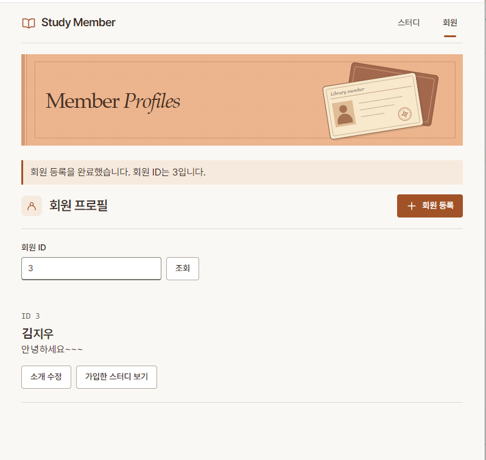
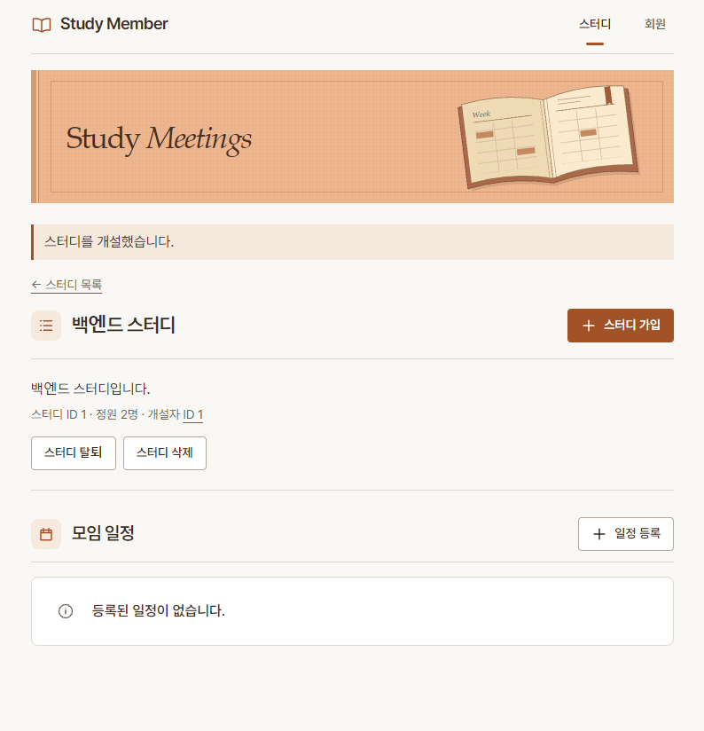
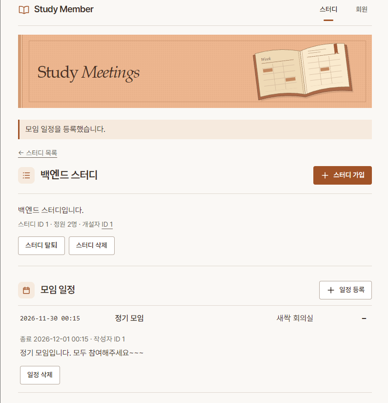
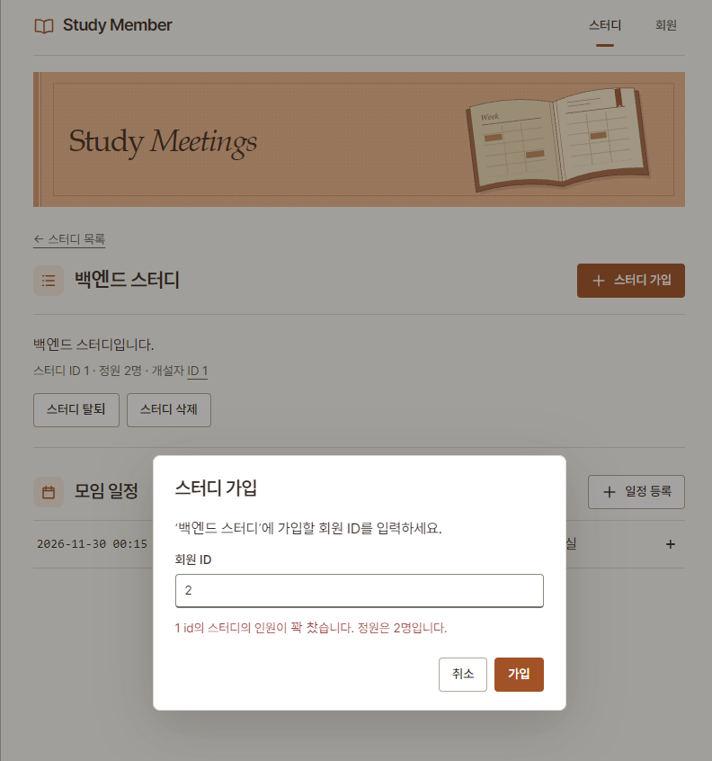
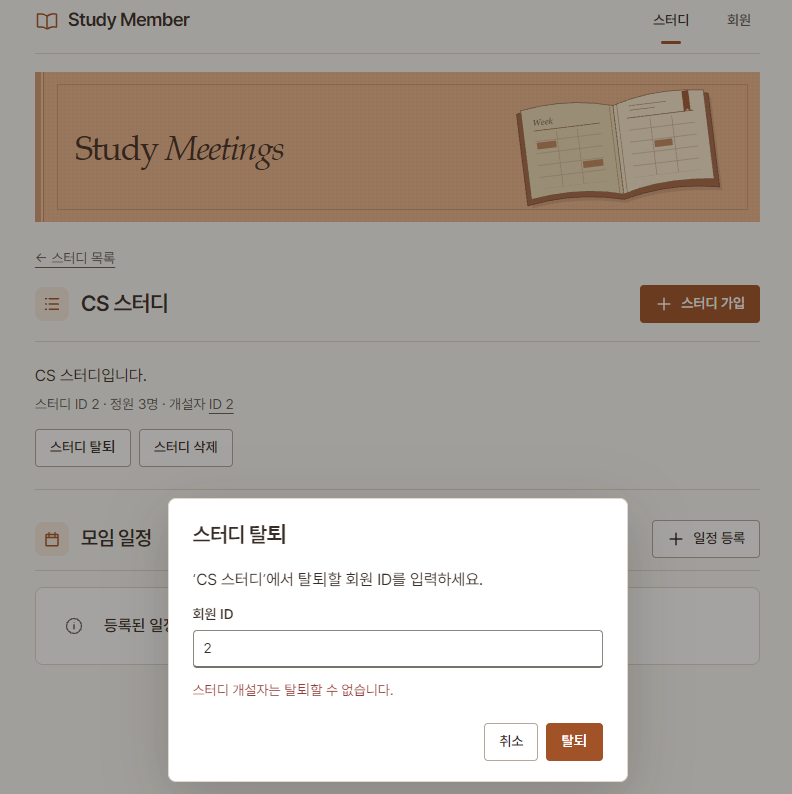
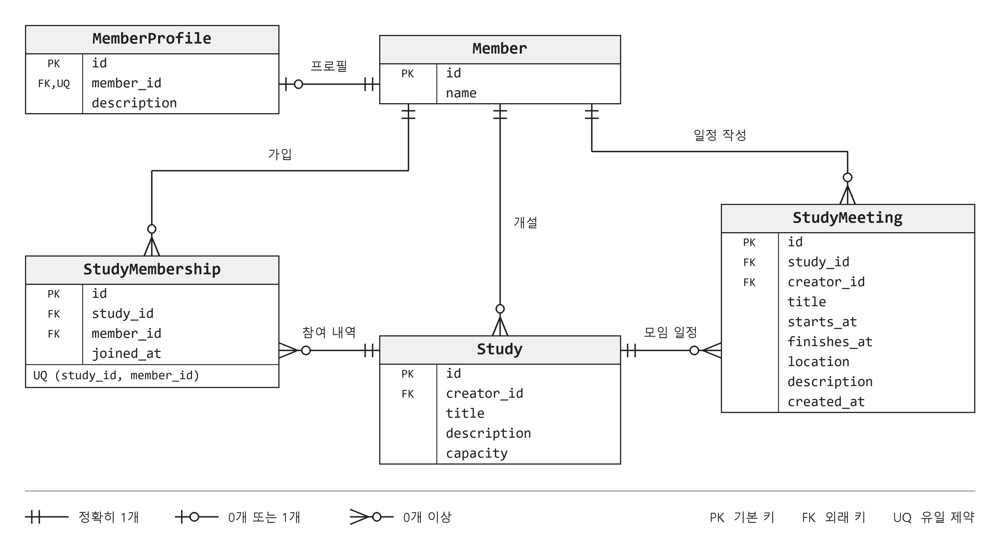

# 스터디 모집·모임 관리 서비스

SeSAC Spring Boot 수업의 11월 26일 JPA 연관관계 과제입니다. 회원은 스터디를 개설하거나 기존 스터디에 가입하고, 참여 중인 스터디에 모임 일정을 등록할 수 있습니다. Spring Boot 애플리케이션 하나에서 REST API와 웹 화면을 함께 제공합니다.

## 실행 방법

JDK 21이 필요합니다. Windows PowerShell에서 저장소 루트를 기준으로 실행합니다.

```powershell
cd study-member
.\gradlew.bat bootRun
```

브라우저에서 [스터디 목록](http://localhost:8080/)을 엽니다. 기본 환경은 Spring Boot 4.2, Spring Data JPA, 인메모리 H2를 사용합니다. 기본 설정에서는 애플리케이션을 재시작하면 데이터가 초기화됩니다.

### 화면에서 사용해 보기

1. **회원 → 회원 등록**에서 두 회원을 등록하고 화면에 표시되는 회원 ID를 확인합니다. 회원 등록 시 자기소개 프로필도 함께 생성됩니다.
2. **스터디 → 스터디 개설**에서 첫 번째 회원의 ID를 개설자로 입력하고 정원을 2명으로 설정합니다. 개설자가 첫 번째 참여자가 됩니다.
3. 스터디 상세에서 **스터디 가입**을 누르고 두 번째 회원의 ID를 입력합니다. 가입이 완료되면 해당 회원의 가입 목록에서 스터디를 확인할 수 있습니다.
4. 같은 스터디의 **일정 등록**에서 두 번째 회원의 ID와 시작·종료 시각을 입력합니다. 등록된 일정에는 실제로 일정을 만든 회원이 작성자로 표시됩니다.

현재 화면은 로그인 없이 입력한 회원 ID로 동작합니다. 일정 등록 시에는 해당 회원의 스터디 가입 여부를 확인합니다.

### 실행 화면

<details>
<summary>회원 등록 후 프로필 조회</summary>



</details>

<details>
<summary>스터디 개설 직후와 모임 일정 등록 후 비교</summary>

**스터디 개설 직후**에는 정원과 개설자 ID가 표시되고, 모임 일정 목록은 비어 있습니다.



**일정 등록 후**에는 등록한 모임이 펼쳐져 시작·종료 시각, 장소, 작성자 ID를 확인할 수 있습니다.



</details>

<details>
<summary>정원이 찬 스터디의 가입 거절과 개설자의 탈퇴 제한</summary>

**가입 거절** — 정원 2명이 모두 찬 스터디에서 추가 가입을 시도한 경우입니다.



**탈퇴 제한** — 개설자 ID로 탈퇴를 시도하면 탈퇴할 수 없는 이유가 표시됩니다.



</details>

## 엔티티 관계



| 관계 | 외래 키와 설계 이유 |
|---|---|
| 회원과 프로필 | `MemberProfile.member_id`에 유일 제약을 두어 회원 한 명이 프로필을 최대 하나만 갖도록 합니다. 등록 시 회원과 프로필을 한 트랜잭션에서 저장해 프로필 저장이 실패하면 회원 등록도 롤백합니다. |
| 스터디 개설과 참여 | `Study.creator_id`는 스터디를 개설한 회원을 가리킵니다. 참여는 `StudyMembership`에 별도로 저장해 가입 시각을 기록하고, `(study_id, member_id)` 복합 유일 제약으로 같은 스터디에 대한 중복 가입을 막습니다. |
| 스터디와 모임 일정 | `StudyMeeting.study_id`는 일정이 속한 스터디를, `creator_id`는 일정을 작성한 회원을 가리킵니다. 일정 생성 시 가입 내역 한 건에서 두 값을 가져오므로 일반 참여자도 일정을 등록할 수 있습니다. |

## 서비스 규칙과 트랜잭션

- **개설과 정원** — 정원은 개설자를 포함해 1명 이상입니다. 스터디와 개설자의 가입 내역을 한 트랜잭션에서 저장합니다. 정원이 1명인 스터디는 개설과 동시에 정원이 찹니다.
- **동시 가입** — 가입 트랜잭션은 대상 스터디 행에 쓰기 잠금(`PESSIMISTIC_WRITE`)을 얻은 뒤 중복 가입 여부와 현재 인원을 확인하고 가입 내역을 저장합니다. 마지막 한 자리에 두 요청이 들어오면, 뒤의 요청은 앞의 트랜잭션이 끝난 뒤 인원을 확인합니다.
- **탈퇴와 삭제** — 일반 참여자가 탈퇴하면 해당 가입 내역 한 건을 삭제합니다. 개설자의 탈퇴 요청은 거절합니다. 스터디 자체를 삭제하면 두 `study_id` 외래 키의 `ON DELETE CASCADE`에 따라 가입 내역과 모임 일정도 함께 삭제됩니다. 회원 계정은 유지됩니다.
- **일정 등록** — 요청한 회원이 해당 스터디에 현재 가입되어 있어야 합니다. 종료 시각은 시작 시각보다 늦어야 합니다.

## REST API

본문이 있는 요청은 JSON을 사용합니다. 표에서 `description`은 선택 입력이며, `startsAt`과 `finishesAt`은 `2026-12-01T14:00:00` 형식의 날짜·시각입니다.

| 기능 | 메서드와 경로 | 요청 본문 필드 | 성공 응답 |
|---|---|---|---|
| 회원·프로필 등록 | `POST /member` | `name`, `description` | 201 · 회원 상세 |
| 회원·프로필 조회 | `GET /member/{memberId}` | — | 200 · 회원 상세 |
| 자기소개 수정 | `PATCH /member/{memberId}` | `description` | 200 · 회원 상세 |
| 스터디 개설 | `POST /study` | `creatorId`, `title`, `capacity`, `description` | 201 · 스터디 상세 |
| 전체 스터디 목록 | `GET /study/list` | — | 200 · 스터디 요약 목록 |
| 스터디 상세 | `GET /study/{studyId}` | — | 200 · 스터디 상세 |
| 회원의 가입 목록 | `GET /study?memberId={memberId}` | — | 200 · 스터디 요약 목록 |
| 스터디 가입 | `POST /study/{studyId}/member` | `memberId` | 200 · 스터디 요약 |
| 스터디 탈퇴 | `DELETE /study/{studyId}/member/{memberId}` | — | 200 · 스터디 요약 |
| 스터디 삭제 | `DELETE /study/{studyId}` | — | 204 · 본문 없음 |
| 일정 등록 | `POST /meeting?studyId={studyId}` | `memberId`, `title`, `startsAt`, `finishesAt`, `location`, `description` | 201 · 모임 일정 |
| 스터디별 일정 목록 | `GET /meeting/list?studyId={studyId}` | — | 200 · 모임 일정 목록 |
| 일정 삭제 | `DELETE /meeting/{meetingId}` | — | 204 · 본문 없음 |

**오류 응답 예시**

| 상태 코드 | 발생 상황 |
|---|---|
| `400 Bad Request` | 정원이 1명 미만이거나 일정 종료 시각이 시작 시각과 같거나 빠른 경우 |
| `404 Not Found` | 상세 조회 대상 회원·스터디가 없거나, 일정을 등록하려는 회원의 가입 내역이 없는 경우 |
| `409 Conflict` | 중복 가입, 정원이 찬 스터디에 가입, 개설자의 탈퇴 요청 |

## 테스트

`study-member` 디렉터리에서 `.\gradlew.bat test`를 실행합니다. 현재 자동 테스트는 Spring 애플리케이션 컨텍스트의 기동을 확인합니다.
