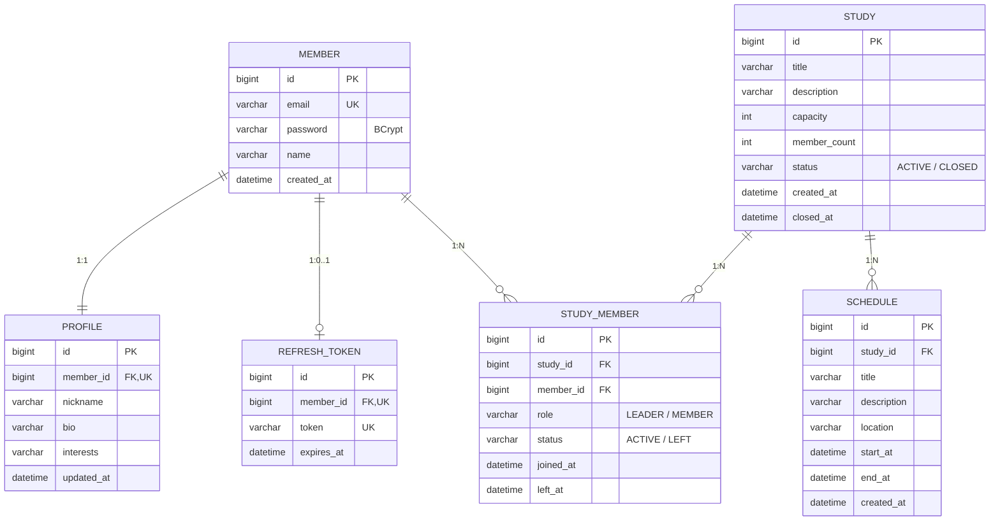

# 스터디 모집 및 모임 관리 서비스

회원이 스터디를 만들고 참여하며 모임 일정을 관리하는 REST API입니다. Spring Boot 4.1, Spring Data JPA, MySQL, Spring Security와 JWT(jjwt)로 구현했습니다.

## 실행

`src/main/resources/application-dev.yml`은 DB 비밀번호와 JWT 비밀키가 있어 `.gitignore`로 제외했습니다. 새로 받은 경우 아래 형식으로 만듭니다.

```yaml
spring:
  datasource:
    url: jdbc:mysql://localhost:3306/study_service?createDatabaseIfNotExist=true&serverTimezone=Asia/Seoul
    username: root
    password: <DB 비밀번호>
    driver-class-name: com.mysql.cj.jdbc.Driver
  jpa:
    hibernate:
      ddl-auto: update
    open-in-view: false

jwt:
  secret: <openssl rand -base64 48 결과>
```

```bash
./gradlew bootRun   # 서버 실행 (8080)
./gradlew test      # H2 메모리 DB로 테스트 21개 실행
```

## 구현 기능

| 기능 | 내용 |
| --- | --- |
| 인증 | 회원가입, 로그인(Access + Refresh 토큰 발급), 토큰 재발급(Refresh 토큰 교체), 로그아웃 |
| 회원, 프로필 | 내 정보 조회, 프로필(닉네임, 자기소개, 관심 분야) 수정, 다른 회원 프로필 조회 |
| 스터디 | 개설(개설자가 스터디장), 목록(상태, 제목 검색), 상세, 수정(스터디장) |
| 참여 | 참여, 탈퇴, 재가입, 스터디장 위임, 스터디 참여자 목록, 내 스터디 목록 |
| 모임 일정 | 스터디별 일정 등록, 수정, 삭제(스터디장), 목록 및 상세 조회(참여 멤버) |

## API

인증이 필요한 API는 `Authorization: Bearer <accessToken>` 헤더를 보내야 합니다.

| Method | URL | 인증 | 설명 |
| --- | --- | --- | --- |
| POST | `/auth/signup` | 불필요 | 회원가입 (프로필 함께 생성) |
| POST | `/auth/login` | 불필요 | 로그인 후 Access, Refresh 토큰 발급 |
| POST | `/auth/reissue` | 불필요 | Refresh 토큰으로 두 토큰 재발급 |
| POST | `/auth/logout` | 필요 | Refresh 토큰 폐기 |
| GET | `/members/me` | 필요 | 내 정보 + 프로필 |
| PUT | `/members/me/profile` | 필요 | 프로필 수정 |
| GET | `/members/me/studies` | 필요 | 내가 참여 중인 스터디 |
| GET | `/members/{memberId}` | 필요 | 회원 프로필 조회 |
| POST | `/studies` | 필요 | 스터디 개설 |
| GET | `/studies?status=ACTIVE&keyword=JPA` | 불필요 | 스터디 목록 |
| GET | `/studies/{studyId}` | 불필요 | 스터디 상세 |
| PUT | `/studies/{studyId}` | 필요 | 스터디 수정 (스터디장) |
| POST | `/studies/{studyId}/members` | 필요 | 참여 |
| DELETE | `/studies/{studyId}/members/me` | 필요 | 탈퇴 |
| GET | `/studies/{studyId}/members` | 필요 | 참여자 목록 |
| PATCH | `/studies/{studyId}/leader` | 필요 | 스터디장 위임 `{"memberId": 3}` |
| POST | `/studies/{studyId}/schedules` | 필요 | 일정 등록 (스터디장) |
| GET | `/studies/{studyId}/schedules` | 필요 | 일정 목록 (참여 멤버) |
| GET | `/studies/{studyId}/schedules/{scheduleId}` | 필요 | 일정 상세 (참여 멤버) |
| PUT | `/studies/{studyId}/schedules/{scheduleId}` | 필요 | 일정 수정 (스터디장) |
| DELETE | `/studies/{studyId}/schedules/{scheduleId}` | 필요 | 일정 삭제 (스터디장) |

에러는 모두 `{"status": 409, "code": "STUDY_FULL", "message": "정원(4명)이 가득 찬 스터디입니다."}` 형태로 응답합니다.

## Entity 관계도



`STUDY_MEMBER`에는 `(study_id, member_id)` 유니크 제약이 있습니다.

## 관계 설계 이유

### 일대일: Member ↔ Profile (FK는 profile)

- 로그인 정보(Member)와 소개 정보(Profile)는 바뀌는 시점과 이유가 달라서 나눴습니다. 인증할 때는 Member만 읽으면 됩니다.
- FK를 `profile.member_id`에 두고 `unique`를 걸었습니다. 회원이 먼저 생기고 프로필이 회원에 딸리는 구조이므로, 딸린 쪽이 FK를 갖는 것이 자연스럽습니다. FK를 Member에 두면 프로필을 만들기 전까지 `member.profile_id`가 null이 됩니다.
- 회원가입 트랜잭션에서 Member와 Profile을 함께 만들기 때문에 프로필 없는 회원은 생기지 않습니다.
- Profile에서 Member로만 참조하는 단방향입니다. 프로필은 `memberId`로 조회하므로 Member에 `profile` 필드가 없어도 됩니다.

### 다대다: Member ↔ Study를 StudyMember 엔티티로

- `@ManyToMany`는 중간 테이블에 컬럼을 추가할 수 없습니다. 가입 정보에는 역할(스터디장/멤버), 상태(참여/탈퇴), 가입일과 탈퇴일이 필요해서 중간 테이블을 `StudyMember` 엔티티로 승격하고 `Member 1:N StudyMember N:1 Study`로 풀었습니다.
- 스터디장은 Study에 따로 두지 않고 `StudyMember.role = LEADER`로 표현했습니다. 위임할 때 두 행의 역할만 바꾸면 되고, "스터디장도 참여자 중 한 명"이라는 사실이 한 곳에만 기록됩니다.
- `(study_id, member_id)` 유니크 제약으로 한 회원이 같은 스터디에 행을 두 개 갖는 것을 DB 수준에서 막습니다.

### 일대다/다대일: Study ↔ Schedule, Study ↔ StudyMember

- FK는 항상 N쪽(`schedule.study_id`, `study_member.study_id`)에 있으므로 `@ManyToOne`만 두는 단방향으로 매핑했습니다.
- Study에 `@OneToMany` 컬렉션을 두지 않은 이유: 참여 이력과 일정은 계속 쌓이는데, 컬렉션으로 들고 있으면 스터디를 읽을 때마다 불필요하게 로딩될 위험이 있고 연관관계 편의 메서드도 관리해야 합니다. 필요한 목록은 리포지토리 쿼리로 조회합니다.
- 모든 연관관계는 `LAZY`로 두고, 목록 조회에서 함께 필요한 엔티티는 `join fetch`로 가져와 N+1을 피했습니다. 스터디 목록의 스터디장 정보도 스터디 ID 목록으로 한 번에 조회합니다.

### Refresh 토큰

- 회원당 1개(`member_id` unique)만 저장합니다. 로그인하거나 재발급하면 값을 교체(rotation)하므로 이전 토큰은 바로 쓸 수 없고, 로그아웃하면 행을 지워 재발급을 막습니다.
- Access 토큰은 서명된 JWT(HS256, 30분)이고 DB를 조회하지 않고 검증합니다. Refresh 토큰은 무작위 문자열(14일)이며 DB에 있는 값만 유효합니다. 서버가 폐기할 수 있어야 하는 토큰만 DB에 둔 것입니다.

## 트랜잭션 설계 이유

- 서비스 클래스에 `@Transactional(readOnly = true)`를 기본으로 두고, 쓰기 메서드에만 `@Transactional`을 붙였습니다.
- **참여, 탈퇴, 위임, 스터디 수정은 Study 행에 비관적 락(`SELECT ... FOR UPDATE`)을 걸고 시작합니다.**
  - 정원이 1자리 남았을 때 두 명이 동시에 참여하면, 락이 없을 경우 둘 다 "아직 자리 있음"을 읽고 정원을 넘깁니다. 같은 스터디에 대한 요청을 한 줄로 세우면 뒤 요청은 앞 요청이 커밋한 인원 수를 보고 판단합니다.
  - 스터디장 위임과 탈퇴가 동시에 일어나 스터디장이 0명 또는 2명이 되는 경우, 정원 축소와 참여가 겹치는 경우도 같은 락으로 막습니다.
  - 충돌이 잦은 짧은 작업이라 낙관적 락처럼 실패 후 재시도하게 하는 것보다 잠깐 기다리게 하는 편이 사용자에게 낫다고 판단했습니다.
- 참여 인원은 `study.member_count`에 저장합니다. 락 안에서만 바뀌므로 정확하고, 목록 조회 때 스터디마다 `count` 쿼리를 날리지 않아도 됩니다.
- 회원가입은 이메일 중복을 먼저 확인하고, 동시에 같은 이메일로 가입해 유니크 제약에 걸리면 `DUPLICATE_EMAIL`로 바꿔 응답합니다.
- `open-in-view: false`로 트랜잭션이 끝나면 영속성 컨텍스트도 닫히게 했습니다. 응답 DTO는 서비스 안에서 만듭니다.

## 서비스 규칙

| 구분 | 규칙 | 에러 코드 |
| --- | --- | --- |
| 개설 | 개설자가 스터디장으로 자동 참여, 정원 2~50명 | |
| 중복 참여 | 이미 참여 중이면 참여 불가 | `ALREADY_JOINED` |
| 정원 | 참여 인원이 정원과 같으면 참여 불가 | `STUDY_FULL` |
| 탈퇴 | 행을 지우지 않고 `status = LEFT`, 탈퇴 시각 기록 | `NOT_STUDY_MEMBER` |
| 재가입 | 탈퇴했던 스터디에 다시 참여 가능. 같은 행을 `ACTIVE`로 되돌리고 일반 멤버로 시작 | |
| 스터디장 탈퇴 | 다른 멤버가 있으면 먼저 위임해야 탈퇴 가능 | `LEADER_MUST_DELEGATE` |
| 스터디 종료 | 혼자 남은 스터디장이 탈퇴하면 스터디가 `CLOSED`, 이후 참여, 수정, 일정 변경 불가 | `STUDY_CLOSED` |
| 위임 | 스터디장만, 참여 중인 다른 멤버에게만 가능 | `NOT_STUDY_LEADER`, `CANNOT_DELEGATE_TO_SELF`, `DELEGATE_TARGET_NOT_MEMBER` |
| 스터디 수정 | 스터디장만 가능, 정원을 현재 인원보다 적게 줄일 수 없음 | `CAPACITY_BELOW_MEMBER_COUNT` |
| 일정 등록, 수정, 삭제 | 스터디장만 가능, 종료 시각은 시작 시각 이후 | `NOT_STUDY_LEADER`, `INVALID_SCHEDULE_TIME` |
| 일정 조회 | 참여 중인 멤버만 가능 | `NOT_STUDY_MEMBER` |
| 공개 범위 | 스터디 목록과 상세는 로그인 없이 조회 가능, 참여자 목록은 로그인해야 조회 가능 | `UNAUTHORIZED` |

## 테스트

H2(MySQL 모드)로 실행하며 서비스 규칙 위주로 작성했습니다.

- `ParticipationRuleTest`: 중복 참여, 정원 초과, 탈퇴 후 재가입, 위임 후 탈퇴, 스터디 종료, 위임 및 수정 규칙, 내 스터디 목록
- `JoinConcurrencyTest`: 20명이 정원 5명 스터디에 동시에 참여해도 정원까지만 들어가는지
- `ScheduleRuleTest`: 일정 권한, 시간 검증, 다른 스터디 일정 접근 차단
- `AuthApiTest`: 로그인 후 토큰으로 접근, 401 사유 코드, Refresh 토큰 교체와 로그아웃, 이메일 중복, 비밀번호 오류
