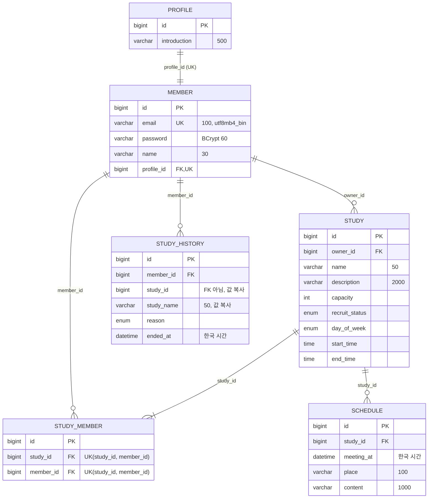

# 스터디 모집·모임 관리 서비스

회원이 스터디를 만들고 참여하며 모임 일정을 관리하는 REST API와 웹 화면입니다. JPA 연관관계, 서비스 규칙, 동시 요청 처리를 학습하기 위한 과제입니다.

- Java 21 / Spring Boot 4.2.0 / Gradle(Kotlin DSL)
- Spring Web MVC, Spring Data JPA, Bean Validation
- MySQL 8.4 (Docker)
- 인증: `HttpSession` + BCrypt(`spring-security-crypto`)
- 화면: HTML·CSS·JavaScript (`src/main/resources/static/`, 외부 라이브러리 없음)

## 목차

1. [실행 방법](#실행-방법)
2. [API](#api)
3. [API 요청 예시](#api-요청-예시)
4. [ERD](#erd)
5. [연관관계 설계 이유](#연관관계-설계-이유)
6. [서비스 규칙](#서비스-규칙)
7. [동시 요청 처리](#동시-요청-처리)
8. [구조와 설계 결정](#구조와-설계-결정)
9. [화면](#화면)
10. [테스트](#테스트)
11. [한계](#한계)

## 실행 방법

필요한 것: **JDK 21**, **Docker**(Compose 포함). 포트 `8080`(앱), `3308`(MySQL)을 사용합니다.

아래 명령은 모두 `study/` 폴더에서 실행합니다.

```bash
# 1. 비밀번호 파일 만들기 (.env는 Git에 올리지 않음)
cp .env.example .env        # 열어서 DB_PASSWORD, DB_ROOT_PASSWORD 변경

# 2. MySQL 실행 (healthy가 될 때까지 대기)
docker compose up -d --wait

# 3. 애플리케이션 실행
./gradlew bootRun           # Windows: gradlew.bat bootRun
```

- 화면: <http://localhost:8080>
- 테스트: `./gradlew test` (MySQL 컨테이너가 켜져 있어야 합니다)
- 종료: 앱은 `Ctrl+C`, DB는 `docker compose down`
- `docker-compose.yml`과 Spring이 같은 `.env`를 읽습니다. IDE에서 실행할 때는 작업 폴더를 `study/`로 지정하세요.

| DB | 용도 | 테이블 |
|---|---|---|
| `study` | 실행 | `ddl-auto: update` |
| `study_test` | 테스트 | `ddl-auto: create-drop` (실행 데이터와 분리) |

`study_test`는 `docker/mysql/init/`의 스크립트가 **빈 볼륨에서 처음 실행할 때만** 만듭니다. `.env`의 비밀번호를 나중에 바꾸거나 DB를 처음 상태로 되돌리려면 `docker compose down -v` 후 다시 실행합니다. **저장한 데이터가 모두 삭제됩니다.**

## API

| 기능 | Method와 URL | 권한 | 성공 |
|---|---|---|---|
| 회원가입 | `POST /api/members` | 누구나 | 201 |
| 로그인 | `POST /api/auth/login` | 누구나 | 200 |
| 로그아웃 | `POST /api/auth/logout` | 로그인 | 204 |
| 내 정보 조회 | `GET /api/members/me` | 로그인 | 200 |
| 이름·자기소개 수정 | `PATCH /api/members/me` | 로그인 | 200 |
| 내 개설·참여 목록 | `GET /api/members/me/studies` | 로그인 | 200 |
| 스터디 개설 | `POST /api/studies` | 로그인 | 201 |
| 스터디 목록 | `GET /api/studies` | 로그인 | 200 |
| 스터디 상세 | `GET /api/studies/{studyId}` | 로그인 | 200 |
| 모집 상태 변경 | `PATCH /api/studies/{studyId}/recruit-status` | 스터디장 | 200 |
| 스터디 삭제 | `DELETE /api/studies/{studyId}` | 스터디장 | 204 |
| 참여·재가입 | `POST /api/studies/{studyId}/members` | 로그인 | 201 |
| 탈퇴 | `DELETE /api/studies/{studyId}/members/me` | 스터디장 제외 참여자 | 204 |
| 일정 등록 | `POST /api/studies/{studyId}/schedules` | 스터디장 | 201 |
| 일정 조회 | `GET /api/studies/{studyId}/schedules` | 스터디장, 현재 참여자 | 200 |

### 입력 규칙

| 항목 | 규칙 |
|---|---|
| `email` | 필수, 이메일 형식, 100자 이하. 앞뒤 공백 제거 후 소문자로 저장 |
| `password` | 필수, 8~64자, UTF-8 72바이트 이하(BCrypt 한도) |
| 회원 `name` | 필수, 30자 이하, 중복 허용 |
| `introduction` | 선택, 500자 이하, 없으면 빈 문자열 |
| 스터디 `name` | 필수, 50자 이하, 중복 허용 |
| `description` | 필수, 2000자 이하 |
| `capacity` | 정수 2~100, 스터디장 포함 |
| `recruitStatus` | `RECRUITING`, `CLOSED` |
| `dayOfWeek` | `MONDAY` ~ `SUNDAY` |
| `startTime`, `endTime` | `HH:mm`, 시작 < 종료 (자정을 넘길 수 없고 최대 `23:59`) |
| `meetingAt` | `yyyy-MM-dd'T'HH:mm`, 한국 시간으로 현재보다 이후, 9999년 이하 |
| `place` | 필수, 100자 이하 |
| `content` | 필수, 1000자 이하 |

### 응답 항목

| 응답 | 항목 |
|---|---|
| 회원 (가입·로그인·수정) | `id, email, name, introduction` |
| 내 정보 | 회원 항목 + `ownedStudies, joinedStudies, histories` |
| 내 개설·참여 목록 | `ownedStudies, joinedStudies` (참여 목록에 본인 개설 스터디 제외) |
| 스터디 목록 항목 | `id, name, ownerName, capacity, memberCount, recruitStatus, dayOfWeek, startTime, endTime` (최신 개설순, 마감 포함) |
| 스터디 상세 | 목록 항목 + `description, myRole`(`OWNER`/`MEMBER`/`NONE`) |
| 과거 이력 | `studyId, studyName, reason, endedAt` (최신순) |
| 일정 | `id, meetingAt, place, content` (일시 오름차순) |

비밀번호는 어떤 응답에도 없습니다.

### 오류 응답

```json
{
  "status": 400,
  "message": "입력값이 올바르지 않습니다.",
  "errors": [
    { "field": "email", "message": "이메일 형식이 아닙니다." }
  ]
}
```

`errors`는 필드 검증 실패 때만 채우고, 그 외에는 빈 배열입니다.

| 상태 | 상황 |
|---|---|
| 400 | 입력값 오류, 시작·종료 시각 순서, 과거 일시, 수정할 값 없음 |
| 401 | 미로그인, 로그인 실패(없는 이메일과 틀린 비밀번호를 구분하지 않음) |
| 403 | 스터디장이 아님, 일정 조회 권한 없음, 스터디장의 탈퇴 시도 |
| 404 | 없는 스터디·URL, 참여하지 않은 스터디의 탈퇴 |
| 405, 415 | 지원하지 않는 Method, Content-Type |
| 409 | 이메일 중복, 중복 참여, 모집 마감, 정원 초과, 시간 겹침, 반복된 요청 충돌 |
| 500 | 서버 오류 (내부 정보는 로그에만 기록) |

## API 요청 예시

앱을 실행한 상태에서 순서대로 실행합니다. 예시의 스터디 ID `1`은 **빈 DB 기준**이므로, 개설 응답의 `id`로 바꿔 주세요. 세션 쿠키는 `*.cookie` 파일에 저장합니다.

### 회원과 인증

```bash
# 회원가입 (스터디장, 참여자)
curl -i -H 'Content-Type: application/json' \
  -d '{"email":"owner@example.com","password":"password123","name":"스터디장","introduction":"안녕하세요"}' \
  http://localhost:8080/api/members
curl -i -H 'Content-Type: application/json' \
  -d '{"email":"member@example.com","password":"password123","name":"참여자"}' \
  http://localhost:8080/api/members

# 로그인
curl -i -c owner.cookie -H 'Content-Type: application/json' \
  -d '{"email":"owner@example.com","password":"password123"}' \
  http://localhost:8080/api/auth/login
curl -i -c member.cookie -H 'Content-Type: application/json' \
  -d '{"email":"member@example.com","password":"password123"}' \
  http://localhost:8080/api/auth/login

# 내 정보 조회, 수정 (보낸 필드만 수정)
curl -i -b member.cookie http://localhost:8080/api/members/me
curl -i -b member.cookie -X PATCH -H 'Content-Type: application/json' \
  -d '{"introduction":"백엔드를 공부합니다"}' \
  http://localhost:8080/api/members/me
```

### 스터디

```bash
# 개설
curl -i -b owner.cookie -H 'Content-Type: application/json' \
  -d '{"name":"알고리즘","description":"매주 온라인으로 문제 풀이","capacity":4,"recruitStatus":"RECRUITING","dayOfWeek":"MONDAY","startTime":"19:00","endTime":"21:00"}' \
  http://localhost:8080/api/studies

# 목록, 상세
curl -i -b member.cookie http://localhost:8080/api/studies
curl -i -b member.cookie http://localhost:8080/api/studies/1

# 모집 상태 변경 (스터디장)
curl -i -b owner.cookie -X PATCH -H 'Content-Type: application/json' \
  -d '{"recruitStatus":"CLOSED"}' \
  http://localhost:8080/api/studies/1/recruit-status
curl -i -b owner.cookie -X PATCH -H 'Content-Type: application/json' \
  -d '{"recruitStatus":"RECRUITING"}' \
  http://localhost:8080/api/studies/1/recruit-status
```

### 참여와 일정

```bash
# 참여
curl -i -b member.cookie -X POST http://localhost:8080/api/studies/1/members

# 일정 등록 (스터디장), 조회 (스터디장·참여자)
curl -i -b owner.cookie -H 'Content-Type: application/json' \
  -d '{"meetingAt":"2030-01-07T19:00","place":"온라인","content":"1장 발표"}' \
  http://localhost:8080/api/studies/1/schedules
curl -i -b member.cookie http://localhost:8080/api/studies/1/schedules

# 탈퇴, 재가입
curl -i -b member.cookie -X DELETE http://localhost:8080/api/studies/1/members/me
curl -i -b member.cookie -X POST http://localhost:8080/api/studies/1/members

# 내 개설·참여 목록
curl -i -b member.cookie http://localhost:8080/api/members/me/studies
```

### 삭제와 로그아웃

```bash
# 스터디 삭제 후, 참여자의 과거 이력에서 LEFT와 STUDY_DELETED 확인
curl -i -b owner.cookie -X DELETE http://localhost:8080/api/studies/1
curl -i -b member.cookie http://localhost:8080/api/members/me

# 로그아웃
curl -i -b member.cookie -X POST http://localhost:8080/api/auth/logout
curl -i -b owner.cookie -X POST http://localhost:8080/api/auth/logout
```

## ERD



스터디 개설일, 참여일은 저장하지 않습니다. 시각은 일정의 일시와 이력의 종료 시각만 저장합니다.

## 연관관계 설계 이유

모든 연관관계는 `LAZY`입니다. 필요한 곳에서만 `@EntityGraph`나 조회 쿼리로 함께 가져옵니다.

| 관계 | 표현 | FK | 이 방향을 고른 이유 |
|---|---|---|---|
| `Member` → `Profile` | `@OneToOne` 단방향, cascade | `member.profile_id` (unique) | 프로필은 회원을 통해서만 접근합니다. 회원이 FK를 가지면 `Profile`이 회원을 몰라도 됩니다. 가입 때 함께 저장합니다. |
| `Study` → 스터디장 | `@ManyToOne` 단방향 | `study.owner_id` | 삭제·상태 변경·일정 권한을 스터디에서 바로 확인합니다. "내가 개설한 목록"은 Repository로 조회하므로 `Member`에 컬렉션을 두지 않습니다. |
| `Study` ↔ `StudyMember` | 양방향, cascade + orphanRemoval | `study_member.study_id` | 정원·중복 검사에 참여자 목록이 필요합니다. 목록에서 제거하면 탈퇴, 스터디를 삭제하면 전체 삭제가 됩니다. |
| `StudyMember` → `Member` | `@ManyToOne` 단방향 | `study_member.member_id` | "내 참여 목록"은 Repository로 조회합니다. `Member`가 스터디를 몰라도 됩니다. |
| `Study` ↔ `Schedule` | 양방향, cascade | `schedule.study_id` | 스터디를 삭제하면 일정도 삭제합니다. 목록은 DB에서 정렬해 조회합니다. 일정 개별 삭제 기능이 없어 orphanRemoval은 두지 않았습니다. |
| `StudyHistory` → `Member` | `@ManyToOne` 단방향 | `study_history.member_id` | 이력은 회원에게 속하고, 회원의 컬렉션으로 들고 있을 이유가 없습니다. |

### 가입 정보를 `StudyMember`로 표현한 이유

- **`@ManyToMany`를 쓰지 않았습니다.** 연결 테이블이 숨겨져, 가입 정보를 객체로 다루거나 제약·항목을 추가하기 어렵습니다.
- **스터디장도 `StudyMember`에 저장합니다.** 인원 계산, 중복 참여, 시간 겹침, 일정 조회를 같은 기준으로 처리할 수 있습니다. `owner_id`는 "누가 관리자인가", `study_member`는 "누가 소속돼 있는가"를 나타냅니다.
- **`(study_id, member_id)` unique**로 중복 가입을 DB에서도 막습니다.
- **현재 가입만 담습니다.** 탈퇴하면 행을 지우고 과거는 `StudyHistory`에 남기므로, 현재 목록 조회에 상태 조건이 필요 없고 재가입은 새 행이 됩니다.

### 이력에 FK 대신 값을 복사한 이유

스터디가 삭제돼도 이력이 남아야 합니다. `study`를 FK로 참조하면 삭제할 수 없거나 이력이 함께 지워지므로, `study_id`와 `study_name`을 삭제·탈퇴 시점의 값으로 저장합니다.

### 양방향 관계의 일관성

`StudyMember`와 `Schedule`의 생성자는 `domain` 패키지 안에서만 호출할 수 있습니다. 양쪽 값은 `Study.open()`, `join()`, `leave()`, `addSchedule()`에서 함께 맞춥니다.

## 서비스 규칙

### 회원·인증
- 이메일은 중복될 수 없습니다. 대소문자와 앞뒤 공백만 다르면 같은 이메일이고, 악센트가 다르면(`jose`, `josé`) 다른 이메일입니다.
- 비밀번호는 BCrypt 해시로 저장합니다.
- 가입 후 자동 로그인하지 않습니다.
- 로그인에 성공하면 기존 세션을 버리고 새 세션 ID를 발급합니다. 세션은 30분 동안 사용하지 않으면 만료되고, 쿠키는 `HttpOnly`, `SameSite=Lax`입니다.
- 내 정보는 이름과 자기소개만 수정합니다. 보낸 필드만 바꾸고, `null`은 보내지 않은 것으로 처리합니다. 다른 필드는 무시합니다.

### 스터디
- 로그인한 회원은 누구나 개설하며, 개설자가 스터디장입니다.
- 시간은 주 1회입니다. 정원은 스터디장을 포함합니다.
- 개설 후에는 모집 상태만 스터디장이 변경합니다. 같은 상태로 변경해도 성공합니다.
- 정원이 차도 모집 상태는 자동으로 바뀌지 않습니다.

### 시간 겹침
- 개설·참여·재가입 때, 본인이 개설했거나 참여 중인 **모든** 스터디와 비교합니다.
- `같은 요일 && 새 시작 < 기존 종료 && 기존 시작 < 새 종료`이면 겹칩니다.
- `19~21시`와 `21~23시`처럼 맞닿는 시간은 허용합니다.

### 참여·탈퇴
- 검사 순서: 스터디 존재 → 중복 참여 → 모집 상태 → 정원 → 시간 겹침
- 재가입은 참여와 같은 조건입니다.
- 스터디장은 탈퇴할 수 없고 삭제만 할 수 있습니다.

### 삭제와 과거 이력

| 상황 | 대상 | `reason` |
|---|---|---|
| 직접 탈퇴 | 탈퇴한 회원 | `LEFT` |
| 스터디 삭제 | 스터디장 | `OWNER_DELETED` |
| 스터디 삭제 | 그 시점의 다른 참여자 | `STUDY_DELETED` |

- 삭제는 이력 저장과 일정·참여 정보·스터디 삭제를 **하나의 트랜잭션**으로 처리합니다.
- 이미 탈퇴한 회원에게는 삭제 이력을 추가하지 않습니다.
- 재가입 후 다시 탈퇴하면 이력이 한 건 더 쌓이며, 기존 이력은 지우지 않습니다.
- `endedAt`은 한국 시간, 초 단위입니다. 같은 초의 이력은 나중에 저장한 것이 앞입니다.

### 모임 일정
- 스터디장만 등록합니다. 과거와 현재 시각은 등록할 수 없습니다(`Asia/Seoul` 기준).
- 스터디의 요일·시간과 달라도 되고, 같은 일시를 여러 번 등록할 수 있습니다.
- 스터디장과 현재 참여자만 조회합니다. 탈퇴한 회원은 볼 수 없습니다.
- 지난 일정을 포함해 일시 오름차순이며, 같은 일시는 등록한 순서입니다.

## 동시 요청 처리

### 비관적 잠금과 순서

| 작업 | 잠금 (`SELECT ... FOR UPDATE`) | 막는 문제 |
|---|---|---|
| 개설 | 회원 | 같은 회원의 동시 개설·참여가 겹침 검사를 함께 통과 |
| 참여·탈퇴 | 회원 → 스터디 | 정원 초과, 겹침, 삭제와의 충돌 |
| 모집 상태 변경 | 스터디 | 마감과 참여의 순서 |
| 일정 등록 | 스터디 | 삭제와의 충돌 |
| 삭제 | 스터디장·참여자 전원(ID 오름차순) → 스터디 | 데드락, 이력 누락 |

- **회원을 잠그는 이유:** 시간 겹침은 "겹치는 행이 없음"을 확인하는 검사라서 잠글 대상 행이 없습니다. 회원 행을 잠가 같은 회원의 요청을 한 줄로 세웁니다.
- **삭제가 회원을 먼저 잠그는 이유:** 이력을 저장하면 FK 검사가 회원 행에 공유 잠금을 겁니다. 스터디를 먼저 잠그면 "회원 → 스터디" 순서가 뒤집혀, 그 회원의 탈퇴 요청 등과 데드락이 날 수 있습니다.
- **삭제의 재시도:** 참여자를 잠근 뒤 스터디를 잠그기 전에 새 참여자가 생길 수 있습니다. 이 경우 아무것도 바꾸지 않고 처음부터 다시 합니다. 10번 모두 실패하면 409를 반환합니다.

### 격리 수준

MySQL 기본값인 `REPEATABLE_READ`에서는 트랜잭션의 **첫 일반 조회** 시점의 스냅샷을 계속 읽습니다. 삭제는 잠그기 전에 참여자를 조회하므로, 잠근 뒤에도 옛 목록을 볼 수 있습니다. 그래서 변경 트랜잭션(개설, 참여, 탈퇴, 상태 변경, 삭제, 일정 등록)은 `READ_COMMITTED`를 사용합니다.

- 검증: 삭제가 대기하는 동안 참여자를 추가하는 테스트는 `REPEATABLE_READ`에서 FK 오류로 실패하고 `READ_COMMITTED`에서 통과합니다.
- 참여·탈퇴는 첫 조회가 잠금이라 현재 코드에서는 두 격리 수준 모두 통과합니다. 잠금 앞에 조회가 추가돼도 안전하도록 `READ_COMMITTED`를 유지합니다.
- 내 정보 조회는 반대로 목록과 이력이 같은 시점이어야 하므로 기본 격리 수준의 읽기 트랜잭션 하나로 읽습니다.

### 동시 가입

`existsByEmail` 검사는 동시에 통과할 수 있어 **최종 판정은 unique 제약**이 합니다. 같은 이메일의 INSERT끼리는 중복 키 잠금 때문에 데드락이 날 수 있어, 데드락으로 롤백된 가입은 새 트랜잭션에서 최대 3번 시도합니다.

## 구조와 설계 결정

```
com.example.study
├── controller   HTTP 요청·응답, 세션
├── dto          요청·응답, 입력 검증
├── service      트랜잭션, 잠금과 처리 순서
├── repository   조회·저장, 잠금 쿼리
├── domain       Entity, 객체가 스스로 판단하는 규칙
├── common       auth(로그인 확인), exception(공통 오류)
└── config       MVC, BCrypt, 시계
```

| 결정 | 이유 |
|---|---|
| Entity를 API에 노출하지 않음 | API 형식과 DB 구조를 분리하고 비밀번호 노출을 막습니다. |
| `open-in-view: false` | 지연 로딩이 서비스 트랜잭션 안에서 끝납니다. |
| 로그인 기본 필수, `@PublicApi`만 공개 | 새 API에 표시를 빠뜨려도 공개되지 않습니다. |
| `ErrorCode` + `GlobalExceptionHandler` | 상태 코드와 한국어 문구를 한 곳에서 관리합니다. |
| 목록은 DTO 프로젝션 쿼리 | 참여 인원까지 한 번에 조회해 N+1을 피합니다. `StudyRepository`가 DTO를 직접 생성합니다. |
| `Clock`(`Asia/Seoul`) 주입 | 서버 시간대와 관계없이 한국 시간으로 판단하고 테스트할 수 있습니다. |
| 입력값을 임의로 변환하지 않음 | `2.5`명, 숫자로 보낸 요일, `24:00`, `2월 30일`은 400입니다. |
| `spring-security-crypto`만 사용 | BCrypt만 필요해 전체 Security 자동 설정은 넣지 않았습니다. |

## 화면

같은 서버가 제공하므로 별도 설정 없이 세션 쿠키를 사용합니다. 권한 검사는 서버가 하고, 화면은 역할에 맞는 버튼만 보여 줍니다.

| 화면 | 주소 | 기능 |
|---|---|---|
| 로그인·회원가입 | `#/login` | 가입 후 이메일을 채운 로그인 화면으로 이동 |
| 스터디 목록 | `#/studies` | 모집 상태, 시간, 스터디장, 인원 |
| 개설 | `#/studies/new` | 스터디 개설 |
| 상세·일정 | `#/studies/{id}` | 스터디장: 상태 변경·삭제·일정 등록 / 참여자: 탈퇴·일정 조회 / 그 외: 참여 |
| 내 정보 | `#/me` | 수정, 개설·참여 목록, 과거 이력 |

- 마감됐거나 정원이 찬 스터디는 참여 버튼을 비활성화하고 이유를 보여 줍니다.
- 삭제와 탈퇴는 확인 창을 거치고, 지난 일정은 흐리게 표시합니다.
- 입력값은 `innerHTML` 없이 텍스트로 넣어 HTML로 실행되지 않습니다.

## 테스트

```bash
./gradlew test
```

실제 MySQL(`study_test`)을 사용합니다. 잠금과 격리 수준은 DB마다 동작이 달라 메모리 DB로 대체하지 않았습니다.

| 확인 항목 | 테스트 |
|---|---|
| 이메일 중복 | `MemberApiTest`, `MemberConcurrencyTest` |
| 권한 | `StudyApiTest`, `ParticipationApiTest`, `ScheduleApiTest` |
| 정원 | `ParticipationApiTest`, `ParticipationConcurrencyTest` |
| 시간 겹침(맞닿는 시간 포함) | `StudyTest`, `StudyApiTest`, `ParticipationApiTest` |
| 탈퇴와 재가입 | `ParticipationApiTest` |
| 삭제 후 이력, 삭제의 원자성 | `ParticipationApiTest`, `StudyApiTest` |
| 일정 조회 권한, 과거 일시 | `ScheduleApiTest`, `StudyScheduleTest` |
| 동시 요청, 데드락, 잠금 후 최신 데이터 | `MemberConcurrencyTest`, `StudyConcurrencyTest`, `ParticipationConcurrencyTest` |
| 오류 응답 형식 | `GlobalExceptionHandlerTest` |
| 화면 파일 접근 | `StaticPageTest` |

화면의 동작은 자동 테스트에 포함되지 않으며, 개발 중 Chrome(데스크톱, 360px 폭)에서 개설부터 삭제까지의 흐름을 따로 확인했습니다.

## 한계

이번 범위에서 만들지 않았거나, 운영 전에 보완해야 하는 부분입니다.

- 스터디장 위임, 스터디 정보 수정, 회원 탈퇴 기능은 없습니다.
- 목록에 페이징·검색이 없습니다.
- CSRF 토큰이 없고 `SameSite=Lax` 쿠키에 의존합니다. HTTPS 환경에서는 쿠키의 `Secure` 설정이 필요합니다.
- 로그인 시도 횟수 제한이 없습니다.
- 세션을 서버 메모리에 저장해, 재시작하면 다시 로그인해야 하고 서버를 여러 대로 늘리려면 세션 저장소가 필요합니다.
- 테이블을 `ddl-auto: update`로 관리합니다. 운영에서는 마이그레이션 도구가 필요합니다.
