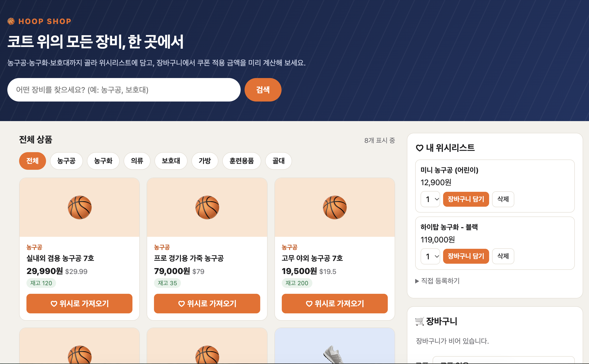
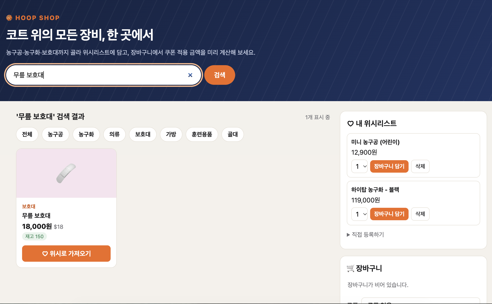
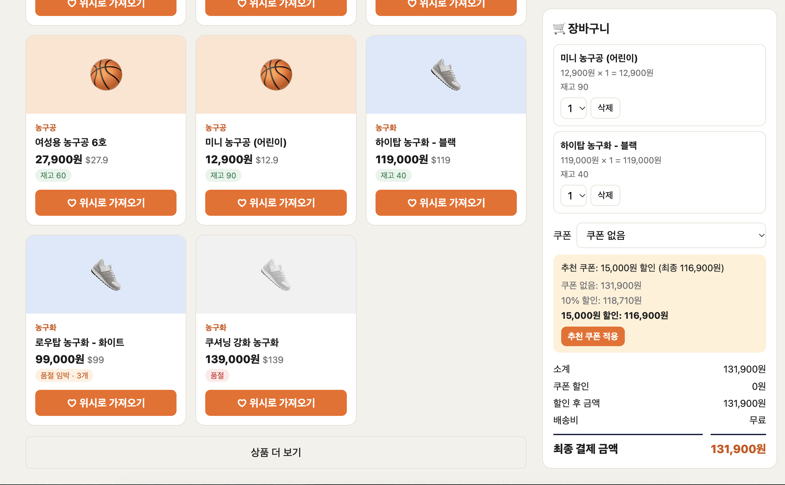
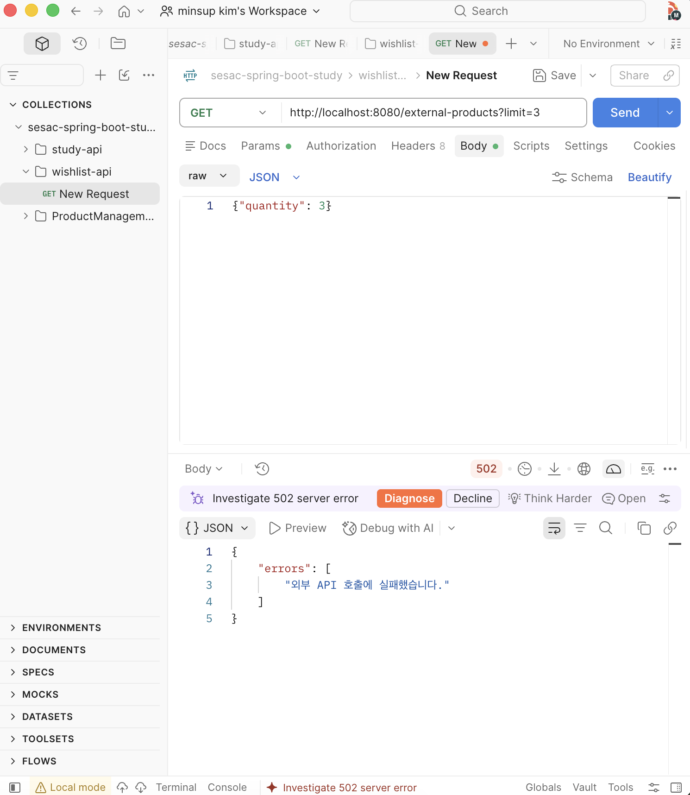

# 외부 상품 연동과 장바구니

Spring Boot로 만든 위시리스트 서버입니다. DummyJSON의 외부 상품을 검색해 위시리스트로 가져오고, 장바구니에서 수량·재고·쿠폰·배송비를 계산해 최종 결제 금액을 미리 보여 줍니다. 위시리스트와 장바구니는 **Docker로 띄운 MySQL**에 저장합니다. 실행 방법, 계산 규칙, 테스트·QA 결과를 이 README에 기록했습니다.

- Java 17 / Spring Boot 4 / Gradle(Kotlin DSL, `build.gradle.kts`)
- DB: MySQL 8 (Docker), `NamedParameterJdbcTemplate`으로 SQL 직접 작성 (JPA 미사용)
- 외부 API: [DummyJSON Products](https://dummyjson.com/docs/products) (`RestClient` 사용)
- 화면: 순수 HTML/CSS/JS (`src/main/resources/static/`, 외부 라이브러리·CDN 없음)

## 단계별 구현 범위

| 단계 | 구현한 것 |
|---|---|
| 1단계 | 외부 상품 목록·검색·단건 조회, 외부 상품을 위시리스트로 가져오기(중복 방지), 가격 환산(BigDecimal), 외부 오류를 502/404로 변환, 연결·읽기 타임아웃 |
| 2단계 | 장바구니 담기/조회/수량 변경/삭제, 수량 1~5와 재고 검증, 동일 상품 합산, 쿠폰 적용 미리보기, 배송비 계산 |
| 3단계(선택) | 최종 금액이 가장 낮은 쿠폰 추천, 농구용품 쇼핑몰 화면(순수 HTML/CSS/JS) |
| 4단계 | Docker MySQL 연동. 위시리스트·장바구니를 DB에 저장(`DatabaseWishRepository`, `DatabaseCartRepository`) |

기존 위시리스트 CRUD 및 추천 기능과 테스트는 그대로 유지했습니다.

### 1단계. 외부 상품 연동

DummyJSON의 상품을 조회하고 내 위시리스트로 가져옵니다.

- 외부 호출은 `ExternalProductClient` 인터페이스(domain)와 `DummyJsonProductClient`(infrastructure)로 분리하고, 생성자로 주입합니다.
- 목록과 검색은 `limit`, `skip`으로 페이지를 나눕니다. 검색은 먼저 검색어로 거른 뒤 그 결과에 `skip`, `limit`을 적용합니다.
- 외부 가격($)은 `BigDecimal`로 받아 × 1000, 반올림(HALF_UP)해 원(int)으로 바꿉니다. (`ExternalPriceConverter`)
- `RestClient`에 연결(2초)·읽기(1초) 타임아웃을 설정했고, 외부 실패는 404(외부에 없음) 또는 502(그 외 외부 오류)로 변환합니다.
- 이미 가져온 외부 상품을 다시 가져오면 409입니다. 가져오기는 외부 조회와 변환이 모두 성공한 뒤 마지막에 저장하므로, 실패해도 위시리스트는 바뀌지 않습니다.
- 관련 API: `/external-products`, `/external-products/search`, `/wish/import`

### 2단계. 장바구니

위시리스트의 상품을 장바구니에 담고 결제 금액을 미리 계산합니다.

- 담기, 조회, 수량 변경, 삭제를 지원하고, 같은 상품을 다시 담으면 수량을 합산합니다.
- 한 번에 1~5개, 같은 상품은 합계 최대 5개, 장바구니는 최대 20종류입니다. 재고가 있는 상품은 재고 0이면 담을 수 없고 재고를 넘길 수 없습니다.
- 장바구니는 위시를 **복사**해 담으므로, 담은 뒤 위시를 삭제하거나 바꿔도 장바구니는 변하지 않습니다.
- 소계는 `long`으로 계산하고, 쿠폰 할인과 배송비를 반영한 최종 금액을 미리보기로 보여 줍니다. 미리보기는 조회만 하며 장바구니를 바꾸지 않습니다.
- 관련 API: `/cart/items`, `/cart/items/{itemId}`, `/cart/preview`

### 3단계(선택). 쿠폰 추천과 농구용품 쇼핑몰 화면

쓸 수 있는 쿠폰 중 최종 금액이 가장 낮은 쿠폰을 추천하고(`GET /cart/coupon-recommendation`), 이 기능들을 한 화면에서 쓸 수 있게 "HOOP SHOP"이라는 농구용품 쇼핑몰 콘셉트의 화면을 만들었습니다. 외부 라이브러리와 CDN 없이 순수 HTML/CSS/JS만 사용합니다.

- 메인 화면

- 상품 검색

- 장바구니, 추천 쿠폰

#### 동작 방식과 주의점

- `BasketballCatalogClient`는 인터넷 너머의 진짜 외부 API가 아니라, `ExternalProductClient` 인터페이스를 구현한 **내장 상품 목록(대역)** 입니다. 서비스·컨트롤러 코드는 바꾸지 않고, 설정 한 줄로 구현체를 교체할 수 있다는 점(인터페이스 분리의 장점)을 보여 줍니다.
- 기본값은 DummyJSON입니다. `application.properties`에 `external.catalog=basketball`을 넣었을 때만 농구 목록으로 바뀌고, 이 속성이 없으면 `DummyJsonProductClient`가 쓰입니다. (`DummyJsonProductClient`에는 `@ConditionalOnProperty(..., havingValue = "dummyjson", matchIfMissing = true)`를 적용)
- 외부 연동 검증(타임아웃, 404/502 변환 등)은 모두 DummyJSON 기준으로 했습니다. 농구 목록은 네트워크 호출이 없어 이런 검증 대상이 아닙니다.
- 카테고리 칩(농구공, 농구화 등)은 농구 목록 기준입니다. DummyJSON 상태에서는 결과가 비는 칩이 많습니다.
- 사진 주소가 없는 상품은 카테고리별 아이콘 타일로 표시하고, 재고 0은 "품절", 5개 이하는 "품절 임박"으로 표시합니다.

### 4단계. Docker MySQL 연동

메모리에만 저장하던 위시리스트·장바구니를 Docker로 띄운 MySQL에 저장하도록 바꿨습니다.

#### 책 실습과 개인 과제의 변경 범위

| 구분 | 내용 | 서비스 코드 변경 |
|---|---|---|
| 책 실습 | Docker 설치, MySQL 컨테이너 실행, 기존 도메인 객체에 맞는 스키마·테이블 생성, `build.gradle.kts` 의존성(`spring-boot-starter-jdbc`, `mysql-connector-j`)과 접속 정보 추가, `DatabaseWishRepository`로 위시 저장소 교체 | 없음 |
| 개인 과제 | 장바구니 DB 저장소(`DatabaseCartRepository`) 추가, `Cart.restore`·`CartItem.restore`·`CartRepository.save` 추가, 예외 변환 | `CartService` 소폭 수정 |

- **위시 쪽**: `WishRepository` 인터페이스가 도메인에 있고 서비스가 이 인터페이스에만 의존하므로(DIP), 서비스 코드는 바꾸지 않고 구현체만 `DatabaseWishRepository`로 교체했습니다. 메서드별 INSERT/SELECT/UPDATE/DELETE/COUNT SQL을 작성했고, `RowMapper`로 행을 `Wish`로 변환합니다.
- **장바구니 쪽**: `DatabaseCartRepository`가 조회 시 `Cart.restore`로 도메인 객체를 복원하고, 저장 시 트랜잭션 안에서 전체 교체(DELETE 후 INSERT)합니다. `CartService`의 변경 메서드(`addItem`/`changeQuantity`/`removeItem`)가 끝난 뒤 `save`를 호출합니다.
- **예외 변환**: `DuplicateKeyException` → `ConflictException`(409), 조회 실패 → `NotFoundException`(404)
- 기존 메모리 저장소(`ListWishRepository` 등)는 지우지 않고 남겨 두었고, `@Primary`로 DB 저장소가 우선 사용됩니다.
- 규칙은 도메인에서 1차 검사하고, DB 제약(`NOT NULL`, `UNIQUE`, `CHECK`)이 2차 안전장치 역할을 합니다.

#### DB 스키마

| 테이블 | 설명 | 제약 |
|---|---|---|
| `wish` | 위시리스트 | PK, `external_id` UNIQUE(외부 상품 중복 방지), `price >= 0` CHECK |
| `cart_item` | 장바구니 항목 | PK, `wish_id` UNIQUE, `quantity BETWEEN 1 AND 5` CHECK |

전체 DDL은 `<schema.sql 경로>`를 참고하세요.

## API 명세

모든 오류 응답은 `{"errors": ["메시지", ...]}` 형식입니다.

### 외부 상품 (1단계)

| 메서드 | 경로 | 설명 | 성공 | 오류 |
|---|---|---|---|---|
| GET | `/external-products?limit=&skip=` | 외부 상품 목록 | 200 | 400(범위), 502 |
| GET | `/external-products/search?q=&limit=&skip=` | 검색(필터 후 skip/limit 적용) | 200 | 400(q 공백), 502 |
| POST | `/wish/import` | 외부 상품을 위시로 가져오기. 본문 `{"externalId":1}` | 201 | 400, 404(외부에 없음), 409(이미 가져옴), 502 |

응답 상품 필드: `id, title, price($), priceWon(원), category, thumbnail, stock`

### 장바구니 (2단계)

| 메서드 | 경로 | 설명 | 성공 | 오류 |
|---|---|---|---|---|
| POST | `/cart/items` | 담기 `{wishId, quantity}` | 201 | 400(수량 범위), 404(위시 없음), 409(품절·재고·합계 5 초과·종류 20 초과) |
| GET | `/cart/items` | 장바구니 조회 | 200 | - |
| PATCH | `/cart/items/{itemId}` | 수량 변경 `{quantity}` | 200 | 400, 404, 409 |
| DELETE | `/cart/items/{itemId}` | 항목 삭제 | 204 | 404 |
| GET | `/cart/preview?coupon=` | 쿠폰 적용 금액 미리보기(저장 안 함) | 200 | 400(알 수 없거나 쓸 수 없는 쿠폰) |
| GET | `/cart/coupon-recommendation` | 최종 금액이 가장 낮은 쿠폰 추천 | 200 | - |

미리보기 응답: `subtotal, discount, discountedSubtotal, shipping, finalAmount, coupon`

### 오류 코드 정리

| 코드 | 의미 | 예 |
|---|---|---|
| 400 | 요청 값이 잘못됨 | 이름 공백, 수량 6, 모르는 쿠폰 |
| 404 | 대상이 없음 | 없는 위시/장바구니 항목/외부 상품 |
| 409 | 현재 상태와 충돌 | 이미 가져온 외부 상품, 품절, 재고 초과, 수량 합계 초과 |
| 502 | 외부 API 실패 | 타임아웃, 연결 실패, 외부 5xx, 응답 본문 없음 |

## 구조와 클래스 책임

의존 방향: `presentation → application → domain ← infrastructure` (안쪽 계층은 바깥 계층을 import하지 않음). TODO: 실제 패키지 구조에 맞게 수정

| 계층 | 주요 클래스 | 책임 |
|---|---|---|
| presentation | `WishController`, `ExternalProductController`, `WishImportController`, `CartController`, `GlobalExceptionHandler` | HTTP 입·출력과 DTO 검증(`@Valid`, `@Min` 등), 예외를 상태코드로 변환 |
| presentation.dto | `WishDto`, `ExternalProductDto`, `CartAddRequest`, `CartQuantityRequest`, `CartItemResponse`, `CartPreviewResponse`, `CouponRecommendationResponse` | 요청·응답 형태. 응답 전용 DTO는 노출할 필드만 담음 |
| application | `WishService`, `WishImportService`, `CartService` | 흐름 조율(조회 → 검증 → 저장 순서). 규칙 자체는 도메인에 위임 |
| domain | `Wish`, `ExternalProduct`, `ExternalPriceConverter`, `Cart`, `CartItem`, `CouponType`, `CartPreview`, `CouponRecommendation` | 이름·가격·수량·재고·금액 규칙. 생성자에서 불변식 검증 |
| domain (인터페이스) | `WishRepository`, `CartRepository`, `ExternalProductClient` | 바깥 계층이 구현할 약속 |
| domain.exception | `NotFoundException`, `ConflictException`, `ExternalApiException` | 의미 있는 실패 종류 (HTTP를 모름) |
| infrastructure | `ListWishRepository`, `InMemoryCartRepository`, `DummyJsonProductClient`, `RestClientConfig`, `BasketballCatalogClient`(선택) | 메모리 저장소, 외부 API 호출 및 오류 변환, 타임아웃 설정 |

핵심 설계 결정:
- 외부 호출은 `ExternalProductClient` 인터페이스 뒤에 분리하고 생성자로 주입합니다. 테스트에서는 이 Client를 Mock으로 바꿉니다.
- `RestClient`에 연결(2초)·읽기(1초) 타임아웃을 설정했고, 실패는 Client 안에서 `NotFoundException`(404) 또는 `ExternalApiException`(502)로 변환합니다.
- 장바구니는 위시를 **복사**해 담습니다(이름·가격·재고 스냅샷). 담은 뒤 위시를 삭제하거나 바꿔도 장바구니는 변하지 않습니다.
- 실패 시 데이터가 보존되도록 "검증 먼저, 변경은 마지막"으로 처리합니다. (예: 가져오기는 외부 조회와 변환이 모두 성공한 뒤 마지막에 저장)
- 미리보기와 쿠폰 추천은 조회만 하며 장바구니를 바꾸지 않습니다.
- 금액 합계는 `long`, 외부 가격 환산은 `BigDecimal`을 사용합니다.

## 테스트

| 테스트 | 검증 내용 |
|---|---|
| `ExternalPriceConverterTest` | 달러 → 원 환산, 반올림 |
| `WishImportServiceTest` | 가져오기 성공, 중복 409, 외부 없음 404, 외부 실패 시 저장 안 됨 (Client Mock) |
| `CartPreviewTest` | 쿠폰·배송비 경계값 계산 |
| `CartTest` | 수량·재고·합산·종류 제한 |
| `CartServiceTest` | 복사 정책(위시 삭제·변경이 장바구니에 영향 없음) |
| `CouponRecommendationTest` | 최저 금액 쿠폰 선택, 동률 처리, 빈 장바구니 |
| 기존 테스트 | 위시리스트 기존 기능 (변경 없이 통과) |

### 테스트 실행 결과

## QA 체크리스트

실제로 실행한 결과를 기록합니다. (`결과` 칸은 직접 실행 후 기입)

| # | 항목 | 방법 | 기대 | 결과 |
|---|---|---|---|---|
| 1 | 외부 목록 조회 | `GET /external-products?limit=3` | 200, 3개 | 200,3 |
| 2 | 외부 검색 | `GET /external-products/search?q=phone&limit=5` | 200 | 200 |
| 3 | 검색 q 공백 | `search?q=%20` | 400 | 400 |
| 4 | 가져오기 성공 | `POST /wish/import {"externalId":1}` | 201 | 201 |
| 5 | 중복 가져오기 | 4번 재실행 | 409 | 409|
| 6 | 없는 외부 상품 | `externalId=99999` | 404 | 404 |
| 7 | 외부 API 실패 | base-url을 잘못된 주소로 변경 후 목록 조회 | 502 | 502 |
| 8 | 타임아웃 | read timeout을 1ms로 낮춘 뒤 목록 조회 | 502 | 502 |
| 8-1 | 연결 타임아웃 | connect timeout을 2ms로 낮춘 뒤 목록 조회 | 502 | (스크린샷 참조) |
| 9 | 실패 시 데이터 보존 | 7번 상태에서 가져오기 후 `GET /wishes` | 위시 개수 변화 없음 | 위시 개수 변화 없음 |
| 10 | 장바구니 담기 | `POST /cart/items {wishId, quantity:2}` | 201 | 201 |
| 11 | 수량 범위 | `quantity:6` | 400 | 400 |
| 12 | 합계 초과 | 같은 상품 합계 6개 | 409 | 409 |
| 13 | 품절 | 재고 0 상품 담기 | 409 | 409 |
| 14 | 재고 초과 | 재고보다 많이 담기 | 409 | 409 |
| 15 | 수량 변경 | `PATCH /cart/items/{id}` | 200, 금액 갱신 | 200, 금액 갱신|
| 16 | 삭제 | `DELETE /cart/items/{id}` | 204 | 204 |
| 17 | 복사 정책 | 담은 뒤 위시 삭제 → `GET /cart/items` | 장바구니 유지 | 200, 장바구니 유지|
| 18 | 쿠폰 PERCENT10 | `preview?coupon=PERCENT10` | 소계의 10%, 최대 2만원 | 소계의 10%, 최대 2만원 |
| 19 | 쿠폰 FIXED15000 조건 | 소계 10만원 미만에서 사용 | 400 | 400 |
| 20 | 배송비 경계 | 할인 후 99,999 / 100,000원 | 5,000 / 무료 | 200 |
| 21 | 쿠폰 추천 | `GET /cart/coupon-recommendation` | 최저 최종 금액 쿠폰 | 200 |
| 22 | 빈 장바구니 | 비운 뒤 preview, 추천 | 모두 0, NONE | 모두 0, NONE |
| 23 | 화면 동작 | 브라우저에서 검색 → 가져오기 → 담기 → 쿠폰 적용 | 정상 | 정상|
| 24 | 기존 기능 | 위시 CRUD, 기존 테스트 | 정상 | 정상 |
| 25 | 전체 테스트 | `./gradlew test` | 전부 통과 | 전부 통과 |

### 연결 타임아웃 확인 (connect timeout 2ms)

`RestClientConfig`의 `connectTimeout`을 `Duration.ofMillis(2)`로 낮춘 뒤 `GET /external-products?limit=3`을 호출한 결과입니다. 연결을 맺기도 전에 시간이 초과되어 외부 오류가 502로 변환되는지 확인했습니다. (확인 후 원래 값 2초로 복구)

## 남은 이슈와 정책

- **`getRecommendWishList`의 DB 구현이 남아 있습니다.**
- **장바구니는 서버 전체에서 하나**입니다. 사용자별 장바구니(`user_id`)를 지원하지 않습니다. 사용자 구분(세션·로그인)도 없습니다.
- **스레드 안전성은 아직 적용하지 않았습니다.** DB 제약(UNIQUE)으로 중복 저장은 막지만, 서비스의 "조회 → 검증 → 저장"을 하나의 트랜잭션으로 묶지는 않았습니다. 동시 요청이 들어오면 합계 오류가 생길 수 있습니다. (트랜잭션 경계 정리 필요)
- **장바구니 저장은 전체 교체(DELETE 후 INSERT) 방식**입니다. 단순하지만 항목이 많아지면 비효율적일 수 있습니다.
- **재고는 가져온 시점의 값(스냅샷)** 입니다. 외부 상품의 재고가 이후에 바뀌어도 반영되지 않고, 담기 시 재고를 차감하지도 않습니다.
- **가져온 뒤에는 외부와 연결이 끊깁니다.** 외부 가격이 변해도 위시/장바구니 가격은 그대로입니다.